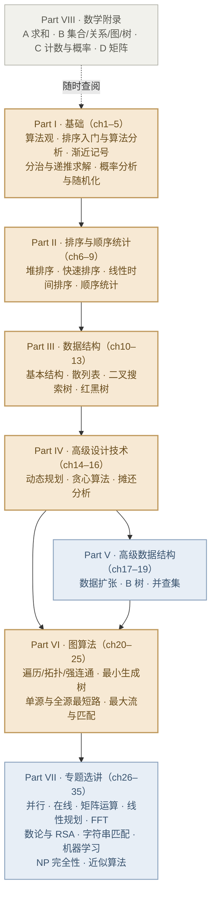

> **系列说明**：本篇是整个系列的总纲，不涉及具体算法。配套教材为 *Introduction to Algorithms*（CLRS）第 4 版。建议先读完本篇，再按课程进度进入后续各篇。

## 一、这个系列是什么

这是一套对着《算法导论》全书逐章精读的中文笔记，目标只有一个：**让你在复习"数据结构与算法"这门课时，不需要再从英文原版书里逐段啃文字**。每篇笔记覆盖一个主题单元，包含：

- **重要定义**：中文阐释 + 英文原文摘录（标注出处位置）；
- **算法原理**：配示意图逐步拆解，重要算法一定有图；
- **伪代码**：在书中伪代码基础上补全中文注释，标注与书中过程的对应关系；
- **例题**：从易到难若干道，全部手动演算，优先从例题理解原理；
- **习题**：★ 书中原题（标题号），◆ 自编模拟题；答案统一附在**本篇末尾**，按"章节 + 题号"标明。

## 二、全书地图

全书八个部分，依赖关系如下图所示。**暖色**为大多数"数据结构与算法"课程的主线，**冷色**为进阶/专题，**灰色**的数学附录则是贯穿全书的工具箱。



八部分各自的"一句话定位"：

| 部分 | 章节 | 一句话定位 | 课程地位 |
|---|---|---|---|
| I 基础 | ch1–5 | 建立"算法 + 复杂度"的思维框架 | 主线 |
| II 排序与顺序统计 | ch6–9 | 排序算法的完整光谱 + 比较下界 | 主线 |
| III 数据结构 | ch10–13 | 从数组链表到平衡树的基本功 | 主线 |
| IV 高级设计技术 | ch14–16 | 动态规划、贪心、摊还三大范式 | 主线 |
| V 高级数据结构 | ch17–19 | 树高控制与均摊思想的极致 | 进阶 |
| VI 图算法 | ch20–25 | 遍历、最小生成树、最短路、流 | 主线 |
| VII 专题选讲 | ch26–35 | 十个专题，按兴趣与课程选讲 | 专题 |
| VIII 数学附录 | A–D | 求和、组合、矩阵的工具书 | 工具 |

## 三、系列目录与阅读顺序

系列规划共 16 篇，随写作进度陆续发布；每篇顶部都有系列导航条，可顺序前后翻页。

| 顺序 | 篇目 | 覆盖章节 |
|---|---|---|
| 1 | 导学篇（本篇） | —— |
| 2 | 算法基础与渐近分析 | ch1–3 |
| 3 | 分治策略与概率分析 | ch4–5 |
| 4 | 堆排序与快速排序 | ch6–7 |
| 5 | 线性时间排序与顺序统计 | ch8–9 |
| 6 | 基本数据结构与散列表 | ch10–11 |
| 7 | 二叉搜索树与红黑树 | ch12–13 |
| 8 | 动态规划 | ch14 |
| 9 | 贪心算法与摊还分析 | ch15–16 |
| 10 | 高级数据结构 | ch17–19 |
| 11 | 图算法基础 | ch20 |
| 12 | 最小生成树与最短路径 | ch21–23 |
| 13 | 最大流与二分图匹配 | ch24–25 |
| 14 | 专题选讲（上） | ch26–29 |
| 15 | 专题选讲（下） | ch30–35 |
| 16 | 数学附录速查 | A–D |

## 四、笔记规范（重要，先读这里）

### 4.1 引用与原文摘录格式

重要定义和定理会给出**英文原文摘录**，格式如下：

> **原文摘录**（§3.1，此 PDF p.28）
> "Informally, an algorithm is any well-defined computational procedure that takes some value, or set of values, as input and produces some value, or set of values, as output in a finite amount of time."

关于页码需要特别说明：**你提供的这份 PDF 是重新排版的版本，页数与纸质印刷版不一致**（例如书中自引用"式 (3.31) 见第 69 页"，在该 PDF 中实际位于第 110 页）。因此本系列统一采用**三元组定位**：`章节号 + 定理/图/式编号 + 此 PDF 页码`。使用纸质书的读者按章节号与编号同样可以定位。摘录均为短段学习性引用，配合中文阐释使用，不替代原著。

### 4.2 伪代码约定

- 伪代码在书中风格基础上补全**中文行注**，关键步骤标注"为什么"；
- 保留书中 1-based 数组索引习惯（与大多数教材一致，翻译成代码时注意 -1）；
- 复杂度标注在过程名后，如 `MERGE-SORT(A, p, r) —— Θ(n lg n)`。

### 4.3 示意图约定

- **结构图**（树、堆、图、链表）用图 + 文字标注表示；
- **过程图**（分区、旋转、松弛、增广）用**分步快照**表示，每步一个表格或一列数组快照，逐步演算；
- 每个重要算法至少一张"输入 → 过程 → 输出"的全景图。

### 4.4 习题与答案约定

- ★ = 书中原题，标注如 `★ Ex 3.3-7`；◆ = 自编模拟题，标注如 `◆ 模拟 3.2`；
- 答案统一放在**每篇末尾的"习题参考答案"**，按章节题号排列，给出完整推理而非只给结论；
- 建议先做后看，答案区可用鼠标选中"防剧透"——老实说并没有这个功能，靠自律。

## 五、三轮学习法

同样一篇笔记，不同阶段用法完全不同：

1. **课前 10 分钟**：只读"定义卡 + 原理卡 + 示意图"，在脑子里过一遍算法流程，不必纠结证明；
2. **课后当周**：精读证明与复杂度分析，独立重做例题（遮住解答），再刷对应习题；
3. **考前 1 小时**：只看每篇的"性质速查表 + 错题 + 习题答案区"，把复杂度表过一遍。

配套的口诀：**定义要能默写英文关键词，算法要能空手画出过程图，复杂度要能条件反射**。

## 六、学前热身自测

在正式开始前，用下面几道题检查前置基础（递归、归纳、对数、复杂度直觉）。都不难，但都是后面一切内容的地基。答案附在篇末。

**◆ 热身 1**　用数学归纳法证明：$1 + 2 + \cdots + n = \dfrac{n(n+1)}{2}$，对一切正整数 $n$ 成立。

**◆ 热身 2**　下面两段伪代码的时间复杂度分别是什么（用 $\Theta$ 表示）？

```
// file: warmup-2.txt
// 片段 A
for i = 1 to n:
    for j = i to n:
        print(i, j)

// 片段 B
i = n
while i >= 1:
    print(i)
    i = i / 2        // 向下取整
```

**◆ 热身 3**　为什么"在 $n$ 个数中找出最大值"至少需要看每个数一眼（即 $\Omega(n)$）？而二分查找为什么是 $O(\lg n)$？$\lg 1024 = ?$

**◆ 热身 4**　下面这段计算斐波那契数的朴素递归，为什么慢？以 $n = 6$ 为例，数一数 $F(1)$ 被计算了几次。

```
// file: warmup-4.txt
FIB(n):
    if n <= 1: return n
    return FIB(n-1) + FIB(n-2)
```

**◆ 热身 5**　CLRS 对"算法"的定义中，哪三个要素必不可少？算法（algorithm）和程序（program）是一回事吗？

---

## 习题参考答案（导学篇）

**热身 1**　归纳法两步：

- **基例**：$n = 1$ 时左边 $= 1$，右边 $= 1 \times 2 / 2 = 1$，相等；
- **归纳步**：假设 $n = k$ 时成立，即 $\sum_{i=1}^{k} i = k(k+1)/2$。则
$$1 + 2 + \cdots + k + (k+1) = \frac{k(k+1)}{2} + (k+1) = \frac{(k+1)(k+2)}{2},$$
正是 $n = k+1$ 时的右式。由归纳法，命题对一切正整数 $n$ 成立。

> 归纳法是本课程使用频率最高的数学工具：红黑树高度证明、主定理证明、摊还分析几乎处处用它。

**热身 2**　片段 A：内层循环次数为 $n - i + 1$，总次数 $\sum_{i=1}^{n}(n-i+1) = n + (n-1) + \cdots + 1 = \Theta(n^2)$。片段 B：$i$ 每次减半，从 $n$ 到 1 需要 $\Theta(\lg n)$ 次迭代，故为 $\Theta(\lg n)$。

**热身 3**　找最大值：每个数都可能是唯一的最大值，若跳过任何一个数而它恰是最大值，就会输出错误答案——因此任何正确算法都必须检查全部 $n$ 个数，$\Omega(n)$。二分查找：每次比较将候选区间折半，区间长度从 $n$ 到 1 需要 $\lg n$ 次折半，故 $O(\lg n)$；$\lg 1024 = 10$（$2^{10} = 1024$）。

**热身 4**　慢在**重复计算**：$F(n-2)$ 这一子树会被 $F(n-1)$ 与顶层各算一次，子问题数量随递归深度指数爆炸（约 $\varphi^n$ 次调用，$\varphi$ 为黄金比例）。$n = 6$ 时展开：$F(6) \to F(5)+F(4)$，其中 $F(5) \to F(4)+F(3)$……逐层数 $F(1)$ 的调用共 **8 次**（调用总数 25 次，而 $n=6$ 只需要 7 个数）。这正是第 14 章动态规划要解决的问题：用记忆化或自底向上表格把指数降为 $\Theta(n)$。

**热身 5**　三要素：**输入**（明确的取值或取值集合）、**输出**（有限时间内产生的取值）、**有限性**（必须在有限时间内结束）；再加上"良定义的计算过程"。算法 ≠ 程序：算法是解决问题的抽象过程，不依赖语言与机器；程序是算法的具体实现，还包含错误处理、工程细节等算法不关心的内容（见 §1.1，此 PDF p.28）。

---

*下一篇进入正题：第 1–3 章，从"什么是算法"到渐近记号的完整形式化。*
