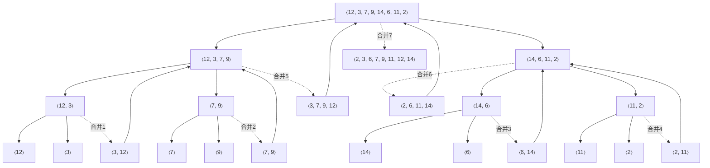

> **本篇范围**：第 1 章（算法的角色）、第 2 章（起步：插入排序、算法分析、归并排序）、第 3 章（刻画运行时间）。这三章是全书的"世界观"，后面所有章节的分析工具都在此埋下伏笔。

## 一、什么是算法（第 1 章）

### 【定义】算法

> **原文摘录**（§1.1，此 PDF p.28）
> "Informally, an algorithm is any well-defined computational procedure that takes some value, or set of values, as input and produces some value, or set of values, as output in a finite amount of time."

拆解这个定义，三个关键词缺一不可：

1. **well-defined（良定义）**：每一步都不能有歧义，"大概""尽量"这类词不允许出现；
2. **input / output（输入 / 输出）**：算法是一个从输入到输出的确定映射；
3. **finite amount of time（有限时间）**：必须停机。死循环不是算法。

配套的**排序问题**形式化描述（§1.1，此 PDF p.28-29）：

- **输入**：$n$ 个数构成的序列 $\langle a_1, a_2, \dots, a_n\rangle$；
- **输出**：输入序列的一个排列（重排）$\langle a_1', a_2', \dots, a_n'\rangle$，满足 $a_1' \le a_2' \le \cdots \le a_n'$。

### 【定义】算法的正确性

> **原文摘录**（§1.1，此 PDF p.29）
> "An algorithm for a computational problem is correct if, for every problem instance provided as input, it halts—finishes its computing in finite time—and outputs the correct solution to the problem instance."

注意是**每一个**合法输入（every problem instance），不是"大多数情况对"。不正确但错误率可控的算法有时也有用（如第 31 章的素性测试），但本课程只关心正确算法。

### 【定义】数据结构

> **原文摘录**（§1.1，此 PDF p.33）
> "A data structure is a way to store and organize data in order to facilitate access and modifications."

一句话：**数据结构是数据的组织方式，服务于"高效访问"与"高效修改"这两个动作**。没有万能的数据结构，只有适合场景的数据结构——这是本书第三部分（第 10-13 章）反复强调的主题。

### 难问题与近似

第 1 章还给出两个贯穿全书的概念（§1.1，此 PDF p.34）：

- **NP 完全问题**（第 34 章）：既没找到高效算法，也没人证明不存在高效算法。若其中一个存在高效算法，则全部都有。实践中遇到它，明智做法是转向**近似算法**（第 35 章）；
- **在线算法**（第 27 章）：输入随时间到达、必须即时决策、无法反悔的场景（如急诊分诊、网络路由）。

### 【原理】算法即技术（§1.2）

第 1.2 节的核心论点：**算法和硬件一样，是一种技术**；系统总性能取决于算法效率，不亚于取决于硬件速度。

原书给了一个经典对比（§1.2，此 PDF p.37-39）：排序 $10^7$ 个数——

| | 电脑 A | 电脑 B |
|---|---|---|
| 速度 | $10^{10}$ 条指令/秒（快 1000 倍） | $10^7$ 条指令/秒 |
| 算法 | 插入排序，机器语言精心编码，$2n^2$ 条指令 | 归并排序，高级语言 + 烂编译器，$50\,n\lg n$ 条指令 |
| 排序 $10^7$ 个数 | $\dfrac{2\times(10^7)^2}{10^{10}} = 2\times10^4$ 秒 | $\dfrac{50\times10^7\times23.25}{10^7}\approx1162$ 秒 |

**慢 1000 倍的电脑 B 反而快约 17 倍**。数据量到 $10^8$ 时更夸张：A 需要 23 天，B 不到 4 小时。结论：**渐近增长率压倒常数因子与硬件差异**。

### 【例题 1.2-2】★ 书中习题

插入排序在特定机器上运行 $8n^2$ 步，归并排序运行 $64\,n\lg n$ 步。$n$ 取哪些值时插入排序更快？

**解**：解不等式 $8n^2 < 64\,n\lg n$，即 $n < 8\lg n$（$n>0$）。逐个试：

| $n$ | $8\lg n$ | $n < 8\lg n$？ |
|---|---|---|
| 2 | 8 | 是 |
| 8 | 24 | 是 |
| 16 | 32 | 是 |
| 43 | $8\times5.426\approx43.4$ | 是 |
| 44 | $\approx43.6$ | **否** |

所以 $n \le 43$ 时插入排序更快（严格说是 $2 \le n \le 43$，$n=1$ 时两者都平凡）。这道题是"小输入用简单算法"的经验法则的量化版。

---

## 二、插入排序与算法分析（第 2 章）

### 【原理】插入排序：扑克牌类比

插入排序模仿人们整理手中扑克牌的方式（§2.1，此 PDF p.45-46）：左手握有序牌，右手从牌堆逐张取牌，**从右向左**扫描左手，找到第一个不大于它的牌，插到其右边。

### 【伪代码】INSERTION-SORT

对应书中过程 INSERTION-SORT（§2.1，此 PDF p.46）：

```
// file: INSERTION-SORT
INSERTION-SORT(A, n)
1  for i = 2 to n              // A[1 : i-1] 是"左手"，A[i : n] 是"牌堆"
2      key = A[i]              // 右手取到的当前牌
3      // 把 A[i] 插入已排好序的子数组 A[1 : i-1]
4      j = i - 1
5      while j > 0 and A[j] > key   // 从右往左找 key 的位置；短路求值保护 A[0]
6          A[j + 1] = A[j]          // 比 key 大的牌右移一格
7          j = j - 1
8      A[j + 1] = key          // 落位
```

### 【图示】执行过程（对应书中 Figure 2.2）

输入 $A = \langle 5, 2, 4, 6, 1, 3\rangle$，灰底为已排序的"左手"，**粗体**为当前 key：

| 迭代 $i$ | key | 数组状态（位置 1-6） | 动作 |
|---|---|---|---|
| 2 | 2 | `5` `2` `4` `6` `1` `3` | 2 与 5 比较，5 右移，2 落位 1 |
| 2 后 | — | `2 5` `4` `6` `1` `3` | A[1:2] 有序 |
| 3 | 4 | `2 5` `4` `6` `1` `3` | 4 > 2 且 < 5，插中间 |
| 3 后 | — | `2 4 5` `6` `1` `3` | |
| 4 | 6 | `2 4 5` `6` `1` `3` | 6 最大，原地不动（内层 0 次） |
| 5 | 1 | `2 4 5 6` `1` `3` | 1 比所有都小，一路左移到位置 1 |
| 5 后 | — | `1 2 4 5 6` `3` | |
| 6 | 3 | `1 2 4 5 6` `3` | 3 插到 2 与 4 之间 |
| 终 | — | `1 2 3 4 5 6` | 排序完成 |

> 建议自己在纸上对 $\langle 31, 41, 59, 26, 41, 58\rangle$ 走一遍（即书中练习 2.1-1），重点观察"相同 key 41 的稳定性"——插入排序是**稳定排序**，相等元素的相对顺序不变。

### 【定义】循环不变式（Loop Invariant）

> **原文摘录**（§2.1，此 PDF p.47）
> "At the start of each iteration of the for loop of lines 1–8, the subarray A[1 : i – 1] consists of the elements originally in A[1 : i – 1], but in sorted order."

用循环不变式证明正确性，需依次验证三件事（§2.1，此 PDF p.48）：

| 性质 | 含义 | 类比数学归纳法 |
|---|---|---|
| **初始化** Initialization | 循环第一次迭代前不变式为真 | 基例 |
| **保持** Maintenance | 若某次迭代前为真，则下次迭代前仍为真 | 归纳步 |
| **终止** Termination | 循环终止时，不变式 + 终止条件给出有用性质 | 归纳收敛到结论 |

插入排序的三步验证：

- **初始化**：$i=2$ 时 $A[1:1]$ 只有一个元素，天然有序，且就是原来的 $A[1]$ ✓；
- **保持**：第 $i$ 轮把 $A[i]$ 从右向左插入到 $A[1:i-1]$ 的正确位置后，$A[1:i]$ 由"原来的那些元素、排好序"构成 ✓；
- **终止**：$i$ 从 2 递增到 $n+1$ 时循环结束，代入不变式得 $A[1:n]$ 有序 ✓。

> 循环不变式是全书的" correctness 标配工具"：堆排序、快速排序、红黑树、Dijkstra，处处可见。

### 【原理】算法分析框架（§2.2）

**RAM 模型**（§2.2，此 PDF p.54）：单处理器随机存取机。指令顺序执行，每条指令、每次数据访问都花常数时间。注意两条红线：不允许"一条指令排好序"这种不现实的指令；每个字的位数固定为 $c\lg n$（$c$ 为常数），防止"一个字存下整个输入"的作弊。

**运行时间** = 执行的指令与数据访问次数。书中把伪代码第 $k$ 行执行一次的代价记为常数 $c_k$，于是：

$$T(n) = \sum_k c_k \cdot (\text{第 } k \text{ 行执行次数})$$

对插入逐行统计（§2.2，此 PDF p.58-59），记 $t_i$ 为第 $i$ 轮内层 while 测试次数：

- **最好情况**（已有序）：每次测试即退出，$t_i = 1$，$T(n) = an + b = \Theta(n)$；
- **最坏情况**（完全逆序）：$t_i = i$，$T(n) = an^2 + bn + c = \Theta(n^2)$；
- **平均情况**：$t_i \approx i/2$，同样是平方级——**所以本书后面基本只看最坏情况**。

**为什么主攻最坏情况**（§2.2，此 PDF p.61）：① 最坏情况给出**任何输入**的运行时间上界，是硬保证；② 有些算法最坏情况经常发生（如在数据库中查一条不存在的记录）；③ 平均情况常常和最坏情况一样糟（插入排序就是）。

**增长率阶（order of growth）**（§2.2，此 PDF p.62-63）：甩掉低阶项和最高阶项的常数系数，只留主项。如插入排序最坏情况写成 $\Theta(n^2)$。$\Theta$ 记号的非正式理解："$n$ 很大时大致成正比"。

### 【原理】分治策略与归并排序（§2.3）

**分治三步**（§2.3.1，此 PDF p.65，英文原文）：

> "Divide the problem into one or more subproblems that are smaller instances of the same problem. Conquer the subproblems by solving them recursively. Combine the subproblem solutions to form a solution to the original problem."

归并排序的对应（§2.3.1，此 PDF p.65-66）：

- **分**：算中点 $q=\lfloor (p+r)/2 \rfloor$，把 $A[p:r]$ 切成 $A[p:q]$ 与 $A[q+1:r]$；
- **治**：递归排序两半；
- **合**：MERGE 把两个有序段并回 $A[p:r]$。

**MERGE 的扑克牌类比**（§2.3.1，此 PDF p.66）：两堆正面朝上、小牌在上的有序牌堆，每次比较两堆顶牌，把小的一张翻扣到输出堆；一堆空了，剩下的整堆直接翻扣上去。两堆共 $n$ 张牌时基本步数在 $n/2$ 与 $n$ 之间，故合并耗时 $\Theta(n)$。

### 【伪代码】MERGE 与 MERGE-SORT

对应书中过程（§2.3.1，此 PDF p.67、p.70）：

```
// file: MERGE
MERGE(A, p, q, r)                    // A[p : q] 与 A[q+1 : r] 均已有序
1  nL = q - p + 1                    // 左段长度
2  nR = r - q                        // 右段长度
3  let L[0 : nL-1] and R[0 : nR-1] be new arrays
4  for i = 0 to nL - 1               // 拷贝左段到 L（哨兵之外的保险：先存再比）
5      L[i] = A[p + i]
6  for j = 0 to nR - 1               // 拷贝右段到 R
7      R[j] = A[q + j + 1]
8  i = 0                             // i 指向 L 中最小未合并元素
9  j = 0                             // j 指向 R 中最小未合并元素
10 k = p                             // k 指向 A 中待填位置
11 while i < nL and j < nR           // 两堆都非空：比较堆顶
12     if L[i] <= R[j]               // 左堆顶小（<= 保证稳定性）
13         A[k] = L[i]; i = i + 1
14     else A[k] = R[j]; j = j + 1
15     k = k + 1
16 while i < nL                      // R 空了，L 有剩余——直接倒过去
17     A[k] = L[i]; i = i + 1; k = k + 1
18 while j < nR                      // L 空了，R 有剩余
19     A[k] = R[j]; j = j + 1; k = k + 1
```

```
// file: MERGE-SORT
MERGE-SORT(A, p, r)
1  if p >= r                          // 0 或 1 个元素：天然有序
2      return
3  q = floor((p + r) / 2)             // 中点
4  MERGE-SORT(A, p, q)                // 递归排序左半
5  MERGE-SORT(A, q + 1, r)            // 递归排序右半
6  MERGE(A, p, q, r)                  // 合并
```

### 【图示】MERGE 执行过程（对应书中 Figure 2.3）

$A[9:16] = \langle 2,4,6,7,1,2,3,5\rangle$，即 $p=9, q=12, r=16$，$L=\langle2,4,6,7\rangle$，$R=\langle1,2,3,5\rangle$：

| 步 | $k$ | 比较 | 动作 | $A[9:16]$ 状态 |
|---|---|---|---|---|
| 0 | 9 | — | 初始化 | `2 4 6 7 1 2 3 5` |
| 1 | 9 | L[0]=2 vs R[0]=1 | R[0] 胜 | `1` `4 6 7 1 2 3 5` |
| 2 | 10 | L[0]=2 vs R[1]=2 | L[0] 胜（≤） | `1 2` `6 7 1 2 3 5` |
| 3 | 11 | L[1]=4 vs R[1]=2 | R[1] 胜 | `1 2 2` `6 7 1 2 3 5` |
| 4 | 12 | L[1]=4 vs R[2]=3 | R[2] 胜 | `1 2 2 3` `6 7 1 2 3 5` |
| 5 | 13 | L[1]=4 vs R[3]=5 | L[1] 胜 | `1 2 2 3 4` `6 7 1 2 3 5` |
| 6 | 14 | L[2]=6 vs R[3]=5 | R[3] 胜 | `1 2 2 3 4 5` `6 7 1 2 3 5` |
| 7 | 15 | R 已空 | L 剩余整体倒入 | `1 2 2 3 4 5 6 7` |

注意第 2 步的 `<=`：相等时取左段，这是归并排序**稳定**的原因。

### 【图示】归并排序全景（对应书中 Figure 2.4）

对 $A = \langle 12, 3, 7, 9, 14, 6, 11, 2\rangle$ 的完整递归（边上标注调用顺序）：



自底向上看：先 4 次合并两两元素，再 2 次合并四元组，最后 1 次合并两个四元组，共 7 次 MERGE 调用——恰好等于 $n-1=7$（内部节点数）。

### 【原理】归并排序的递推式与求解

分治算法的运行时间天然写成**递推方程**（§2.3.2，此 PDF p.71、p.74）：

$$T(n) = 2T(n/2) + \Theta(n)$$

- 分：$D(n) = \Theta(1)$（只算中点）；
- 治：$2T(n/2)$；
- 合：$C(n) = \Theta(n)$。

第 4 章的主定理将给出 $T(n) = \Theta(n\lg n)$。直觉：递归树共 $\lg n$ 层，每层合并总代价 $\Theta(n)$。**归并用 $\lg n$ 换掉了插入排序的 $n$**——这就是 $n\lg n$ 与 $n^2$ 的全部差距。

### 【例题 2.2-1】★ 书中习题

用 $\Theta$-记号表示 $f(n) = \dfrac{n^3}{1000} + 100n^2 - 100n + 3$。

**解**：最高阶项 $\dfrac{n^3}{1000}$ 的阶为 $n^3$；低阶项 $100n^2$、$-100n$、$3$ 当 $n$ 大时被主项压倒（例如 $n=10^6$ 时主项 $10^{15}$，二阶项 $10^{14}$ 已差一个量级，且差距越拉越大）。故 $f(n) = \Theta(n^3)$。

---

## 三、渐近记号（第 3 章）

### 【定义】O / Ω / Θ 的非正式含义

| 记号 | 含义（§3.1，此 PDF p.86-87） | 类比 |
|---|---|---|
| $O(g(n))$ | 上界：增长**不快于** $g(n)$ | $a \le b$ |
| $\Omega(g(n))$ | 下界：增长**至少**与 $g(n)$ 一样快 | $a \ge b$ |
| $\Theta(g(n))$ | 紧界：上下都被 $g(n)$ 常数因子夹住 | $a = b$ |
| $o(g(n))$ | 非紧上界：渐近地可忽略 | $a < b$ |
| $\omega(g(n))$ | 非紧下界：渐近地占主导 | $a > b$ |

例：$7n^3 + 100n^2 - 20n + 6$ 是 $O(n^3)$、$\Omega(n^3)$，从而 $\Theta(n^3)$；但它也是 $O(n^4)$、$O(n^5)$、$\Omega(n^2)$……**上界可以松，下界可以低，$\Theta$ 才是精确答案**。

### 【原理】插入排序最坏情况是 $\Omega(n^2)$ 的巧妙论证

$O(n^2)$ 好证（内层至多 $n-1$ 次 × 外层 $n-1$ 轮）。$\Omega(n^2)$ 需要构造性论证（§3.1，此 PDF p.89-90，Figure 3.1）：

设 $n$ 被 3 整除，把数组分三段。构造输入：**最大的 $n/3$ 个数全部放在前 $n/3$ 个位置**：

```
位置:   1 .......... n/3 | n/3+1 ......... 2n/3 | 2n/3+1 ......... n
        [ 最大的 n/3 个数 ]  [   中间 n/3 个位置   ]  [   最终它们会到这里   ]
```

排序后这 $n/3$ 个大数必须全部移到后 $n/3$ 个位置。每个大数右移一格需要执行一次第 6 行（赋值右移），而每个大数都必须**逐个穿过中间 $n/3$ 个位置**。于是第 6 行至少执行 $(n/3)\times(n/3) = n^2/9$ 次，即 $T(n) = \Omega(n^2)$。

结合 $O(n^2)$ 与 $\Omega(n^2)$，得最坏情况 $\Theta(n^2)$。注意论证的是**最坏情况**（存在性输入），不是说每个输入都要 $n^2$——这正是下面易错点的来源。

### 【定义】形式化定义（§3.2，此 PDF p.92-94）

> **原文摘录**（O-notation，§3.2，此 PDF p.92）
> $O(g(n)) = \{\, f(n) : \text{there exist positive constants } c \text{ and } n_0 \text{ such that } 0 \le f(n) \le c\,g(n) \text{ for all } n \ge n_0 \,\}$

另两个记号同理：

$$\Omega(g(n)) = \{\, f(n) : \exists\, c>0,\ n_0>0,\ 0 \le c\,g(n) \le f(n),\ \forall n \ge n_0 \,\}$$

$$\Theta(g(n)) = \{\, f(n) : \exists\, c_1,c_2,n_0>0,\ 0 \le c_1 g(n) \le f(n) \le c_2 g(n),\ \forall n \ge n_0 \,\}$$

**Theorem 3.1**（§3.2，此 PDF p.94）：$f(n) = \Theta(g(n)) \iff f(n) = O(g(n))$ 且 $f(n) = \Omega(g(n))$。这是把"上下界"拼成"紧界"的法定通道。

$o$ 与 $\omega$（§3.2，此 PDF p.100-101）：把"存在某个 $c$"加强为"对任意 $c>0$"：

$$o(g(n)) = \{\, f(n) : \forall c>0,\ \exists n_0>0,\ 0 \le f(n) < c\,g(n),\ \forall n\ge n_0\,\}$$

等价于 $\lim_{n\to\infty} f(n)/g(n) = 0$。例：$2n = o(n^2)$，但 $2n^2 \ne o(n^2)$；$n^2/2 = \omega(n)$，但 $n^2/2 \ne \omega(n^2)$。

### 【原理】渐近记号进公式（§3.2，此 PDF p.96-98）

渐近记号写在等号右边表示集合成员；写在公式里则代表**某个匿名函数**。如

$$2n^2 + 3n + 1 = 2n^2 + \Theta(n)$$

含义是"存在 $f(n)\in\Theta(n)$ 使左边 $= 2n^2 + f(n)$"（此处 $f(n)=3n+1$）。出现几次记号就有几个匿名函数：$O(1)+O(2)+\cdots+O(n)$ 没有意义，而 $\sum_{i=1}^{n} O(i)$ 只有一个匿名函数。出现在等号左边时（$2n^2+\Theta(n)=\Theta(n^2)$），含义是"左边无论怎么选，右边都有办法选使等式成立"。

### 【原理】渐近比较的性质（§3.2，此 PDF p.101-102）

传递性、自反性、对称性都成立，可与实数比较类比（$O\leftrightarrow\le$，$\Theta\leftrightarrow=$，$o\leftrightarrow<$）。**唯一失效的是三分律**：存在互相不可渐近比较的函数，如 $n$ 与 $n^{1+\sin n}$（指数在 0 与 2 之间振荡）。

### 【易错】三个高频错误（§3.2，此 PDF p.95、p.102-103）

1. **"插入排序的运行时间是 $\Theta(n^2)$"** —— 错。漏了"最坏情况"，最好情况是 $\Theta(n)$。正确说法："插入排序的最坏情况运行时间是 $\Theta(n^2)$"，或"运行时间是 $O(n^2)$"（所有情况的上界）。
2. **"算法 A 的运行时间至少是 $O(n^2)$"** ——  meaningless。$O$ 是上界，"至少一个上界"逻辑混乱。
3. **把 $O$ 当 $\Theta$ 用** —— "$O(n\lg n)$ 算法比 $O(n^2)$ 算法快"不一定，前者实际可能是 $\Theta(n)$ 的。要表达紧界就写 $\Theta$。

### 【原理】常用函数增长率（§3.3，此 PDF p.104-112）

| 函数类 | 记号与事实 | PDF 位置 |
|---|---|---|
| 单调性 | $m\le n \Rightarrow f(m)\le f(n)$ 为单调增 | p.104 |
| 下取整/上取整 | $\lfloor x\rfloor \le x \le \lceil x\rceil$；$\lceil n/2\rceil + \lfloor n/2\rfloor = n$ | p.104 |
| 模运算 | $a \bmod n$ 为余数；$a\equiv b \pmod n \iff n \mid (b-a)$ | p.105 |
| 多项式 | $p(n)=\Theta(n^d)$（$a_d>0$） | p.105 |
| 指数 | $a>1$ 时 $a^n$ 压倒任意多项式：$n^b = o(a^n)$ | p.106-107 |
| 对数 | $\lg n=\log_2 n$；换底只差常数：$\log_b n = \Theta(\lg n)$；$\lg^k n = (\lg n)^k$，$\lg\lg n=\lg(\lg n)$ | p.107-108 |
| 阶乘 | $n! \le n^n$；Stirling：$n! = \sqrt{2\pi n}\,(n/e)^n(1+\Theta(1/n))$ | p.109 |
| 迭代对数 | $\lg^* n = \min\{i\ge0 : \lg^{(i)} n \le 1\}$；$\lg^* 2=1,\ \lg^* 4=2,\ \lg^* 16=3,\ \lg^* 65536=4$ | p.110 |
| 斐波那契 | $F_0=0,F_1=1,F_i=F_{i-1}+F_{i-2}$；$F_i = \lfloor \varphi^i/\sqrt5 + 1/2 \rfloor$，$\varphi=(1+\sqrt5)/2$ | p.110-112 |

**增长率层级**（从慢到快，Problem 3-3 的完整排序可作自我挑战）：

$$\lg\lg n \ \ll\ \lg^* n \ \ll\ \lg n \ \ll\ \lg^2 n \ \ll\ \sqrt n \ \ll\ n \ \ll\ n\lg n \ \ll\ n^2 \ \ll\ n^3 \ \ll\ 2^n \ \ll\ 3^n \ \ll\ n! \ \ll\ n^n$$

### 【例题 3.1-3】★ 书中习题

设 $0<\alpha<1$。把插入排序的下界论证推广为：最大的 $\alpha n$ 个数初始占据前 $\alpha n$ 个位置。需要对 $\alpha$ 加什么限制？$\alpha$ 取何值时穿越次数最多？

**解**：这 $\alpha n$ 个大数排序后要全部进入后 $\alpha n$ 个位置，每个都必须逐个穿过中间 $(1-2\alpha)n$ 个位置（当 $\alpha<1/2$ 时中间段才非空，故需 $\alpha \le 1/2$；$\alpha=1/2$ 时中间段为空，下界为 0，无意义）。第 6 行执行次数至少为

$$\alpha n \cdot (1-2\alpha)n = \alpha(1-2\alpha)\,n^2.$$

对 $\alpha(1-2\alpha)$ 求极大：令 $h(\alpha)=\alpha-2\alpha^2$，$h'(\alpha)=1-4\alpha=0 \Rightarrow \alpha=1/4$，此时最大值为 $1/4 \times 1/2 = 1/8$，即 $n^2/8$。原书的 $\alpha=1/3$ 给出 $n^2/9$，略保守；**最优构造是 $\alpha=1/4$**。

### 【例题 3.2-1】★ 书中习题

设 $f,g$ 渐近非负。证明 $\max\{f(n), g(n)\} = \Theta(f(n)+g(n))$。

**解**：对一切 $n$，

$$\max\{f,g\} \le f+g, \qquad \max\{f,g\} \ge \tfrac{1}{2}(f+g)$$

（第二式：不妨设 $f\ge g$，则 $\max=f\ge (f+g)/2$；$g>f$ 时对称）。于是

$$\tfrac12(f+g) \le \max\{f,g\} \le f+g,$$

取 $c_1=1/2$、$c_2=1$、$n_0=1$ 即满足 $\Theta$ 定义。这个技巧在合并多个代价项时极常用（如"外层循环与内层循环谁贵？答：一样贵，取 max"）。

### 【例题 3.2-3】★ 书中习题

$2n+1 = O(2^n)$ 吗？$2^{2n} = O(2^n)$ 吗？

**解**：$2n+1 \le c\cdot 2^n$ 对 $c=1$、$n\ge1$ 成立（$2n+1\le 2^n$ 可归纳），故**是**。$2^{2n}=4^n$，若 $4^n = O(2^n)$ 则需 $4^n \le c\,2^n$ 即 $2^n \le c$ 对所有大 $n$ 成立——不可能，故**否**。事实上 $2^{2n}=\omega(2^n)$。

### 【例题 3.3-9】★ 书中习题

证明：$k\lg k = \Theta(n)$ 蕴含 $k = \Theta(n/\lg n)$。

**解**：设 $c_1 n \le k\lg k \le c_2 n$。先证上界：$\lg k = \Theta(\lg(n/\lg n))$……更直接的路线：由 $k\lg k \ge c_1 n$ 得 $k \ge c_1 n/\lg k$。又 $k\lg k \le c_2 n \Rightarrow \lg k \le \lg(c_2 n) = \Theta(\lg n)$（因为 $k \le c_2 n/\lg k \le c_2 n$，故 $\lg k \le \lg(c_2n)$），于是 $k \ge c_1' n/\lg n$。反向：$k \le c_2 n/\lg k$，而 $k\lg k\ge c_1 n \Rightarrow \lg k \ge \lg(c_1 n/\lg k)$……严谨写法：由 $k\lg k\le c_2 n$ 得 $k\le c_2 n/\lg k$；只需 $\lg k = \Omega(\lg n)$，即 $k$ 至少多项式增长——由 $k\lg k\ge c_1 n$ 知 $k\ge\sqrt{c_1 n}$（因 $\lg k \le \sqrt k$），故 $\lg k \ge \tfrac12\lg(c_1 n) = \Omega(\lg n)$，代入得 $k = O(n/\lg n)$。两侧合并即 $k=\Theta(n/\lg n)$。

### 【例题】◆ 模拟 3.1

判断下列命题真假并说明理由：
a. $n^2 = O(n^2+1)$；b. $\lg(n!) = \Theta(n\lg n)$；c. $2^{2^n} = O(2^{2^{n+1}})$；d. $\lceil \lg n\rceil ! = O(n^3)$。

**解**：a. 真（$n^2 \le n^2+1$，取 $c=1$）。b. 真，$\lg(n!) = \Theta(n\lg n)$（由 Stirling 或 $\lg(n!)=\sum\lg i=\Theta(n\lg n)$，见 §3.3，此 PDF p.109）。c. 假，$2^{2^n}/2^{2^{n+1}} = 2^{2^n-2^{n+1}}\to0$，故 $2^{2^n}=o(2^{2^{n+1}})$，不是 $O$。d. 真（★ 3.3-5）：$\lceil\lg n\rceil! \le (\lg n+1)^{\lg n+1}$，取对数后为 $(\lg n+1)\lg(\lg n+1) = o(\lg^2 n) = o(\lg n^3)$，故多项式有界。

---

## 四、性质速查表

| 性质 | 内容 |
|---|---|
| 插入排序 | 最好 $\Theta(n)$ / 最坏 $\Theta(n^2)$ / 稳定 / 增量法 |
| 归并排序 | 全部情况 $\Theta(n\lg n)$ / 稳定 / 分治 / 需 $\Theta(n)$ 辅助空间 |
| 分治递推 | $T(n)=aT(n/b)+D(n)+C(n)$ |
| Theorem 3.1 | $\Theta \iff O \wedge \Omega$ |
| 记号类比 | $O\leftrightarrow\le$，$\Omega\leftrightarrow\ge$，$\Theta\leftrightarrow=$，$o\leftrightarrow<$，$\omega\leftrightarrow>$ |
| 不存在三分律 | $n$ 与 $n^{1+\sin n}$ 不可比 |
| 增长率层级 | $\lg\lg n < \lg^* n < \lg n < \sqrt n < n < n\lg n < n^2 < 2^n < n! < n^n$ |
| 正确性工具 | 循环不变式（初始化/保持/终止） |

---

## 五、习题

**★ Ex 2.1-2**　为 SUM-ARRAY（§2.1，此 PDF p.53）给出循环不变式，并用三性质证明它返回 $A[1:n]$ 之和。

**★ Ex 2.2-3**　线性搜索（§2.1 练习 2.1-4）在平均与最坏情况下各需检查多少元素？用 $\Theta$ 给出平均/最坏运行时间。

**★ Ex 3.2-2**　为什么"算法 A 的运行时间至少是 $O(n^2)$"这句话没有意义？

**★ Ex 3.3-4**　证明：a. 式 (3.21)；b. 式 (3.26)–(3.28)；c. $\lg(\Theta(n)) = \Theta(\lg n)$。（式号见 §3.3，此 PDF p.105-109）

**★ Ex 3-2**　对每对 $(A,B)$ 判断 $A$ 是 $O/o/\Omega/\omega/\Theta$ 中的哪一种（或不可比）：① $(n^2,\ n^2+n)$；② $(\lg^2 n,\ \lg n^2)$；③ $(2^n,\ 2^{n/2})$；④ $(n^{\lg n},\ 2^n)$；⑤ $(n!,\ (n+1)!)$。

**◆ 模拟 2.1**　插入排序作用于 $A=\langle 8, 3, 9, 1, 5, 7, 2\rangle$：写出每轮 i、key、以及第 5-7 行的执行次数，并分别算出最好/最坏情况对该输入的差距来源。

**◆ 模拟 2.2**　MERGE-SORT(A, 1, 7) 作用于 $A=\langle 9, 4, 7, 1, 3, 8, 2\rangle$：画出递归树，统计 MERGE 调用次数与总比较次数的上界。

**◆ 模拟 3.2**　下面这段"分析"错在哪里？
> "外层 for 执行 $n-1$ 次，内层 while 最多执行 $n$ 次，所以插入排序的比较次数是 $O(n^2)$；又内层至少执行 0 次，所以是 $\Omega(1)$；因此插入排序的比较次数无法确定。"

**◆ 模拟 3.3**　计算 $\lg^* 2^{65536}$ 与 $\lg^*(2^{2^{16}})$，并验证 $\lg^* n \le 5$ 对一切现实输入规模成立的说法。

**◆ 模拟 3.4**　设 $T(n)=T(\lceil n/2\rceil)+\Theta(1)$。猜想 $T(n)=\Theta(\lg n)$ 并用主定理思想（不必严格）说明理由；若把 $\lceil n/2\rceil$ 换成 $\lceil n/3\rceil$，结论如何变化？

---

## 习题参考答案（第 1-3 章）

**Ex 2.1-2**　不变式：第 $i$ 轮 for 循环开始时，`sum` 等于 $A[1:i-1]$ 之和。初始化：$i=1$ 时 `sum=0`，空和 ✓。保持：第 $i$ 轮加上 $A[i]$ 后，`sum` 为 $A[1:i]$ 之和，$i$ 递增后不变式恢复 ✓。终止：$i=n+1$ 时 `sum` 为 $A[1:n]$ 之和，返回 ✓。

**Ex 2.2-3**　线性搜索从头扫描。设目标等概率出现在任一位置或不存在（共 $n+1$ 种）：平均检查次数 $=\frac{1}{n+1}\sum_{i=1}^{n}i + \frac{n}{n+1}=\frac{n}{2}+\frac{n}{n+1}=\Theta(n)$；最坏（在最后或不存在）检查 $n$ 个，$\Theta(n)$。两者同阶。

**Ex 3.2-2**　$O(n^2)$ 是**上界**集合，"至少 $O(n^2)$"把上界当成了下界来用，逻辑上说不通（正如说"我的身高至多 1.8 米以上"）。要表达下界应写 $\Omega(n^2)$；要表达紧界写 $\Theta(n^2)$。

**Ex 3.3-4**　a. 式 (3.21) 即 $n! = o(n^n)$（由 $n! \le n^n$ 且逐项比值 $\prod i/n \le 1$ 有严格空隙，例如 $\prod_{i=1}^{n}(i/n)\le (1/2)^{n/2}\to0$）……严谨证法见主教材，核心是 $n!/n^n = \prod_{i=1}^{n}\frac{i}{n} \le \prod_{i\le n/2}\frac{i}{n}\cdot 1 \le 2^{-n/2}$。b. 式 (3.26)-(3.28) 是 Stirling 近似的三个直接推论：$n!=\sqrt{2\pi n}(n/e)^n(1+\Theta(1/n))$、$\lg(n!)=\Theta(n\lg n)$、$\lg(n!)=n\lg n - n\lg e + \Theta(\lg n)$。c. 若 $f(n)=\Theta(n)$，则 $\lg f(n)=\lg(cn)=\lg c+\lg n=\Theta(\lg n)$（注意 $c>0$ 为常数）。

**Ex 3-2**　① $n^2+n = \Theta(n^2)$（取 $\Theta$）。② $\lg n^2 = 2\lg n$，$\lg^2 n = (\lg n)^2$，故 $\lg n^2 = o(\lg^2 n)$，即 $A$ 是 $o(B)$。③ $2^n = \omega(2^{n/2})$（比值 $2^{n/2}\to\infty$）。④ $n^{\lg n} = 2^{\lg^2 n}$ 与 $2^n$ 比：$\lg^2 n = o(n)$，故 $A=o(B)$。⑤ $(n+1)! = (n+1)\cdot n!$，比值为 $n+1\to\infty$，故 $A=o(B)$。

**模拟 2.1**　逐轮：$i=2$，key=3，比较 1 次（8>3），右移 1 次；$i=3$，key=9，比较 1 次，右移 0；$i=4$，key=1，比较 3 次，右移 3；$i=5$，key=5，比较 2 次，右移 2；$i=6$，key=7，比较 2 次，右移 2；$i=7$，key=2，比较 4 次，右移 4。总比较 13 次、右移 12 次。最好情况（已有序）总比较恰为 $n-1=6$、右移 0；最坏（逆序）总比较 $n(n-1)/2=21$、右移 21。本例差距来自"逆序程度"。

**模拟 2.2**　递归树：$\langle9,4,7,1,3,8,2\rangle \to \langle9,4,7,1\rangle + \langle3,8,2\rangle，左半再分 $\langle9,4\rangle+\langle7,1\rangle$……MERGE 调用共 $n-1=6$ 次。每层比较次数不超过该层元素总数，层数 $\lceil\lg n\rceil=3$，故总比较 $\le n\lceil\lg n\rceil = 21$ 次（精确上界可由递归树逐层相加得到）。

**模拟 3.2**　三处错误：① 上界分析没错但没说清是"所有输入"；② "$\Omega(1)$"虽然技术上成立，却把下界估得毫无信息量——下界论证必须针对**同一个最坏情况**才有意义，不能拿一个松上界配一个松下界说"无法确定"；③ 结论恰恰相反：最坏情况比较次数是 $\Theta(n^2)$（第 3.1 节的 $\Omega(n^2)$ 构造性论证）。算法运行时间是确定的量，"无法确定"暴露的是分析没做，不是算法随机。

**模拟 3.3**　$\lg^* 2^{65536}$：$2^{65536}\xrightarrow{\lg}65536=2^{16}\xrightarrow{\lg}16\xrightarrow{\lg}4\xrightarrow{\lg}2\xrightarrow{\lg}1$，共 5 次，$\lg^*=5$。$\lg^*(2^{2^{16}})=\lg^*(2^{65536})=5$（多一层只是多一次取对数到 $2^{65536}$，已计入）。原书说法：可观测宇宙原子数 $\approx10^{80} < 2^{65536}$，故现实规模 $\lg^* n\le5$ ✓。

**模拟 3.4**　$T(n)=T(\lceil n/2\rceil)+\Theta(1)$：每层问题规模减半，层数 $\Theta(\lg n)$，每层常数，故 $T(n)=\Theta(\lg n)$（与主定理情形 2 中 $a=b$ 相合）。换成 $\lceil n/3\rceil$：规模缩为 $1/3$，层数 $\Theta(\log_3 n)=\Theta(\lg n)$，结论**不变**——换底只差常数，这正是 §3.3"换底只差常数因子"的用武之地（此 PDF p.108）。

---

*下一篇：第 4-5 章——分治策略的递推求解三法与主定理、概率分析与随机化算法。*
