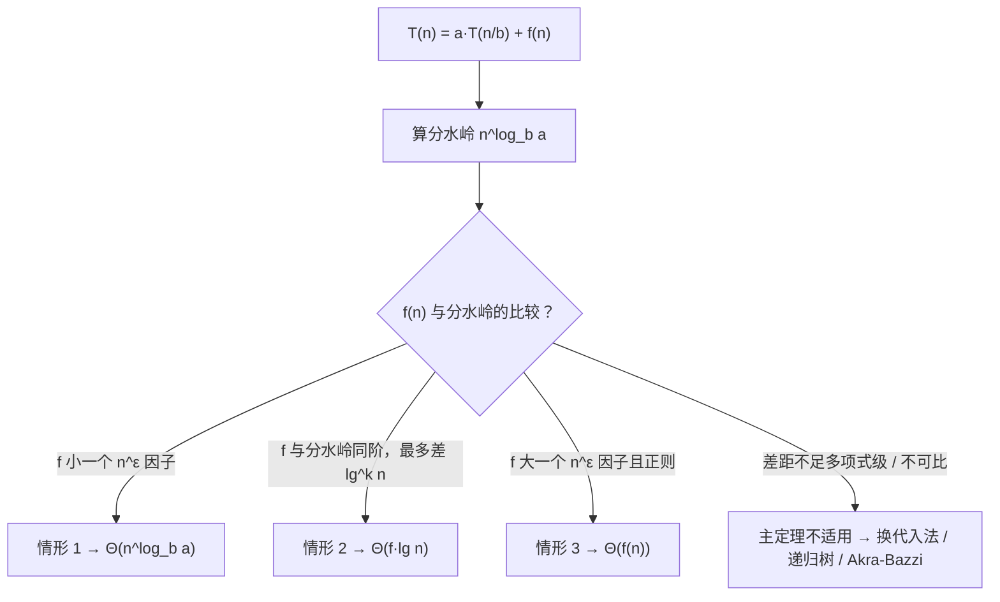

> **本篇范围**：第 4 章（分治策略：矩阵乘法、递推求解三法 + 主定理）、第 5 章（概率分析与随机化算法）。第 4 章是全书"数学味"最浓的章节之一，主定理是后面翻页速度最快的工具。

## 一、递推式：分治算法的运行时间语言

**递推式**（recurrence）是用函数自身在更小参数上的取值来描述函数的方程（§4，此 PDF p.120）。分治算法"分-治-合"三步天然导出递推：

$$T(n) = a\,T(n/b) + f(n)$$

其中 $a$ 是子问题个数、$n/b$ 是子问题规模、$f(n)$ 是**驱动函数**（划分 + 合并的代价）。本书约定（§4，此 PDF p.122）：**不写基例时默认 $T(n)=\Theta(1)$（$n<n_0$）**；floor/ceiling 不影响渐近解，可放心省略。

先看两个代表（§4，此 PDF p.122-124）：

| 递推式 | 来源 | 解 |
|---|---|---|
| $T(n)=2T(n/2)+\Theta(n)$ | 归并排序 | $\Theta(n\lg n)$ |
| $T(n)=8T(n/2)+\Theta(1)$ | 朴素分治矩阵乘法 | $\Theta(n^3)$ |
| $T(n)=7T(n/2)+\Theta(n^2)$ | Strassen | $\Theta(n^{\lg 7})\approx\Theta(n^{2.81})$ |
| $T(n)=T(n/3)+T(2n/3)+\Theta(n)$ | 不均匀分裂 | $\Theta(n\lg n)$ |

## 二、矩阵乘法：从 8 次递归到 7 次（§4.1-4.2）

### 【原理】朴素分治：换个姿势，不加速

把 $n\times n$ 矩阵分成四块 $n/2\times n/2$ 子矩阵，块乘展开（§4.1，此 PDF p.127，式 (4.5)-(4.8)）需要 **8 次**子矩阵乘法 + 4 次加法：

$$C_{11} = A_{11}B_{11} + A_{12}B_{21},\quad C_{12} = A_{11}B_{12} + A_{12}B_{22},\quad \dots$$

划分用**索引计算**实现，$\Theta(1)$ 完成（不动元素，只记坐标）；合并步不存在（结果原地累加进 $C$）。于是

$$T(n) = 8T(n/2) + \Theta(1) \implies T(n) = \Theta(n^3)$$

——和三重循环一样快。**分治本身不保证加速，子问题 branching factor 太大会吃掉红利**：递归树有 8 路分支，叶子数 $8^{\log_2 n}=n^3$。

### 【原理】Strassen：用加法换乘法

1969 年 Strassen 发现 7 次乘法就够（§4.2，此 PDF p.132）。核心思想类比一个代数恒等式：

$$x^2 - y^2 = (x+y)(x-y)$$

表面需要 2 次乘法，实际只需 1 次乘法 + 2 次加法。**矩阵乘法贵、加减法便宜，所以拿加法换乘法稳赚不赔**。

具体做法（§4.2，此 PDF p.134-135）：

**第一步**，构造 10 个加减矩阵 $S_1,\dots,S_{10}$：

| 矩阵 | 定义 | | 矩阵 | 定义 |
|---|---|---|---|---|
| $S_1$ | $B_{12}-B_{22}$ | | $S_6$ | $B_{11}+B_{22}$ |
| $S_2$ | $A_{11}+A_{12}$ | | $S_7$ | $A_{12}-A_{22}$ |
| $S_3$ | $A_{21}+A_{22}$ | | $S_8$ | $B_{21}+B_{22}$ |
| $S_4$ | $B_{21}-B_{11}$ | | $S_9$ | $A_{11}-A_{21}$ |
| $S_5$ | $A_{11}+A_{22}$ | | $S_{10}$ | $B_{11}+B_{12}$ |

**第二步**，递归计算 7 个乘积 $P_1,\dots,P_7$（每步 $\Theta(n^2)$ 准备，$7T(n/2)$ 递归）：

$$P_1=A_{11}S_1,\ P_2=S_2B_{22},\ P_3=S_3B_{11},\ P_4=A_{22}S_4,\ P_5=S_5S_6,\ P_6=S_7S_8,\ P_7=S_9S_{10}$$

**第三步**，用 12 次加减组合出结果：

$$C_{11}\mathrel{+}=P_5+P_4-P_2+P_6,\quad C_{12}\mathrel{+}=P_1+P_2,\quad C_{21}\mathrel{+}=P_3+P_4,\quad C_{22}\mathrel{+}=P_5+P_1-P_3-P_7$$

代开验证（以 $C_{11}$ 为例，$P_5+P_4-P_2+P_6$ 展开后交叉项恰好抵消，剩下 $A_{11}B_{11}+A_{12}B_{21}$，即式 (4.5)）。递推式：

$$T(n)=7T(n/2)+\Theta(n^2)\implies T(n)=\Theta(n^{\lg 7})=\Theta(n^{2.807\dots})=o(n^3)$$

**代价权衡**：每次递归少 1 次乘法，多几次加法； branching factor 从 8 降到 7，叶子数从 $n^3$ 降到 $n^{\lg 7}$——$0.19$ 个指数级的差距，就是全部收益。

### 【例题 4.2-5】★ 书中习题

只用**三次**实数乘法计算复数乘积 $(a+bi)(c+di)$。

**解**：Gauss 技巧。算

$$t_1 = a(c+d),\quad t_2 = d(a+b),\quad t_3 = b(c-d)$$

则实部 $= t_1 - t_2 = ac+ad-ad-bd = ac-bd$ ✓；虚部 $= t_1 + t_3 = ac+ad+bc-bd = ad+bc$ ✓。与 Strassen 同宗：用加法换乘法。

## 三、代入法：猜出答案，归纳证明（§4.3）

**两步走**（§4.3，此 PDF p.138）：① 猜解的形式（带待定常数）；② 数学归纳法证明并定出常数。

标准示范：证明 $T(n)=2T(\lfloor n/2\rfloor)+\Theta(n)$ 的解为 $O(n\lg n)$（§4.3，此 PDF p.138-141）。归纳假设 $T(n)\le cn\lg n$，代入：

$$T(n)\le 2c\lfloor n/2\rfloor\lg\lfloor n/2\rfloor+\Theta(n)\le cn\lg(n/2)+\Theta(n)=cn\lg n-cn+\Theta(n)\le cn\lg n$$

只要 $c$ 足够大使 $cn$ 压倒 $\Theta(n)$ 的匿名函数即可；基例 $n_0=2$、$c=\max\{T(2),T(3)\}$ 兜底。

### 【技巧】减掉一个低阶项

猜 $T(n)=2T(n/2)+1$ 的解是 $O(n)$，直接代：

$$T(n)\le 2\cdot c(n/2)+1 = cn+1 \not\le cn$$

卡住了！解法：**把归纳假设加强为 $T(n)\le cn-d$**（§4.3，此 PDF p.141-142）：

$$T(n)\le 2(cn/2-d)+1 = cn-2d+1 \le cn-d \quad(\text{取 } d\ge1)$$

反直觉但正确：子问题被调用 $a$ 次，假设里减的 $d$ 也被减 $a$ 次，越减越有盈余；反之**加**低阶项会被递归放大，越加越不够。

### 【易错】代入法两大坑（§4.3，此 PDF p.142-143）

1. **归纳假设里禁用渐近记号**：用 $T(n)=O(n)$ 当假设"证明" $T(n)=O(n)$ 是循环论证——$O$ 里藏的常数每一步都在变。必须显式命名常数 $c$；
2. **要证的是假设的确切形式**：目标是证 $T(n)\le cn$，不能证到 $cn+\Theta(n)=O(n)$ 就收工。

## 四、递归树法：先画图，再猜解（§4.4）

每个节点 = 一个子问题的代价；按层求和，层层相加（§4.4，此 PDF p.145）。典型示范 $T(n)=3T(n/4)+cn^2$（§4.4，此 PDF p.146-148）：

| 层 $i$ | 节点数 | 每节点代价 | 层总代价 |
|---|---|---|---|
| 0 | $1$ | $cn^2$ | $cn^2$ |
| 1 | $3$ | $c(n/4)^2$ | $\frac{3}{16}cn^2$ |
| 2 | $9$ | $c(n/16)^2$ | $\left(\frac{3}{16}\right)^2cn^2$ |
| $\vdots$ | $3^i$ | $c(n/4^i)^2$ | $\left(\frac{3}{16}\right)^i cn^2$ |
| $\log_4 n$（叶） | $3^{\log_4 n}=n^{\log_4 3}$ | $\Theta(1)$ | $\Theta(n^{\log_4 3})$ |

层代价公比 $3/16<1$，**几何递减**，根节点主导：总数被 $\frac{1}{1-3/16}=\frac{16}{13}$ 箍住，猜 $T(n)=O(n^2)$；再注意根就是 $\Theta(n^2)$，下界 $\Omega(n^2)$ 自动成立，故 $T(n)=\Theta(n^2)$。递归树给出的猜测随后用代入法严格化（选 $d\ge\frac{16}{13}c$）。

不规则例子 $T(n)=T(n/3)+T(2n/3)+cn$（§4.4，此 PDF p.150-152）：树高 $\Theta(\lg n)$（沿右脊），每层内部节点总代价 $\le cn$，内部合计 $O(n\lg n)$；叶子数单独设 $L(n)=L(n/3)+L(2n/3)$ 可证 $L(n)=\Theta(n)$，叶子总代价 $\Theta(n)$，被内部主导，故 $T(n)=\Theta(n\lg n)$。

> 经验法则：**层代价几何递增 → 叶子主导（情形 1）；层代价持平 → 每层 × 层数（情形 2）；层代价几何递减 → 根主导（情形 3）**。这正是主定理三种情形的递归树直觉。

## 五、主定理：背下三种情形，秒解递推（§4.5）

**Theorem 4.1（主定理）**（§4.5，此 PDF p.154-155）：设 $T(n)=aT(n/b)+f(n)$，$a>0,b>1$。记**分水岭函数** $n^{\log_b a}$（递归树叶子的临界规模），则：

| 情形 | 条件 | 结论 | 递归树直觉 |
|---|---|---|---|
| **1** | $f(n)=O(n^{\log_b a-\epsilon})$，即 $f$ 比分水岭**小多项式级** | $T(n)=\Theta(n^{\log_b a})$ | 叶子主导 |
| **2** | $f(n)=\Theta(n^{\log_b a}\lg^k n)$，$k\ge0$ | $T(n)=\Theta(n^{\log_b a}\lg^{k+1} n)$ | 每层持平 |
| **3** | $f(n)=\Omega(n^{\log_b a+\epsilon})$ **且** 正则条件 $af(n/b)\le cf(n)$（$c<1$） | $T(n)=\Theta(f(n))$ | 根主导 |

判别流程：



注意**多项式级差距**是硬门槛：$4T(n/2)+n^{1.99}$ 中分水岭 $n^2$ 只比驱动函数大 $n^{0.01}$ 倍——够用，情形 1 成立；但 $2T(n/2)+n/\lg n$ 差距不足，主定理失效。

**速查示例**（§4.5，此 PDF p.156-158）：

| 递推式 | $a,b$ | 分水岭 | 情形 | 解 |
|---|---|---|---|---|
| $2T(n/2)+\Theta(n)$ | 2,2 | $n$ | 2（$k=0$） | $\Theta(n\lg n)$ |
| $9T(n/3)+n$ | 9,3 | $n^2$ | 1 | $\Theta(n^2)$ |
| $T(2n/3)+1$ | 1,3/2 | $1$ | 2 | $\Theta(\lg n)$ |
| $3T(n/4)+n\lg n$ | 3,4 | $n^{0.79}$ | 3 | $\Theta(n\lg n)$ |
| $2T(n/2)+n\lg n$ | 2,2 | $n$ | 2（$k=1$） | $\Theta(n\lg^2 n)$ |
| $8T(n/2)+\Theta(1)$ | 8,2 | $n^3$ | 1 | $\Theta(n^3)$ |
| $7T(n/2)+\Theta(n^2)$ | 7,2 | $n^{2.81}$ | 1（$\epsilon=0.8$） | $\Theta(n^{\lg 7})$ |

## 六、雇用问题：概率分析第一课（§5.1-5.2）

### 【场景】HIRE-ASSISTANT

每天面试一个应聘者，比现任助手强就花大价钱 $c_h$ 换人；面试费 $c_i$ 便宜。总成本 $O(c_i n + c_h m)$，$m$ 是雇用次数——**分析目标就是 $m$**（§5.1，此 PDF p.185）。

```
// file: HIRE-ASSISTANT
HIRE-ASSISTANT(n)
1  best = 0              // 0 号是最差的 dummy 候选人
2  for i = 1 to n
3      interview candidate i
4      if candidate i is better than candidate best
5          best = i
6          hire candidate i
```

最坏情况（质量递增）雇 $n$ 次，成本 $O(c_h n)$。但输入顺序不可控，我们想要**平均情况**——前提是假设"随机顺序"，即排名构成**均匀随机排列**（$n!$ 种排列等概率，§5.1，此 PDF p.186-187）。

### 【定义】指示器随机变量

$$I\{A\} = \begin{cases} 1 & \text{若事件 } A \text{ 发生}\\ 0 & \text{否则}\end{cases}, \qquad \mathbb{E}[I\{A\}] = \Pr\{A\}$$

（§5.2，此 PDF p.189-190，Lemma 5.1）。配合**期望线性性**（$\mathbb{E}[\sum X_i]=\sum\mathbb{E}[X_i]$，**不要求独立**），就是概率分析的流水线：把复杂随机变量拆成一堆 0/1 变量，逐个求概率再相加。

### 【推导】期望雇用次数

设 $X_i=I\{\text{第 }i\text{ 人被雇}\}$。第 $i$ 人被雇 $\iff$ 他比前 $i-1$ 人都强。随机顺序下，前 $i$ 人中谁最强等概率，故 $\Pr\{X_i=1\}=1/i$（§5.2，此 PDF p.192）。于是

$$\mathbb{E}[X]=\sum_{i=1}^{n}\mathbb{E}[X_i]=\sum_{i=1}^{n}\frac{1}{i}=H_n=\ln n+O(1)$$

**面试 $n$ 人，平均只雇 $\ln n$ 个**（Lemma 5.2，§5.2，此 PDF p.193）。最坏 $n$、平均 $\ln n$——天壤之别。

### 【原理】随机化算法：把随机性握在自己手里（§5.3）

概率分析对输入分布做假设；随机化算法**自己制造**随机性——先洗牌再跑原算法（§5.3，此 PDF p.195-196）：

```
// file: RANDOMIZED-HIRE-ASSISTANT
RANDOMIZED-HIRE-ASSISTANT(n)
1  randomly permute the list of candidates   // 强制均匀排列
2  HIRE-ASSISTANT(n)
```

关键差异：确定性算法在"最坏输入"上一定坏；随机化算法**没有固定最坏输入**——对手再强也没用，只能指望随机数发生器"倒霉"。Lemma 5.3：期望雇用成本 $O(c_h\ln n)$，对**一切输入**成立（§5.3，此 PDF p.196）。

> 术语对照：分布架在**输入**上 → average-case（平均）；分布架在**算法的随机选择**上 → expected（期望）。

### 【伪代码】均匀洗牌与正确性（§5.3）

```
// file: RANDOMLY-PERMUTE
RANDOMLY-PERMUTE(A, n)
1  for i = 1 to n
2      swap A[i] with A[RANDOM(i, n)]    // 从"还没固定的后缀"里等概率挑一个
```

正确性用循环不变式（Lemma 5.4，§5.3，此 PDF p.198-199）：第 $i$ 轮前，每个 $(i-1)$-排列出现在 $A[1:i-1]$ 的概率为 $(n-i+1)!/n!$。维护：第 $i$ 轮从 $A[i:n]$ 的 $n-i+1$ 个元素中等概率选一个放 $A[i]$，概率乘 $1/(n-i+1)$。终止时每个 $n$-排列概率 $0!/n!=1/n!$ ✓。

⚠️ 两个常见错误洗牌法（§5.3，此 PDF p.200-201）：PERMUTE-WITH-ALL（与全数组随机位置交换，$n^n$ 种结果不等概率）和 PERMUTE-BY-CYCLE（循环偏移，每个元素到每个位置的概率都是 $1/n$ 但**整体不是均匀的**——$1/n$ 的边缘概率均匀不等于联合均匀，Ex 5.3-4）。

### 【例题 5.2-5】★ 书中习题（帽子问题）

$n$ 位顾客的帽子被随机归还。预期拿回自己帽子的人数？

**解**：设 $X_i=I\{\text{第 }i\text{ 人拿回自己的帽子}\}$。随机排列中第 $i$ 人拿对帽子的概率是 $1/n$（他那个位置等概率是 $n$ 顶帽子中的任意一顶）。由期望线性性：

$$\mathbb{E}[X]=\sum_{i=1}^{n}\frac{1}{n}=1$$

**答案：恰好 1 人**，与 $n$ 无关。

### 【例题 5.2-6】★ 书中习题（逆序对）

随机排列中逆序对（$i<j$ 但 $A[i]>A[j]$）的期望个数？

**解**：设 $X_{ij}=I\{A[i]>A[j]\}$（$i<j$）。任取两位置，两值大小关系等概率，故 $\Pr\{X_{ij}=1\}=1/2$。共有 $\binom{n}{2}$ 对：

$$\mathbb{E}[X]=\binom{n}{2}\cdot\frac12=\frac{n(n-1)}{4}$$

这个数字直接预言了**插入排序的平均比较次数**（第 7 章会看到快速排序的分析也用同一招）——插入排序的内层循环每执行一次恰好消除一个逆序对。

### 【例题】◆ 模拟 5.1

 hire 问题中，应聘者按质量降序到达时雇几次？按 $\langle 5,2,1,8,4,7,10,9,3,6\rangle$ 到达时雇几次？这两个输入说明随机化算法的什么性质？

**解**：降序时只在第 1 轮雇 1 次（后面没人更强）；给定序列中在排名 5、8、10 三轮雇，共 3 次（§5.3，此 PDF p.195 的原例）。说明：**同一个输入，确定性算法的雇用次数是固定的**；而随机化版本每次运行结果都可能不同（同一次输入可能洗出 10 次也可能洗出 1 次）——随机化把"最坏输入"这个概念消灭了。

---

## 七、性质速查表

| 工具 | 适用 | 要点 |
|---|---|---|
| 代入法 | 任意递推 | 猜形式 + 归纳；卡住就减个低阶项；假设里禁渐近记号 |
| 递归树 | 猜解 / 不均匀分裂 | 按层求和；看层代价递增/持平/递减 |
| 主定理 | $aT(n/b)+f(n)$ | 比分水岭 $n^{\log_b a}$：小→情形 1，同→2，大→3 |
| 指示器变量 | 计数期望 | $\mathbb{E}[I\{A\}]=\Pr\{A\}$；配期望线性性（免独立） |
| 均匀洗牌 | 随机化预处理 | $A[i]$ 与 $A[i:n]$ 随机交换；$O(n)$ 时间 |

---

## 八、习题

**★ Ex 4.3-2**　证明 $T(n)=4T(n/2)+n$ 的解为 $\Theta(n^2)$，并说明假设 $T(n)\le cn^2$ 的代入证明为何失败，如何修正。

**★ Ex 4.4-1**　画出 $T(n)=4T(n/3)+n$ 的递归树，猜上界并用代入法验证。

**★ Ex 4.5-3**　用主定理给出紧渐近界：a. $T(n)=4T(n/2)+n\lg n$；b. $T(n)=3T(n/4)+n^2$；c. $T(n)=9T(n/3)+n^3\lg n$。

**★ Ex 5.2-1**　随机顺序下，雇用问题恰好雇 1 次的概率是多少？恰好雇 $n$ 次呢？

**★ Ex 5.2-4**　两枚独立骰子点数和的期望；第二枚等于第一枚时；第二枚等于 7 减第一枚时。三个答案验证期望线性性是否依赖独立性。

**★ Ex 5.3-3**　PERMUTE-WITH-ALL（$A[i]$ 与 $A[1:n]$ 随机位置交换）是均匀随机排列吗？为什么？

**◆ 模拟 4.1**　解递推 $T(n)=2T(n/2)+n\lg n$：先画递归树猜解，再用主定理核对，最后指出代入法中归纳假设需要怎样的小改动才能严格化。

**◆ 模拟 4.2**　下列递推哪些能直接用主定理？不能的说明原因并给出解法：a. $T(n)=2T(n/2)+n/\lg n$；b. $T(n)=T(\sqrt n)+1$；c. $T(n)=3T(n/3)+\Theta(n^2/\lg n)$。

**◆ 模拟 5.2**　孟格尔（Monty Hall）变体不再追；改追这个：随机排列 $\langle1,\dots,n\rangle$ 中，从左向右扫描时"当前最大值"被更新的次数的期望是多少？若只能从右向左扫描呢？（提示：这与雇用问题同构，注意方向。）

---

## 习题参考答案（第 4-5 章）

**Ex 4.3-2**　归纳假设 $T(n)\le cn^2$：代入得 $T(n)\le4c(n/2)^2+n=cn^2+n$，$+n$ 无法被吸收，证明失败。修正：假设 $T(n)\le cn^2-dn$，则 $T(n)\le4(c n^2/4-dn/2)+n=cn^2-2dn+n\le cn^2-dn$（取 $d\ge1$）。结合 $\Omega(n^2)$（根代价）得 $\Theta(n^2)$。

**Ex 4.4-1**　递归树：每层节点数 $4^i$、每节点 $n/3^i$、层代价 $\frac{4}{3}in$，公比 $4/3>1$ 几何递增，叶子主导：叶在深度 $\log_3 n$，叶代价合计 $\Theta(4^{\log_3 n})=\Theta(n^{\log_3 4})$，猜 $T(n)=O(n^{\log_3 4})$。代入验证：设 $T(n)\le dn^{\log_3 4}$，则 $T(n)\le4d(n/3)^{\log_3 4}+n=dn^{\log_3 4}+n$……严格化需减低阶项：$T(n)\le dn^{\log_3 4}-en$，代入得 $dn^{\log_3 4}-4en/3+n\le dn^{\log_3 4}-en$（取 $e\ge3$）✓。与主定理情形 1 一致。

**Ex 4.5-3**　a. $a=2,b=2$，分水岭 $n$，$f(n)=n\lg n=\Theta(n\lg n)$，情形 2（$k=1$）：$T(n)=\Theta(n\lg^2 n)$。b. $a=3,b=4$，分水岭 $n^{\log_4 3}\approx n^{0.79}$，$f(n)=n^2=\Omega(n^{0.79+\epsilon})$ 且正则，情形 3：$T(n)=\Theta(n^2)$。c. $a=9,b=3$，分水岭 $n^2$，$f(n)=n^3\lg n$ 比分水岭大 $n\lg n$——超出多项式级且非同阶，主定理不直接适用；用递归树：每层 $9^i(n/3^i)^3\lg(n/3^i)=\frac{1}{3^i}n^3(\lg n-i)$，层和 $\approx n^3\lg n\cdot\sum(1/3)^i - n^3\sum i/3^i=O(n^3\lg n)$，根给出 $\Omega(n^3\lg n)$，故 $T(n)=\Theta(n^3\lg n)$。

**Ex 5.2-1**　恰好雇 1 次 $\iff$ 第 1 人就是全局最强（否则第 1 人之后必有更强者触发再次雇用），概率 $1/n$。恰好雇 $n$ 次 $\iff$ 排列严格递增，唯一排列，概率 $1/n!$。

**Ex 5.2-4**　独立骰子：$3.5+3.5=7$。第二枚 = 第一枚：$\mathbb{E}[2X]=7$。第二枚 = $7-X$：$\mathbb{E}[X+(7-X)]=7$。三种情形答案都是 7——**期望线性性不要求独立性**（§5.2，此 PDF p.191、p.194）。

**Ex 5.3-3**　不是。$n$ 次交换各产生 $n$ 种选择，共 $n^n$ 个等概率结果序列，但不同序列可能产生同一个排列、且产生概率不同（例如恒等排列可由"自我交换"序列产生，概率 $1/n^n$，也可由"互换再换回"产生，概率更高）。要均匀必须每步只在**未固定后缀** $A[i:n]$ 中随机选（RANDOMLY-PERMUTE，Lemma 5.4）。

**模拟 4.1**　递归树：层 $i$ 有 $2^i$ 个节点，每节点代价 $(n/2^i)\lg(n/2^i)=\frac{n}{2^i}(\lg n-i)$，层代价 $n\lg n-in$。前 $\lg n-1$ 层合计 $n\lg n\cdot(\lg n-1)-n\cdot\frac{(\lg n)(\lg n-1)}{2}\approx\frac12 n\lg^2 n$，故猜 $T(n)=O(n\lg^2 n)$。主定理：$a=b=2$，分水岭 $n$，$f(n)=n\lg n=\Theta(n\lg^1 n)$，情形 2 直接给 $\Theta(n\lg^2 n)$ ✓。代入严格化：$T(n)\le cn\lg^2 n$ 代入得 $cn\lg^2 n-cn\lg n+n\lg n$，差一项 $-cn\lg n$ 需由低阶项兜底——加强为 $T(n)\le cn\lg^2 n-dn\lg n$ 即可（$d$ 略大于 $1$ 的量级吸收误差）。

**模拟 4.2**　a. 主定理**不适用**：$f(n)=n/\lg n$ 与分水岭 $n$ 的差距不足多项式级（差一个 $\lg n$ 因子，不是 $n^\epsilon$）。递归树可解：层代价 $n/\lg(n/2^i)\approx n/\lg n$ 持平，共 $\lg n$ 层，$T(n)=\Theta(n\lg\lg n)$……严格说需代入法验证，结论为 $\Theta(n\lg\lg n)$ 类界（层代价缓慢递增，上界 $O(n\lg\lg n)$）。b. 先换元：令 $n=2^m$、$S(m)=T(2^m)$，得 $S(m)=S(m/2)+1$，主定理（或直接看）给 $S(m)=\Theta(\lg m)$，回代 $T(n)=\Theta(\lg\lg n)$。c. $a=b=3$，分水岭 $n$，$f(n)=\Theta(n^2/\lg n)$ 比分水岭大多项式级且正则，情形 3：$T(n)=\Theta(n^2/\lg n)$。

**模拟 5.2**　从左向右扫描："当前最大值被更新"即新元素是前缀最大值，第 $i$ 个元素是前 $i$ 个最大值的概率 $1/i$，期望 $H_n=\ln n$——与雇用问题同构（更新次数 = 雇用次数）。从右向左扫描完全对称：同样 $\ln n$。**方向不影响期望**，因为"前缀最大"与"后缀最大"在随机排列中同分布。

---

*下一篇：第 6-7 章——堆排序与快速排序，两个 $O(n\lg n)$ 排序的正面交锋。*
