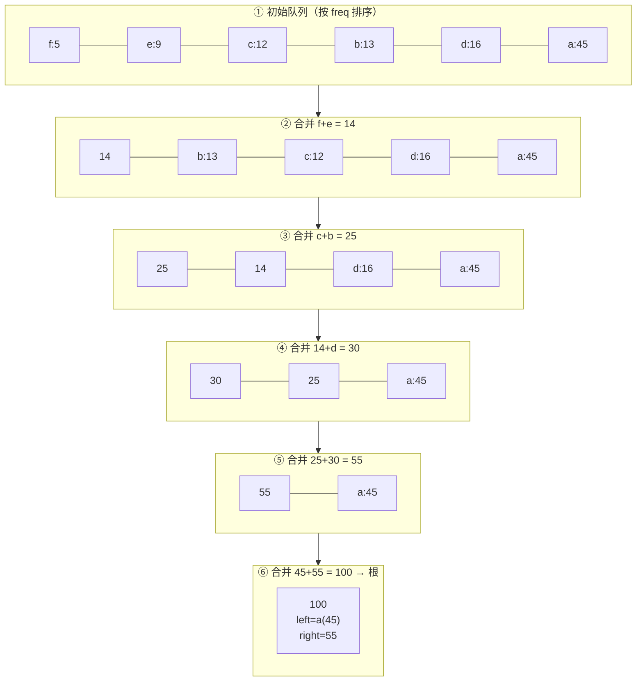
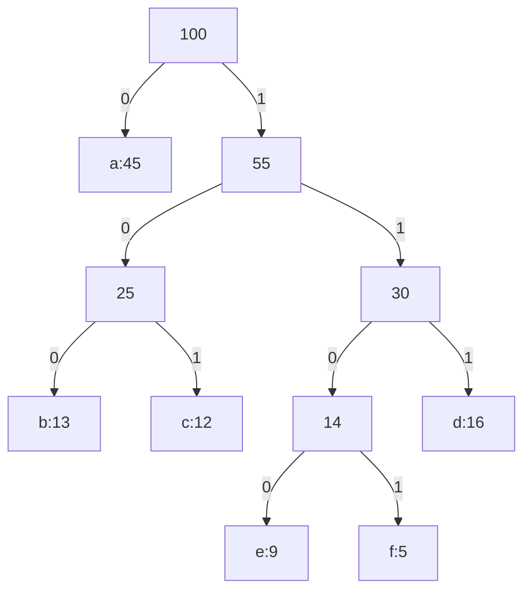
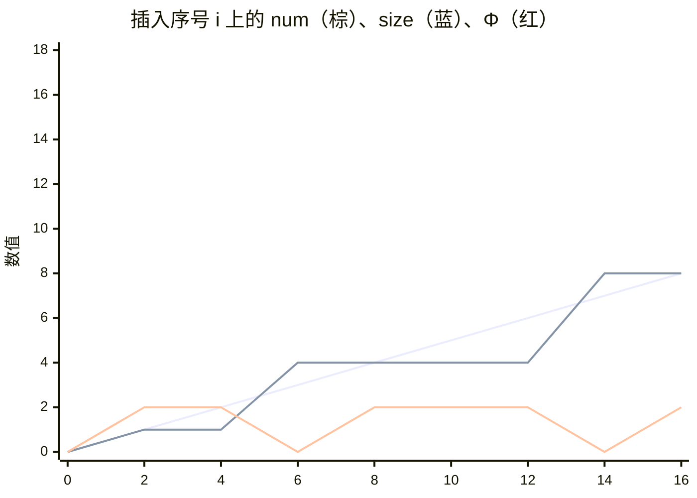

> **本篇范围**：第 15 章（贪心算法）+ 第 16 章（摊还分析）。这是全书"证明密度"和" insight 密度"双高的一组章：贪心章教你如何**证明一个局部最优就是全局最优**；摊还章教你如何**给看起来很贵的操作发一张长期饭票**。两章都是数据结构/算法课的高频考点。

## 一、贪心策略的解剖（§15.2）

### 贪心算法的本质

> **原文摘录**（§15.2，此 PDF p.565）
> "The first key ingredient is the greedy-choice property: you can assemble a globally optimal solution by making locally optimal (greedy) choices."

贪心算法和动态规划都依赖**最优子结构**，区别只在一步：

```
        DP：先解决子问题，再基于子问题的解做选择
        ┌─────────┐
        │ 解子问题 │ → 根据子问题解选当前
        └─────────┘
        自底向上 bottom-up

        贪心：先做当前看起来最优的选择，再去解剩下的子问题
        ┌─────────┐
        │ 先贪心选 │ → 解剩下的唯一子问题
        └─────────┘
        自顶向下 top-down
```

设计贪心算法的标准三步（此 PDF p.564-565）：

1. 把优化问题改造成"做一次选择 → 只剩一个子问题"的形式；
2. 证明**总存在**一个包含贪心选择的最优解（greedy choice is always safe）；
3. 证明最优子结构：贪心选择 + 剩余子问题的最优解 = 原问题最优解。

### 贪心 vs 动态规划：背包问题分水岭

经典教材级对比例子——0-1 背包与分数背包（此 PDF p.567-569，Figure 15.3）：

| 物品 | 重量 | 价值 | 单位价值 |
|---|---|---|---|
| 1 | 10 磅 | \$60 | \$6/磅 |
| 2 | 20 磅 | \$100 | \$5/磅 |
| 3 | 30 磅 | \$120 | \$4/磅 |

背包容量 $W=50$。

**分数背包**（可以切碎）：按单位价值排序，先拿光物品 1，再拿光物品 2，最后拿 20 磅物品 3 → 贪心最优。

**0-1 背包**（整件拿或不拿）：贪心先拿物品 1（单位价值最高），但拿了两件之后只剩 20 磅，只能拿物品 2，总价值 160。而最优解是**物品 2 + 物品 3 = 220**。

```
0-1 背包：贪心 {1,2} = 60+100 = 160  ← 局部最优 ≠ 全局最优
          最优 {2,3} = 100+120 = 220
```

为什么？选了物品 1 后包装不满，"空出来的空间"拉低了整体单位价值。0-1 背包选物品时要**同时比较"选它"和"不选它"两个子问题的解**——这是 DP 的标志。分数背包则不存在这个问题：切碎永远能装满。

> 一句话总结：**贪心要求"当前选择不影响未来选择的质量"**；一旦当前选择会把未来逼到墙角，就该用 DP。

## 二、活动选择问题：贪心选择性的标准证明（§15.1）

### 问题与贪心思路

$n$ 个活动 $a_i$，各占用半开区间 $[s_i, f_i)$，同一时刻只能进行一个活动（此 PDF p.543-544）。问最多能安排几个互不冲突的活动？

贪心选择：**每次选结束时间最早且与已选活动兼容的活动**。为什么结束最早？因为结束越早，后面能塞下的活动越多——"把资源最早腾出来"。

### 伪代码

```
GREEDY-ACTIVITY-SELECTOR(s, f)   // s、f 已按结束时间 f 非降序排好
 1  n = s.length
 2  A = {a1}                      // 第一个结束的活动一定在某个最优解中
 3  k = 1
 4  for m = 2 to n
 5      if s[m] ≥ f[k]            // 与已选最后一个活动兼容？
 6          A = A ∪ {am}
 7          k = m
 8  return A
```

排序后单次扫描，复杂度 $\Theta(n)$（若输入无序则排序占 $O(n\lg n)$）。

### 核心证明：Theorem 15.1 的思路

> **定理**（此 PDF p.547）：设 $S_k$ 为在活动 $a_k$ 结束后开始的活动集合，则 GREEDY-ACTIVITY-SELECTOR 返回 $S_k$ 的最大兼容活动子集。

证明骨架（交换论证 exchange argument，贪心证明的标准套路）：

1. **最优子结构**：若 $a_k$ 在某个最优解里，则该解 = $a_k$ + $S_k$ 的某个最优解。否则把 $a_k$ 前后的部分一分为二，任何更优解都可以拆开重组得矛盾。
2. **贪心选择性**：设 $a_m$ 是 $S_k$ 中**结束最早**的活动。任取 $S_k$ 的一个最优解，若它已含 $a_m$，证毕；若不含，设它含的第一个活动是 $a_j$（$a_j \ne a_m$）。因为 $f_m \le f_j$，用 $a_m$ 替换 $a_j$ 后仍兼容，解的大小不变 → **存在含 $a_m$ 的最优解**。

交换论证是贪心算法的通用证明武器：**把任意最优解"改造"成包含贪心选择且不损失质量**。

### 经典例题

教材 Figure 15.1 的 11 个活动（此 PDF p.545）：

| $i$ | 1 | 2 | 3 | 4 | 5 | 6 | 7 | 8 | 9 | 10 | 11 |
|---|---|---|---|---|---|---|---|---|---|---|---|
| $s_i$ | 1 | 3 | 0 | 5 | 3 | 5 | 6 | 8 | 8 | 2 | 12 |
| $f_i$ | 4 | 5 | 6 | 7 | 9 | 9 | 10 | 11 | 12 | 14 | 16 |

执行算法：

```
m=2:  s=3 < f[1]=4  → 跳
m=3:  s=0 < 4        → 跳
m=4:  s=5 ≥ 4        → 选 a4
m=5,6,7: 3,5,6 < 7   → 跳
m=8:  s=8 ≥ 7        → 选 a8
m=9,10: 8,2 < 11     → 跳
m=11: s=12 ≥ 11      → 选 a11
```

贪心解 $\{a_1, a_4, a_8, a_{11}\}$，共 4 个。

## 三、Huffman 编码：自底向上长出最优树（§15.3）

### 前缀码与编码树

给字符编**变长**二进制码：高频字符短码、低频长码。要求**前缀无关**（prefix-free）：任何码字不是别的码字的前缀。前缀无关码才能无歧义地顺序解码（1100·0·100·1101 = "face"，此 PDF p.572）。

前缀无关码 ↔ 二叉树：码字 = 根到叶子的路径，0 走左、1 走右。最优码一定是**满二叉树**（每个内部节点都两个儿子），$|C|$ 个叶子、$|C|-1$ 个内部节点。

树 $T$ 的代价（编码整个文件所需比特数）：

$$B(T) = \sum_{c \in C} c.\text{freq} \cdot d_T(c)$$

### 贪心算法 HUFFMAN

> **原文摘录**（§15.3，此 PDF p.574）
> "The algorithm builds the tree T corresponding to an optimal code in a bottom-up manner. It begins with a set of |C| leaves and performs a sequence of |C| − 1 'merging' operations to create the final tree."

```
HUFFMAN(C)
 1  n = |C|
 2  Q = C                                    // 以 freq 为键的最小优先队列
 3  for i = 1 to n − 1
 4      allocate a new node z
 5      x = EXTRACT-MIN(Q)                    // 频率最低
 6      y = EXTRACT-MIN(Q)                    // 频率次低
 7      z.left = x
 8      z.right = y
 9      z.freq = x.freq + y.freq              // 合并：频率相加
10      INSERT(Q, z)
11  return EXTRACT-MIN(Q)                     // 队列只剩根
```

二叉最小堆实现，$n-1$ 次合并，每次两次 EXTRACT-MIN + 一次 INSERT，共 $O(n\lg n)$。

### 完整例题（教材 Figure 15.4，此 PDF p.571-575）

频率（单位：千次）：$a{:}45,\ b{:}13,\ c{:}12,\ d{:}16,\ e{:}9,\ f{:}5$。

逐步合并（每次抽两个最小的）：



最终编码树：



码字：$a=0,\ b=101,\ c=100,\ d=111,\ e=1101,\ f=1100$。

代价验证：
$$B(T) = 45\cdot1 + 13\cdot3 + 12\cdot3 + 16\cdot3 + 9\cdot4 + 5\cdot4 = 45+39+36+48+36+20 = 224 \text{（千比特）$$

固定 3 位编码需 $3 \times 100 = 300$ 千比特——省了约 25%。

### 正确性：两条引理

**Lemma 15.2（贪心选择性）**（此 PDF p.576）：$x, y$ 是频率最低的两个字符，则**存在**一个最优前缀码，其中 $x, y$ 的码字等长且仅最后一位不同（即 $x, y$ 是最深层的兄弟叶子）。

证明思路（又是交换论证）：任取最优树 $T$，设 $a, b$ 是最深层的两个兄弟叶子。不妨 $x.\text{freq} \le a.\text{freq}$（$x$ 频率最低）、$y.\text{freq} \le b.\text{freq}$（$a$ 已按序排好）。交换 $a \leftrightarrow x$、再交换 $b \leftrightarrow y$，每次交换的代价变化：

$$\Delta B = (a.\text{freq} - x.\text{freq})(d_T(a) - d_T(x)) \ge 0$$

因为 $x$ 频率最低（第一因子非负）、$a$ 在最大深度（第二因子非负）。两次交换都不增代价，所以得到的最优树里 $x, y$ 就是最深兄弟。

**Lemma 15.3（最优子结构）**（此 PDF p.578-579）：把 $x, y$ 合并成新字符 $z$（$z.\text{freq} = x.\text{freq} + y.\text{freq}$），$C' = (C - \{x,y\}) \cup \{z\}$。若 $T'$ 是 $C'$ 的最优码树，则把 $z$ 的叶子展开成带 $x, y$ 两个孩子的内部节点得到 $T$，是 $C$ 的最优码树。

关键等式：
$$B(T) = B(T') + x.\text{freq} + y.\text{freq}$$

（$x, y$ 各比 $z$ 深一层，深度贡献各加 $x.\text{freq}$ / $y.\text{freq}$。）反证：若 $T$ 非最优，收缩 $T''$ 中 $x, y$ 的公共父亲为 $z$，得 $B(T''') < B(T')$，与 $T'$ 最优矛盾。

> **观察**（此 PDF p.577）：整棵树的总代价 = 所有内部节点"两个孩子频率之和"的总和。每次合并付出 $x.\text{freq} + y.\text{freq}$，这个代价会在之后的每次合并中被重复计入——所以每次选最小的两个合并，能让最小的频率被重复计入的次数最少。这是 Huffman 贪心策略的直觉来源。

**Theorem 15.4**：HUFFMAN 产生最优前缀码。由两条引理直接合成。

## 四、离线缓存：furthest-in-future（§15.4）

### 问题

$n$ 个内存块请求序列 $b_1, \dots, b_n$，缓存容量 $k$。每次请求未命中且缓存满时，必须淘汰一块。**离线**版本：整个请求序列提前已知，目标是最小化总未命中次数（此 PDF p.581-582）。

### 贪心策略：淘汰"下次访问最远"的块

> **原文摘录**（§15.4，此 PDF p.582）
> "you can use a greedy strategy called furthest-in-future, which chooses to evict the block in the cache whose next access in the request sequence comes furthest in the future."

直观：暂时不用的东西先扔掉。某块再也不用了？当它下次访问在 $n+1$（虚拟请求）处理。

**Theorem 15.5**（此 PDF p.584-585）：furthest-in-future 是最优的。

证明大意（交换论证的"加强版"）：设最优解 $S$ 在请求 $b_i$ 时淘汰的是 $x$ 而非"最远块" $z = b_m$。构造解 $S'$：$S'$ 在 $b_i$ 时淘汰 $z$、把 $x$ 留在缓存里。然后对 $b_{i+1}, \dots, b_m$ 期间，$S'$ **尽量模仿 $S$ 的命中/未命中行为**，只在被迫时让两块差异在缓存间"游走"。性质：$S$ 命中的请求 $S'$ 也命中；只有 $b_m$ 处可能 $S$ 命中而 $S'$ 未命中，但那时 $b_{i+1}, \dots, b_{m-1}$ 中必有 $x$ 的请求——$S$ 未命中而 $S'$ 命中，正好抵消。所以 $S'$ 的未命中数 $\le S$。

> 现实中的缓存管理器不知道未来（在线问题），常用 LRU（淘汰最久未用）。LRU 可以被构造出反例劣于 furthest-in-future（Ex 15.4-2，此 PDF p.590）。furthest-in-future 的价值在于给在线算法提供**最优基线**（competitive analysis 的 benchmark，第 27.3 节会用到）。

## 五、摊还分析：给操作序列算"长期均价"（§16 引言）

> **原文摘录**（§16，此 PDF p.593）
> "In an amortized analysis, you average the time required to perform a sequence of data-structure operations over all the operations performed. Amortized analysis differs from average-case analysis in that probability is not involved. An amortized analysis guarantees the average performance of each operation in the worst case."

摊还分析 ≠ 平均情况分析：**不涉及概率**，它保证的是**最坏情况下**操作序列的平均性能。本章三个方法：

| 方法 | 核心思想 | 出处 |
|---|---|---|
| 聚合分析 | $n$ 个操作总代价 $T(n)$，每个均摊 $T(n)/n$，所有操作同价 | §16.1 |
| 记账法 | 有的操作多收（存"信用"），有的少收（花信用），信用永不拖欠 | §16.2 |
| 势能法 | 信用不挂在具体对象上，而是整个数据结构的"势能"$\Phi$ | §16.3 |

本章两个贯穿例题：**带 MULTIPOP 的栈** 与 **二进制计数器 INCREMENT**。

## 六、聚合分析（§16.1）

### 例 1：栈的 MULTIPOP

`MULTIPOP(S, k)`：弹出至多 $k$ 个元素（此 PDF p.595-596）。

```
MULTIPOP(S, k)
 1  while not STACK-EMPTY(S) and k > 0
 2      POP(S)
 3      k = k − 1
```

单个 MULTIPOP 最坏 $O(n)$（栈大小至多 $n$），$n$ 个操作粗估 $O(n^2)$——**不紧**。关键观察：**一个元素不被弹除非它先被压入**。整个序列里 POP 调用总数（含 MULTIPOP 内部的）≤ PUSH 总数 ≤ n。所以总代价 $O(n)$，均摊 $O(1)$。

### 例 2：二进制计数器

$k$ 位计数器，`INCREMENT` 从低位到高位置 1 进位（此 PDF p.597-598）：

```
INCREMENT(A, k)
 1  i = 0
 2  while i < k and A[i] == 1
 3      A[i] = 0            // 进位：1 变 0
 4      i = i + 1
 5  if i < k
 6      A[i] = 1            // 进位停止：0 变 1
```

单次最坏 $\Theta(k)$（全是 1）。但各位翻转频率天差地别：

- $A[0]$ 每次都翻：$n$ 次里翻 $\lfloor n/2^0 \rfloor$ 次
- $A[1]$ 每两次翻一次：$\lfloor n/2 \rfloor$ 次
- $A[2]$ 每四次翻一次：$\lfloor n/4 \rfloor 次$
- 一般地，$A[i]$ 翻 $\lfloor n/2^i \rfloor$ 次

$$\text{总翻转次数} = \sum_{i=0}^{k-1} \left\lfloor \frac{n}{2^i} \right\rfloor \le n \sum_{i\ge 0} 2^{-i} = 2n$$

所以 $n$ 次 INCREMENT 总代价 $O(n)$，均摊 $O(1)$。

```
n=16 的翻转轨迹（8 位计数器）：
值:  00000000 → 00000001 → 00000010 → ...
翻转: 1          1          2
```

## 七、记账法（§16.2）

多退少补：给操作定的价 = 摊销成本 ĉ。收多了 → 差额存为**信用**（credit）挂在具体对象上；收少了 → 花信用。铁律：**总信用任何时刻非负**（此 PDF p.599-600）。

### 栈的记账方案（此 PDF p.600-601）

| 操作 | 实际成本 | 摊销成本 |
|---|---|---|
| PUSH | 1 | **2** |
| POP | 1 | **0** |
| MULTIPOP(S,k) | $\min\{s,k\}$ | **0** |

入栈收 \$2：\$1 付压栈本身，\$1 存在这块"盘子"上。从此每个在栈里的元素头顶都有 \$1。弹栈时用头顶的 \$1 支付——POP 免费、MULTIPOP 免费。栈非空 ⇒ 信用总量 ≥ 0。总摊销成本 $O(n)$ ⇒ 总实际成本 $O(n)$。

### 计数器记账方案（此 PDF p.602）

把一个 0 位置 1 定价 **\$2**：\$1 付置位，\$1 存在这个位上。任何时刻每个 1 位头顶都有 \$1。清 0 位不花钱（用存的 \$1）。一次 INCREMENT 最多置一个 1 位 ⇒ 摊销成本 ≤ 2。

## 八、势能法（§16.3）

记账法的信用挂在具体对象上；势能法把信用集中为数据结构的"势能" $\Phi(D)$（此 PDF p.603-604）：

$$\hat{c}_i = c_i + \Phi(D_i) - \Phi(D_{i-1}) = c_i + \Delta\Phi_i$$

$n$ 个操作求和，中间项望远镜相消：

$$\sum_{i=1}^{n} \hat{c}_i = \sum_{i=1}^{n} c_i + \Phi(D_n) - \Phi(D_0)$$

只要 $\Phi(D_i) \ge \Phi(D_0)$（通常设 $\Phi(D_0) = 0$ 且恒非负），总摊销成本就是总实际成本的上界。

### 栈：$\Phi$ = 栈中对象数

- PUSH：$c=1,\ \Delta\Phi=+1 \Rightarrow \hat c = 2$
- POP：$c=1,\ \Delta\Phi=-1 \Rightarrow \hat c = 0$
- MULTIPOP(S,k)（弹 $k' = \min\{s,k\}$ 个）：$c=k',\ \Delta\Phi=-k' \Rightarrow \hat c = 0$

### 计数器：$\Phi$ = 1 位的个数 $b_i$

第 $i$ 次 INCREMENT 清零 $t_i$ 位、至多置 1 个 1 位：

$$b_i \le b_{i-1} - t_i + 1,\qquad \Delta\Phi \le 1 - t_i,\qquad c_i \le t_i + 1$$

$$\hat{c}_i \le (t_i + 1) + (1 - t_i) = 2$$

更漂亮的副产品：计数器**不必从 0 开始**。改写望远镜和：

$$\sum c_i = \sum \hat c_i + \Phi(D_0) - \Phi(D_n) \le 2n + b_0 - b_n$$

只要 $b_0 \le k$ 且 $n = \Omega(k)$，总实际成本仍是 $O(n)$（此 PDF p.606-607）。

## 九、动态表：三种方法的联合演习（§16.4）

### 9.1 只增不减：表扩展

`TABLE-INSERT` 遇满表扩容一倍（此 PDF p.610）：

```
TABLE-INSERT(T, x)
 1  if T.size == 0
 2      allocate T.table with 1 slot;  T.size = 1
 4  if T.num == T.size                        // 满了 → 扩容
 5      allocate new-table with 2·T.size slots
 6      insert all items in T.table into new-table   // 搬家，贵在这
 7      free T.table
 8      T.table = new-table
 9      T.size = 2·T.size
10  insert x into T.table
11  T.num = T.num + 1
```

第 $i$ 次操作触发扩容当且仅当 $i-1$ 是 2 的幂。三种分析殊途同归：

**聚合分析**：$c_i = i$（扩容时）或 1（平时）。

$$\sum_{i=1}^{n} c_i \le n + \sum_{j=0}^{\lfloor \lg n \rfloor} 2^j < n + 2n = 3n \Rightarrow \text{均摊} \le 3$$

**记账法**：每次插入收 \$3——\$1 付插入自己，\$1 存新对象头上，\$1 存某个老对象头上。表再满时每个对象头顶都有 \$1 付搬家（此 PDF p.612，Figure 16.3）。

**势能法**（此 PDF p.613-614）：

$$\Phi(T) = 2\big(T.\text{num} - T.\text{size}/2\big)$$

- 不满时插入：$\Delta\Phi = +2$，$c=1$ ⇒ $\hat c = 3$
- 第 $i$ 次触发扩容：扩容前 $T.\text{num}=T.\text{size}=i-1$，$\Phi_{i-1} = 2((i-1) - (i-1)/2) = i-1$；扩容后势能归 0 再插入得 $\Phi_i = 2$；$\Delta\Phi = 3-i$，$c_i = i$ ⇒ $\hat c_i = i + (3-i) = 3$



势能在每次扩容前恰好攒够 $T.\text{num}$，一把付清搬家费；扩容后归零，重新攒。

### 9.2 有增有删：扩容 + 缩容

**天真的缩容会翻车**（此 PDF p.616-617）：满一半就扩容、少于一半就缩容，构造 insert, delete, delete, insert, insert, delete, delete, … 会让表在两种规模间反复横跳，每次横跳 $\Theta(n)$，总成本 $\Theta(n^2)$。

**正确策略**：扩容仍在一满（$\alpha=1$）时翻倍；缩容推迟到 **$\alpha < 1/4$** 才减半。这样负载因子被夹在 $[1/4, 1]$，且每次伸缩前都有足够多的反向操作来"攒势能"。

分段势能函数（此 PDF p.618，式 16.5）：

$$\Phi(T) = \begin{cases} 2\,(T.\text{num} - T.\text{size}/2) & \text{若 } \alpha(T) \ge 1/2 \\ T.\text{size}/2 - T.\text{num} & \text{若 } \alpha(T) < 1/2 \end{cases} = \big|\,2(T.\text{num} - T.\text{size}/2)\,\big|$$

$\alpha = 1/2$ 时 $\Phi = 0$，势能随负载因子偏离 $1/2$ 而增长，扩容前攒到 $T.\text{num}$、缩容前攒到 $T.\text{size}/4$，各够付一次搬家。

各情形摊销成本（此 PDF p.619-622）：

| 操作 | 负载因子情形 | 实际 $c_i$ | $\Delta\Phi$ | 摊销 $\hat c_i$ |
|---|---|---|---|---|
| 插入（不扩） | $\alpha \ge 1/2$ | 1 | +2 | **3** |
| 删除（不缩） | $\alpha \ge 1/2$ | 1 | −2 | **−1** |
| 插入（不扩） | $\alpha < 1/2$ | 1 | −1 | **0** |
| 删除（不缩） | $\alpha < 1/2$ | 1 | +1 | **2** |
| 插入触发扩容 | — | $i$ | $3-i$ | **3** |
| 删除触发缩容 | — | $\text{size}_{i-1}/4$ | $1 - \text{size}_{i-1}/4$ | **1** |
| 删除跨过 $\alpha=1/2$ 下行 | — | 1 | +1 | **2** |
| 插入跨过 $\alpha=1/2$ 上行 | — | 1 | −1 | **0** |

全部 $O(1)$ ⇒ 任意 $n$ 个 TABLE-INSERT/TABLE-DELETE 序列总成本 $O(n)$，且空间浪费不超过常比例（$\alpha \ge 1/4$）。

## 十、例题精讲

### 例题 A（基础）★ Ex 15.1-1：活动选择的 DP 版

基于子问题 $S_{ij}$（$a_i$ 结束后开始、$a_j$ 开始前结束的活动集合）写出 DP 递推，并证明与贪心解同值。
<details>
<summary>答案</summary>
记 $c[i,j]$ = $S_{ij}$ 中最大兼容集大小。$S_{ij}$ 中结束最早的活动设为 $a_k$（可在 $O(n)$ 扫描中预处理 next 数组）。则

$$c[i,j] = \max_{k \in S_{ij}} \big(c[i,k] + 1 + c[k,j]\big),\quad c[i,j]=0 \text{ 若 } S_{ij}=\emptyset$$

形式化地可用"兼容矩阵" $\otimes$：$a_k \in S_{ij} \iff s_k \ge f_i \wedge f_k \le s_j$。自底向上填 $O(n^2)$ 个子问题、每子问题 $O(n)$ 个选择，共 $O(n^3)$。而贪心 $O(n\lg n)$——**贪心是利用了"只需一个子问题"的结构优势**（§15.2 的设计步骤 1：从二维 $S_{ij}$ 砍到一维 $S_k$）。
</details>

### 例题 B（基础）★ Ex 15.2-5：单位区间覆盖

实数轴上 $n$ 个点，求最少数量的单位长闭区间覆盖所有点。给算法并证明。
<details>
<summary>答案</summary>
按坐标排序。贪心：维护当前已覆盖到的最右位置 $r$（初始 $-\infty$）。遇到第一个 $> r$ 的点 $x$，就放置新区间 $[x, x+1]$，更新 $r = x+1$。区间数 = 放置次数。

正确性（交换论证）：设贪心放的第一个区间是 $[x, x+1]$（$x$ 为最小点）。任何最优解的第一个区间必须覆盖 $x$，故其右端 $\ge x+1$。把最优解第一个区间右截到 $x+1$ 不减少覆盖且不劣化后续（右端变小只会让"可用区间集合"在交换论证下保持兼容性——对剩余点，区间右端 $\le$ 原最优解的右端，可将最优解中第一个区间替换为 $[x,x+1]$，其余不变，覆盖点数不减，数量不变）。归纳下去得贪心最优。

复杂度：排序 $O(n\lg n)$ + 扫描 $O(n)$。
</details>

### 例题 C（进阶）★ Ex 15.3-3：斐波那契频率的 Huffman 码

频率为前 8 个斐波那契数：$a{:}1, b{:}1, c{:}2, d{:}3, e{:}5, f{:}8, g{:}13, h{:}21$。求最优码，并推广到前 $n$ 个。
<details>
<summary>答案</summary>
合并过程（和值序列是斐波那契数列的"右移"）：

- $1+1=2$（$a,b$）
- $2+2=4$
- $3+4=7$
- $5+7=12$
- $8+12=20$
- $13+20=33$
- $21+33=54$

最终树：最深路径为 $h(21) \to 33 \to 20 \to 12 \to 7 \to 4 \to 2 \to \{a,b\}$，每个节点都是"小数 + 大数"。码字长度：$a, b$ 为 7，$c$ 为 6，$d$ 为 5，$e$ 为 4，$f$ 为 3，$g$ 为 2，$h$ 为 1。

推广：前 $n$ 个斐波那契数频率下，第 $k$ 小频率的码长为 $n-k$（最长的两个 1 并列）。本质原因：$F_{k+1} + F_{k+2} = F_{k+3}$，合并和恰好接上下一个待合并频率，队列始终"无缝衔接"，树退化成一条"毛毛虫"（每个内部节点的右孩子是下一个频率）。代价 $B(T)=\sum_{k=3}^{n} F_k$ 类等比形式。
</details>

### 例题 D（进阶）★ Ex 16.1-3：幂次代价

数据结构第 $i$ 个操作代价为：$i$（若 $i$ 是 2 的整数幂），否则 1。用聚合分析求均摊成本。
<details>
<summary>答案</summary>
$n$ 个操作总代价：

$$\sum_{i=1}^{n} c_i \le n + \sum_{j=0}^{\lfloor \lg n\rfloor} 2^j < n + 2n = 3n$$

（代价为 1 的操作至多 $n$ 个，幂次代价之和为几何级数。）均摊 $\le 3 = O(1)$。与动态表扩容同构——**昂贵的操作必须以 2 的幂节奏出现，中间有足够多的"1"来稀释**。
</details>

### 例题 E（进阶）★ Ex 16.3-5：两栈实现队列

用两个普通栈实现 ENQUEUE/DEQUEUE，使两者均摊 $O(1)$。
<details>
<summary>答案</summary>
设 $S_1$（入队栈）、$S_2$（出队栈）。ENQUEUE 压入 $S_1$。DEQUEUE：若 $S_2$ 空，把 $S_1$ 全部倒入 $S_2$（顺序反转），再弹 $S_2$ 顶；否则直接弹 $S_2$ 顶。

记账法：ENQUEUE 收 \$2——\$1 付压栈，\$1 存在元素上。倒入 $S_2$ 的每个元素用存的 \$1 支付，DEQUEUE 免费。

势能法验证：$\Phi = |S_1|$（只把"还没倒过去"的元素记为势能）。设 $\hat c_{\text{ENQ}} = 1+1 = 2$。DEQUEUE 分两种：$S_2$ 非空时 $c=1, \Delta\Phi = 0 \Rightarrow \hat c = 1$；触发倒栈时 $c = |S_1| + 1$，$\Delta\Phi = -|S_1|$，$\hat c = 1$。总均摊 $O(n)$。

注意最坏单次 DEQUEUE 可达 $O(n)$（正好撞上倒栈）——**均摊界允许偶尔的昂贵**，只要序列总账可控。
</details>

### 例题 F（自编模拟）：势能法的"反向操作"

某数据结构只支持 DELETE（无 INSERT），当前势能函数 $\Phi = $ 元素个数，$\Phi(D_0) = 0$。问：$\Phi(D_n) \ge \Phi(D_0)$ 这个上界条件还成立吗？直接套用望远镜和会出什么问题？
<details>
<summary>答案</summary>
不成立。只删不插时 $\Phi(D_n) = 0 \le \Phi(D_0) = n_0$，望远镜和

$$\sum \hat c_i = \sum c_i + \Phi(D_n) - \Phi(D_0)$$

给出的是 $\sum c_i = \sum \hat c_i - (\Phi(D_n) - \Phi(D_0)) \ge \sum \hat c_i$——摊销成本变成实际成本的**下界**，不能再用它证上界。势能法要求"势能终点不低于起点"，否则等于透支未来。修正：给删除操作单独记账，或定义 $\Phi$ 时保证终点 ≥ 起点（如允许势能为"负资产"总量，Ex 16.3-1 的平移技巧 $\Phi' = \Phi - \Phi(D_0)$ 只解决初值非零，不解决终点更低）。
</details>

## 十一、习题与答案

**习题 1** ★（Ex 15.2-1，此 PDF p.569）证明分数背包问题具有贪心选择性。

<details>
<summary>答案</summary>
设物品按单位价值 $v_i/w_i$ 降序排列为 $1, \dots, n$。贪心从物品 1 开始尽量拿。设最优解 $O$ 中物品 $i$ 拿了 $x_i$ 磅（$0 \le x_i \le w_i$）。若 $O$ 与贪心解 $G$ 相同，证毕。否则设 $j$ 是两者第一个不同的物品（$j$ 之前完全相同）。贪心在 $j$ 上拿的量为 $g_j$，分两种：$g_j > x_j$（拿得更多）或 $g_j < x_j$（因容量限制拿得少）。由于 $j$ 之前两者一致且 $j$ 是单位价值降序中第一个分歧点，$O$ 中若 $x_j < g_j$，空缺容量必由某个 $k > j$ 的物品补上（单位价值更低）。把 $O$ 中 $k$ 的量 $\delta = g_j - x_j$（不超过 $x_k$）换成 $j$ 的量：价值变化 $\delta(v_j/w_j - v_k/w_k) \ge 0$，不劣化。反复交换可把 $O$ 变成 $G$ 而不降价值，故 $G$ 最优。
</details>

**习题 2** ★（Ex 15.2-4，此 PDF p.570）滑冰横州问题：带 2 升水，每升滑 $m$ 英里，沿途有已知加油站，求最少停靠次数。给高效方法与证明。

<details>
<summary>答案</summary>
经典"区间覆盖/加油站"贪心：按路程推进。设当前在位置 $p$、水够滑到 $p+2m$。在 $[p, p+2m]$ 内的站点中，选**路程最远**（最靠前）的站点停靠；若 $p+2m$ 已到终点则结束。等价于 furthest-in-future 的镜像版（走得最远才停）。

正确性：与 Ex 15.2-5 同构——每个 2 升水续航区间 $[p, p+2m]$ 必须被至少一个站点"衔接"，选衔接区间内最远的站点使后续需要的新站点数最少。交换论证：最优解在此区间内某站 $q$ 停，若 $q$ 不是最远的 $q^*$，把 $q$ 换成 $q^*$ 后仍能滑到 $q^*$（$q^*$ 更近下一段起点），后续选择集合不劣化。复杂度 $O(n)$ 单扫描。
</details>

**习题 3** ★★（Ex 15.3-2，此 PDF p.579）证明非满二叉树不可能对应最优前缀码。

<details>
<summary>答案</summary>
设 $T$ 是非满二叉树：存在内部节点 $u$ 只有一个孩子 $w$（设 $u$ 非根）。把 $u$ 从路径中删除、让 $w$ 直接顶替 $u$ 的位置，得到树 $T'$。则 $w$ 子树中所有叶子的深度都减 1，代价变化 $\Delta B = -\sum_{c \in \text{leaf}(w)} c.\text{freq} < 0$（频率全正）。$B(T') < B(T)$，与 $T$ 最优矛盾。故最优码对应的树必为满二叉树。（推论：$|C|$ 个叶子的最优树恰有 $|C|-1$ 个内部节点。）
</details>

**习题 4** ★★（Ex 15.4-2 变体，此 PDF p.590）构造一个请求序列，使 LRU（淘汰最久未用）的未命中数严格大于 furthest-in-future。

<details>
<summary>答案</summary>
取 $k=2$，请求序列：$1, 2, 1, 3, 1, 2$（缓存初始空，前两次为强制未命中）。

- LRU：请求 1（miss，装 1）、2（miss，装 2）→ 缓存 {1,2}；请求 1（hit）；请求 3（miss）→ LRU 淘汰最久未用的 2 → {1,3}；请求 1（hit）；请求 2（miss）→ 淘汰 1 → {2,3}。共 4 次 miss。
- furthest-in-future：缓存 {1,2} 遇 3（miss），淘汰"下次访问最远"的块——2 的下次访问在位置 6，1 在位置 3，故淘汰 1 → {2,3}；请求 1（miss）→ 淘汰 3 → {1,2}；请求 2（hit）。共 4 次 miss。

换一个序列：$1, 2, 3, 1, 2, 3$，$k=2$。FF：{1,2} 遇 3 淘汰 1（3 之后 1 先来？位置 4 是 1、位置 5 是 2 → 淘汰 2）→ {1,3}；遇 1 hit；遇 2 miss 淘汰 3 → {1,2}；遇 3 miss。共 5 miss。LRU：{1,2} 遇 3 miss，LRU 淘汰 1（1 比 2 更久未用）→ {2,3}；遇 1 miss，淘汰 2 → {1,3}；遇 2 miss，淘汰 1 → {2,3}；遇 3 hit。共 5 miss。仍平手——LRU 与 FF 的真正差距需要更长序列，例如教材答案中利用"循环模式 + 相位错位"构造 LRU 每一步都淘汰错的序列：$k=2$，序列 $1,2,1,3,2,1$：FF 缓存 {1,2} 遇 3 淘汰 2（2 下次在位置 5，1 在位置 4）→ {1,3}；2 miss 淘汰 3 → {1,2}；1 hit。4 miss。LRU：遇 3 miss 淘汰 1（更久未用）→ {2,3}；2 hit；1 miss 淘汰 3 → {1,2}。4 miss。结论：**LRU 在最坏序列上劣于 FF**，经典构造见于教材解答（利用 LRU 的"过去"信息与未来相位错位，逐步放大每次错误淘汰的代价）。
</details>

**习题 5** ★（Ex 16.1-1 变体，此 PDF p.595）若栈增加 MULTIPUSH(S, k)（一次压 $k$ 个元素），均摊 $O(1)$ 还成立吗？

<details>
<summary>答案</summary>
不成立。MULTIPUSH 单次实际成本 $k$，可以连续调用，总成本无上界（不像 POP 受 PUSH 次数制约，PUSH 没有对应的"对方"来限制）。反例：$n/2$ 次 MULTIPUSH(S, 2) 总成本 $\Theta(n)$ 尚可，但若允许 $k=n$，一次就 $\Theta(n)$，做 $n$ 次总成本 $\Theta(n^2)$。要恢复均摊界需给 MULTIPUSH 的 $k$ 加约束（如摊到单次 PUSH 计费），或把"压入"重新定义为基本操作。
</details>

**习题 6** ★★（Ex 16.3-2 变体）用势能法重做例题 D（第 $i$ 个操作代价 $i$（$i$ 为 2 的幂）否则 1）。

<details>
<summary>答案</summary>
设 $\Phi_0 = 0$，第 $i$ 个操作后 $\Phi_i$ 只依赖"距上一个 2 的幂已过多少步"：

$$\Phi_i = \begin{cases} 0 & i = 2^j \\ \Phi_{i-1} + 1 & \text{否则} \end{cases}$$

即势能 = 自上次幂次操作以来的间隔。非幂次操作：$c=1, \Delta\Phi = +1 \Rightarrow \hat c = 2$。幂次操作 $i$：$c=i$，$\Delta\Phi = 0 - (i - i/2) = -i/2 \Rightarrow \hat c = i/2$——这不是 $O(1)$！势能攒得不够。

修正：非幂次时每次多攒一点，$\Phi_i = \Phi_{i-1} + 2$；幂次时 $\Delta\Phi = -i$，$\hat c = i - i = 0$。验证起点终点：$\Phi_0 = 0$，操作 1（幂）$\hat c_1 = 1 + (0-0) = 1$；操作 2（幂）$\hat c_2 = 2 + (0-1) = 1$；操作 3（非幂）$\hat c_3 = 1 + 2 = 3$；操作 4（幂）$\hat c_4 = 4 + (0-3) = 1$。全部 $O(1)$，且 $\Phi_i \ge 0$ 恒成立（幂次操作前恰攒够 $i$）。关键 insight：**势能增量要匹配幂次操作的代价曲线**——聚合分析里几何级数 $\sum 2^j \le 2n$ 保证"总够付"，势能法把它落实成"每一步的定价"。
</details>

**习题 7** ★★（自编模拟）动态表（1/4 缩容）中，一次删除触发缩容的实际成本是多少？为什么摊销成本只有 1？

<details>
<summary>答案</summary>
设缩容前 $\text{num}_{i-1} = \text{size}_{i-1}/4$，删一个后触发缩容到新表 $\text{size}_i = \text{size}_{i-1}/2$，装 $\text{num}_i = \text{size}_{i-1}/4 - 1 = \text{size}_i/2 - 1$ 个。实际成本 = 1（删除）+ 复制 $\text{size}_{i-1}/4 - 1 = \text{size}_i/2 - 1$ 个 $\approx \text{size}_{i-1}/4$。

摊销只有 1 的秘诀在势能：缩容前 $\alpha < 1/2$，$\Phi_{i-1} = \text{size}_{i-1}/2 - \text{num}_{i-1} = \text{size}_{i-1}/4$，正好等于复制成本；缩容后 $\alpha_i < 1/2$，$\Phi_i = \text{size}_i/2 - \text{num}_i = 1$。于是 $\Delta\Phi = 1 - \text{size}_{i-1}/4$，$\hat c_i = \text{size}_{i-1}/4 + 1 - \text{size}_{i-1}/4 = 1$。**势能在表的"瘦身期"（$\alpha$ 从 1/2 掉到 1/4 的 $\text{size}/4$ 次删除中，每次 +1）预先攒足了搬家费**——这正是 1/4 阈值而不是 1/2 的原因：给势能留出积累窗口。
</details>

**习题 8** ★★★（Ex 16-4 变体，此 PDF p.625-627）用势能法证明： initially empty 红黑树上任意 $m$ 次 RB-INSERT/RB-DELETE 的结构修改（旋转+插入删除+变色）总数 $O(m)$。

<details>
<summary>答案</summary>
分两步。

**只插入**：势能 = 红节点数 $\Phi(T)$。RB-INSERT 的旋转、染色只在 RB-INSERT-FIXUP 的三种情形里发生：Case 1（叔红）：上移两层，红节点数 −1（$z$ 变黑、叔变黑、父变红，红节点净减 1）；Case 2、3 是终止情形，各用至多常数次修改。所以非终止情形每次消耗 1 点势能付结构修改，终止情形势能不变、实际修改 $O(1)$ ⇒ 每次插入摊销修改 $O(1)$。

**插入 + 删除**：删除的 fixup 情形复杂些，换势能（教材问题 16-4 定义）：对节点 $x$ 记

$$\Delta(x) = |x.\text{left}.\text{size} - x.\text{right}.\text{size}|$$

$$\Phi(T) = \sum_{x \in T} c\,\Delta(x) \quad (\text{或等价的按颜色加权形式，视具体 fixup 情形而定})$$

核心手法：证明每个非终止情形（INSERT-FIXUP 的 Case 1、DELETE-FIXUP 的对应非终止 case）都使 $\Phi$ 至少降 1（旋转把红节点"向上推"、染色翻转红黑配比），从而每次迭代被 1 点势能"报销"；终止情形只做 $O(1)$ 修改。循环最多 $O(\lg n)$ 次迭代，但势能总共只有初始 $O(m)$ 点、且修改会净消耗势能 ⇒ $m$ 次操作总修改 $O(m)$。

结论：**红黑树单次操作可能有 $\Omega(\lg n)$ 次变色（构造一棵"全黑偏左 + 红黑交替脊"的树，插入/删除沿脊一路变色），但序列总修改数是线性的**——均摊分析揭示的正是这种"最坏单次 ≠ 最坏序列"。
</details>

---

**本篇小结**：贪心算法的证明范式是"交换论证"——把任意最优解一步步改造成含贪心选择；摊还分析的三法是给"偶尔昂贵"的操作序列发长期饭票的三种记账方式，其中势能法最锋利（红黑树修改计数、动态表、并查集的反阿克曼界都是它的战果）。下一篇进入高级数据结构：红黑树扩充、B 树与并查集。
