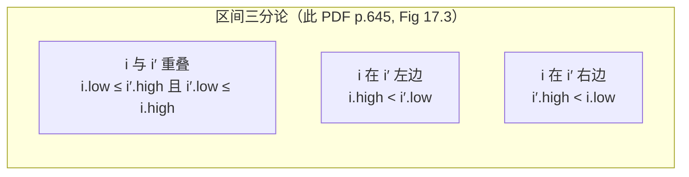
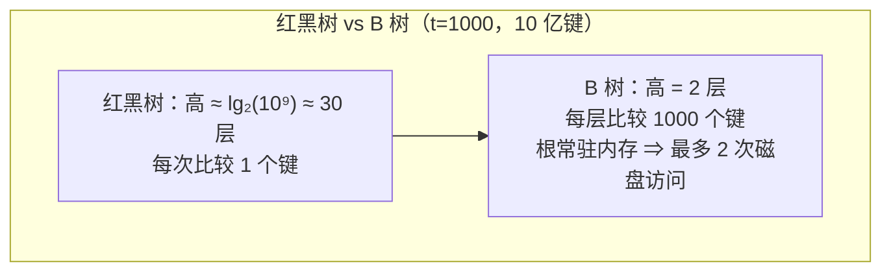
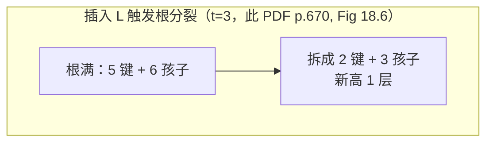

> **本篇范围**：第 17-19 章（Part V 高级数据结构）。三条主线：**怎么给现成数据结构"加挂件"**（红黑树扩充）、**怎么给磁盘设计平衡树**（B 树）、**怎么把"等价类合并"做到近乎线性**（并查集）。第 19 章是全书摊还分析的巅峰之作，也是竞赛/面试的常客。

## 一、扩充数据结构的方法论（§17.1-17.2）

### 四步扩充法

> **原文摘录**（§17.2，此 PDF p.641）
> "1. Choose an underlying data structure. 2. Determine additional information to maintain in the underlying data structure. 3. Verify that you can maintain the additional information for the basic modifying operations. 4. Develop new operations."

很少需要从零发明数据结构，大多数时候是**在教科书数据结构上加信息**。经典案例：红黑树每节点加 `x.size`（子树内节点数），升级成**顺序统计树**，支持 OS-SELECT / OS-RANK。

### 顺序统计树

```
OS-SELECT(x, i)                    // 返回 x 子树中第 i 小的节点
 1  r = x.left.size + 1            // x 在自己子树内的秩
 2  if i == r      return x
 4  elseif i < r   return OS-SELECT(x.left, i)
 6  else           return OS-SELECT(x.right, i − r)

OS-RANK(T, x)                      // 返回 x 在中序遍历中的位置
 1  r = x.left.size + 1
 2  y = x
 3  while y ≠ T.root
 4      if y == y.p.right          // y 是右孩子：把父亲和左兄弟整棵算进来
 5          r = r + y.p.left.size + 1
 6      y = y.p
 7  return r
```

两个都是 $O(\lg n)$（沿一条路径下行/上行）。**维护 size 不增加复杂度**：插入时下行路径上每个节点 size +1（$O(\lg n)$）；旋转只碰两个节点，各 $O(1)$ 重算；删除时移动路径上的节点 size −1。插入/删除仍是 $O(\lg n)$。

> 教材 Figure 17.1 的树中 OS-SELECT(root, 17)：根 26 的左子树大小 12 ⇒ 秩 13 ⇒ 去右子树找第 4 小；41 的左子树大小 5 ⇒ 秩 6 ⇒ 去左子树找第 4；30 秩 2 ⇒ 去右子树找第 2；38 的左子树大小 1 ⇒ 就是 38 自己。三步下行命中（此 PDF p.635-636）。

### Theorem 17.1：扩充红黑树的通用许可证

> **定理**（§17.2，此 PDF p.642）设属性 $f$ 满足：每个节点 $x.f$ 的值只依赖 $x$、$x.left$、$x.right$ 的信息（可含 $x.left.f$、$x.right.f$），且 $O(1)$ 时间可算。则插入删除可在不增加渐近复杂度的前提下维护所有 $f$。

证明核心：**改动只沿祖先链传播**。改 $x.f$ 至多影响 $x.p.f$，再影响 $x.p.p.f$……到根为止。红黑树高 $O(\lg n)$ ⇒ 传播 $O(\lg n)$；插入/删除只有 $O(1)$ 次旋转，每次旋转 $O(1)$ 个节点属性失效、重算后传播 $O(\lg n)$。合计仍是 $O(\lg n)$。

> 定理的隐藏前提：**每步旋转次数必须 O(1)**。教材特别提醒（此 PDF p.644）：有些平衡树方案（如 scapegoat、部分 BB[α] 树）单次操作可能要 $\Theta(\lg n)$ 次旋转，若每次旋转都向上传播 $O(\lg n)$，单操作就涨到 $\Theta(\lg^2 n)$——Theorem 17.1 的"免费午餐"就不成立了。

## 二、区间树（§17.3）

### 设计（四步法的完整示范）

维护一组闭区间，支持查询"哪个区间与 $i$ 重叠"（此 PDF p.645-648）：

1. **底层**：红黑树，**键 = 区间左端点** `x.int.low`（中序遍历即按左端点有序）；
2. **附加信息**：`x.max` = 以 $x$ 为根的子树中**所有区间右端点的最大值**；
3. **维护**：$x.\text{max} = \max\{x.\text{int}.\text{high},\ x.left.\text{max},\ x.right.\text{max}\}$ ——满足 Theorem 17.1 的局部依赖，$O(1)$ 更新，插入删除 $O(\lg n)$；
4. **新操作**：INTERVAL-SEARCH。

### INTERVAL-SEARCH：只走一条路径

```
INTERVAL-SEARCH(T, i)
 1  x = T.root
 2  while x ≠ T.nil and i does not overlap x.int
 3      if x.left ≠ T.nil and x.left.max ≥ i.low
 4          x = x.left      // 左子树可能重叠；或右子树一定不重叠
 5      else
 6          x = x.right     // 左子树一定不重叠
 7  return x
```

复杂度 $O(\lg n)$。正确性（Theorem 17.2，此 PDF p.649-651）的两种走向：

- **向右走**（第 5 行）：已知 $x.left = T.nil$ 或 $x.left.\text{max} < i.low$。左子树任何区间 $i'$ 都有 $i'.\text{high} \le x.left.\text{max} < i.low$ ⇒ 与 $i$ 不重叠。**右走绝不错过**。
- **向左走**（第 4 行）：设左子树有区间 $i'$ 达到 $i'.\text{high} = x.left.\text{max} \ge i.low$。若 $i'$ 不与 $i$ 重叠，则由三分论 $i.\text{high} < i'.\text{low}$。又左子树一切区间左端 $\le x.\text{int}.\text{low} \le$ 右子树一切区间左端，所以 $i.\text{high} < i''.\text{low}$（$i''$ 为右子树任一区间）⇒ 右子树也不重叠。**左走绝不错过**。



> 应用场景：日程冲突检测（会议时间区间）、VLSI 矩形重叠检测（Ex 17.3-6 扫描线 $O(n\lg n)$）、数据库时间段检索。

## 三、B 树：为磁盘而生的平衡树（§18）

### 为什么不能用红黑树管磁盘

磁盘是机械设备：7200 RPM 转一圈 8.33 ms，而主存访问约 50 ns——**差 5 个数量级**（此 PDF p.657）。一次磁盘访问（寻道 + 旋转，约 4 ms）期间 CPU 能访问主存 10 万次。而且磁盘按块读写（512-4096 字节），读一个块的边际成本远低于再寻道一次。

结论：**要按"磁盘访问次数"计费，而不是按比较次数**。B 树把节点做得尽量大（一整个磁盘块），用高度换宽度：



Figure 18.3 的 B 树：分支因子 1001、高 2、10 亿多键，根留内存 ⇒ **任意查找至多 2 次磁盘访问**。

### B 树的定义（§18.1，此 PDF p.661-663）

最小度数 $t \ge 2$ 的参数化：

| 属性 | 约束 |
|---|---|
| 键数（根除外） | $t-1 \le x.n \le 2t-1$ |
| 根键数 | $\ge 1$（树非空时） |
| 内部节点孩子数 | $x.n+1$（即 $t \sim 2t$ 个） |
| 叶子深度 | 全部相同 |
| 键序 | 节点内升序；第 $i$ 棵子树的键夹在 $\text{key}_{i-1}$ 与 $\text{key}_i$ 之间 |

$t=2$ 时即 2-3-4 树。**Theorem 18.1**：$n$ 键 B 树高 $h \le \log_t\frac{n+1}{2}$（证明：最"瘦"的树每层至少 $1, 2, 2t, 2t^2, \dots$ 个节点，$n \ge 1 + 2(t-1)\sum_{i=1}^{h-1}t^{i-1} = 2t^{h-1}-1$）。

### 查找与插入（§18.2）

**查找**就是多路 BST：节点内线性扫出 $k$ 的位置（$O(t)$ CPU），命中或递归到对应孩子。$O(h)$ 次磁盘访问、$O(t\log_t n)$ CPU。

**插入的难点**：不能新造叶子（会破坏"叶子同深"和键数下界），只能往已有叶子里插；叶子可能满（$2t-1$ 键）。**解法：自上而下，遇到满节点就拆**。

```
B-TREE-SPLIT-CHILD(x, i)          // x 非满，x.ci 是满孩子（2t−1 键）
   y = x.ci                        // 满节点
   z = 新节点
   z.leaf = y.leaf;  z.n = t − 1
   for j = 1 to t − 1:  z.keyj = y.key_{j+t}    // z 拿 y 最大的 t−1 个键
   if not y.leaf: for j = 1 to t:  z.cj = y.c_{j+t}  // 及对应孩子
   y.n = t − 1                     // y 只剩最小的 t−1 个键
   x 的孩子指针表右移，插入 z 于 ci+1
   x 的键表右移，x.keyi = y.keyt    // 中位数上升到 x
   x.n = x.n + 1
```

满孩子 $y$ 被中位数切成两半各 $t-1$ 键，中位数上升为分割键。**树长高只发生在根分裂时**（B-TREE-SPLIT-ROOT），且从顶部长，不像 BST 从底部长。

```
B-TREE-INSERT(T, k)
  r = T.root
  if r.n == 2t − 1                 // 根满：先拆根，树高 +1
      s = B-TREE-SPLIT-ROOT(T)
      B-TREE-INSERT-NONFULL(s, k)
  else B-TREE-INSERT-NONFULL(r, k)

B-TREE-INSERT-NONFULL(x, k)        // 保证不递归进满节点
  if x.leaf: 就地后移插入 k
  else:
      找到孩子 ci
      DISK-READ(x.ci)
      if x.ci.n == 2t − 1:         // 孩子满？先拆
          B-TREE-SPLIT-CHILD(x, i)
          if k > x.keyi: i = i + 1 // k 落进右半边
      B-TREE-INSERT-NONFULL(x.ci, k)
```

一次下行、$O(h)$ 磁盘访问、$O(t\log_t n)$ CPU。**"先拆后下"是单遍算法的关键**：保证递归到达的任何节点都非满，不需要回溯。



### 删除（§18.3，此 PDF p.676-679）

删除比插入麻烦：键可能在内部节点；且要防止路径上节点**跌破下界**（少于 $t-1$ 键）。策略同样是一遍下行：**递归前保证目标孩子至少有 $t$ 个键**（比下界多一个，删一个也不破界）。三种大情形：

| 情形 | 处理 |
|---|---|
| 1. 到叶子 | 直接删（叶子里的键不需要补位） |
| 2. 内部节点含 $k$ | 2a：左孩子 $\ge t$ 键 ⇒ 用前驱顶替，递归删前驱；2b：右孩子 $\ge t$ 键 ⇒ 用后继顶替；2c：左右都 $t-1$ ⇒ $k$ 与右孩子**合并**进左孩子（$2t-1$ 键），再递归删 |
| 3. 内部节点不含 $k$ | 3a：目标孩子 $t-1$ 键但有富余兄弟 ⇒ 父亲下一个键、兄弟上一个键，转嫁一个（旋转）；3b：兄弟都穷 ⇒ 与一个兄弟**合并**（父亲下一个键作中位数） |

合并可能让父亲少一个键——所以"递归前先保证 $t$ 个键"的口子要一路带下去。根被掏空时删根、孩子升根，树高 −1。全过程 $O(h)$ 磁盘访问。

> 直观记忆：**插入防"太胖"（遇满先拆），删除防"太瘦"（遇穷先借/并）**；借不到就合并，和 2-3 树、B+ 树数据库索引的行为一脉相承。

## 四、并查集：从链表到森林（§19）

### 问题与应用

维护不相交动态集合：MAKE-SET / UNION / FIND-SET（此 PDF p.683-684）。典型应用：**连通分量**——每顶点一个集合，每条边做一次 UNION，之后 SAME-COMPONENT 一问即答。边动态增补时比反复 DFS 划算。

### 链表表示 + 加权合并（§19.2）

每集合一条链表，头结点存 head/tail/length，成员回指集合对象。FIND-SET $O(1)$，UNION 要改被并链表所有成员的回指指针——**朴素 UNION 单次 $O(n)$，经典序列 $\Theta(n^2)$**（第 $i$ 次 UNION 改 $i$ 个指针，Figure 19.3）。

**加权合并**（weighted union）：永远把短表并到长表。此时任一成员 $x$ 的指针每被改一次，它所在集合至少翻倍 ⇒ 每个成员至多被改 $\lceil \lg n \rceil$ 次。

> **Theorem 19.1**（此 PDF p.690）：链表 + 加权合并，$m$ 个操作（$n$ 个 MAKE-SET）总时间 $O(m + n\lg n)$。

### 森林表示：按秩合并 + 路径压缩（§19.3）

```
MAKE-SET(x):  x.p = x;  x.rank = 0
LINK(x, y):   // x, y 是根
  if x.rank > y.rank:  y.p = x
  else:                x.p = y
  if x.rank == y.rank: y.rank = y.rank + 1   // 等秩： arbitrarily 选父，秩 +1
UNION(x, y):  LINK(FIND-SET(x), FIND-SET(y))
FIND-SET(x):  // 两趟：上去找根，下来把沿途节点挂到根下
  if x ≠ x.p:  x.p = FIND-SET(x.p)
  return x.p
```

两条启发式：

- **按秩合并**（union by rank）：rank 是高度的上界（不是精确高度！），矮树根挂到高树根下；秩只增不减，等秩合并时当选父的秩 +1。
- **路径压缩**（path compression）：FIND-SET 回程途中，把路径上每个节点的父亲直接改成根。树被"压扁"，后续 FIND 飞快。

单用按秩合并 $O(m\lg n)$ 且紧（Ex 19.3-3）；单用路径压缩 $\Theta(n + f(1+\log_{2+f/n} n))$；**两个一起用：$O(m\,\alpha(n))$**（此 PDF p.696）。

### $\alpha(n)$ 有多小（§19.4，此 PDF p.697-699）

定义 $A_k(j)$（$k$ 为层级）：

$$A_0(j) = j+1,\qquad A_k(j) = A_{k-1}^{(j+1)}(j)\ \ (k \ge 1)$$

$$A_1(j) = 2j+1,\qquad A_2(j) = 2^{j+1}(j+1)-1,\qquad A_3(j) = A_2(A_2(j)) = 2^{2^{j+1}(j+1)} - 1\ (\text{近似})$$

$$\alpha(n) = \min\{k : A_k(1) \ge n\}$$

代入 $j=1$：$A_0(1)=2$，$A_1(1)=3$，$A_2(1)=7$，$A_3(1)=2047$，$A_4(1) > 2^{2056} \gg 10^{80}$（**可观测宇宙原子数**）！

$$\alpha(n) \le 4\ \ \text{对所有现实中的 } n$$

**任何能塞进计算机的问题，$\alpha(n)$ 至多 4**。所以 $O(m\alpha(n))$ 本质上是线性——但数学上它确实是超线性的，这个"几乎线性"的证明是全书最难的摊还分析。

### 证明骨架（此 PDF p.700-708）

用势能法。每个节点 $x$（非根且 rank ≥ 1）的势能：

$$\phi_q(x) = \big(\alpha(n) - \text{level}(x)\big)\cdot x.\text{rank} - \text{iter}(x)$$

其中 $\text{level}(x)$ = 使 $A_k(x.\text{rank}) \le x.p.\text{rank}$ 的最大 $k$（$0 \le \text{level} < \alpha(n)$），$\text{iter}(x)$ = 从 $x.\text{rank}$ 起反复施加 $A_{\text{level}(x)}$ 而不超过 $x.p.\text{rank}$ 的最大次数。

三条关键引理：

- **Lemma 19.10**：非根节点的势能在 LINK/FIND-SET 后不增；若 rank ≥ 1 且 level 或 iter 变了，势能至少降 1。
- **Lemma 19.12**（LINK）：最多让新根的势能涨 $\alpha(n)$ ⇒ 摊销 $O(\alpha(n))$。
- **Lemma 19.13**（FIND-SET）：长度为 $s$ 的查找路径上，至少 $\max\{0, s-(\alpha(n)+2)\}$ 个节点势能降 1 ⇒ 摊销成本 $O(s) - (s-\alpha(n)-2) = O(\alpha(n))$。

直观图像：**rank 像"海拔"，level 是节点按海拔分的档（最多 $\alpha(n)$ 档）。路径压缩把同一档的节点拉平到同一父亲下，每个被拉平的节点"档内迭代次数"iter 增加、势能释放 1**。查找路径上同档节点至多 $\alpha(n)+2$ 个（每档最后一个 + 首尾），其余都释放势能——这就是 $s$ 被抵消掉的原因。

> **Theorem 19.14**：$m$ 个操作（$n$ 个 MAKE-SET）总时间 $O(m\alpha(n))$。按秩合并保证秩沿路径严格递增、路径不缩水；路径压缩保证同层节点被批量拉平。两兄弟一个管"高度"、一个管"宽度"，缺一不可。

## 五、例题精讲

### 例题 A（基础）★ Ex 17.1-3：非递归 OS-SELECT

把 OS-SELECT 改成循环版。
<details>
<summary>答案</summary>
```
OS-SELECT-ITER(T, i)
  x = T.root
  while true
      r = x.left.size + 1
      if i == r     return x
      if i < r      x = x.left
      else          x = x.right;  i = i − r
```
尾递归转循环，$O(1)$ 空间。
</details>

### 例题 B（基础）★ Ex 17.2-3：旋转后 O(1) 维护"聚合属性"

设 $\otimes$ 是结合律二元算子，节点属性 $x.f$ = $x$ 子树中序遍历所有节点的 $a$ 值做 $\otimes$。证明旋转后 $O(1)$ 更新 $f$，并说明 size 是特例。
<details>
<summary>答案</summary>
左旋（LEFT-ROTATE(T, x)，$y = x.right$ 上位）：旋转前 $x.f = A_L \otimes x.a \otimes B \otimes y.a \otimes C$，$y.f = B \otimes y.a \otimes C$（$B$、$C$ 为两棵子树的聚合值）。旋转后 $y$ 的左孩子是 $x$，则
- 先算 $x.f_{\text{new}} = A_L \otimes x.a \otimes B$（用 $x$ 新左右孩子的 $f$ 值，各一次 $\otimes$）；
- 再算 $y.f_{\text{new}} = x.f_{\text{new}} \otimes y.a \otimes C$。
各 $O(1)$。size 对应 $\otimes = +$、$a = 1$：$x.\text{size} = x.left.\text{size} + x.right.\text{size} + 1$，正是第 1 节的旋转更新式。
</details>

### 例题 C（进阶）★ Ex 18.1-4：B 树最大键数

最小度数 $t$、高 $h$ 的 B 树最多存多少键？
<details>
<summary>答案</summary>
每节点最多 $2t-1$ 键：根 1 个、第 1 层 $2t$ 个、第 2 层 $(2t)^2$ 个……第 $h$ 层 $(2t)^h$ 个。

$$n_{\max} = 1 + (2t-1)\sum_{i=1}^{h}(2t)^i = 1 + (2t-1)\cdot\frac{2t\,((2t)^h-1)}{2t-1} = 1 + 2t\big((2t)^h - 1\big) = 2t(2t)^h - 2t + 1$$

与 Theorem 18.1 的下界 $n \ge 2t^{h-1}-1$ 对照：上下界差 $(2t)^h$ 与 $t^h$ 的因子，差一个 $2^h$。
</details>

### 例题 D（进阶）★ 自编模拟：t=2 连续插入的节点分裂计数

空 B 树（$t=2$）依次插入 $1,2,\dots,n$，根分裂几次？
<details>
<summary>答案</summary>
根分裂发生在"根满（3 键）且还要往下插"时。序列插入使树尽量"右倾"，根在键数达到 $1, 3, 7, 15, \dots$ 即 $2^k-1$ 时满。所以根分裂次数 = 满足 $2^k - 1 \le n$ 的 $k \ge 2$ 的个数 $\approx \lg n$。更一般地（Ex 18.2-4）：最终树有 $n - \lceil \lg(n+1)\rceil + 1$ 个节点左右（每键入一棵树，每次分裂 +1 节点，共分裂 $n-1$ 次减去最终根的唯一性，精确计数需要对合并模式分情况）。关键 insight：**顺序插入与随机插入的分裂节奏不同，但总分裂次数 = 总插入次数 − 最终节点数 + 1**，与顺序无关。
</details>

### 例题 E（进阶）★ Ex 19.2-3：链表并查集的摊销界

把 Theorem 19.1 的证明改造成"每次操作"的摊销表述：MAKE-SET/FIND-SET 摊销 $O(1)$，UNION 摊销 $O(\lg n)$。
<details>
<summary>答案</summary>
总时间 $O(m + n\lg n)$ 中，$m$ 项均摊到全部操作；$n\lg n$ 项全部来自 UNION（指针更新只发生在 UNION），而 UNION 至多 $n-1$ 次 ⇒ 每次 UNION 分 $O(\lg n)$，其余操作 $O(1)$。势能法视角：设 $\Phi$ = 所有 $\lceil \lg(\text{size of } x\text{'s set})\rceil$ 之和。MAKE-SET：$\Delta\Phi = 0$，摊销 $O(1)$；FIND-SET：不改结构，摊销 $O(1)$；UNION：短表成员各"升级"一档，代价 = 升级人数 = $\Delta\Phi$（每个升级的成员 $\lceil\lg\text{size}\rceil$ 恰 +1）⇒ 摊销 $O(1) + O(\lg n)$（等号取成员数变化上界）。殊途同归。
</details>

### 例题 F（进阶）★ Ex 19.3-5：先并后查的线性界

若所有 LINK 都出现在所有 FIND-SET 之前，证明路径压缩 + 按秩合并下 $m$ 个操作仅 $O(m)$。只用路径压缩（不按秩）会怎样？
<details>
<summary>答案</summary>
**双启发式**：设 LINK 阶段势能为 0 起。FIND-SET 阶段，Lemma 19.10 保证非根节点势能不增，Lemma 19.13 保证路径上至少 $s - (\alpha(n)+2)$ 个节点降 1。把势能初始设为 $m$（每个操作预算 1 点），前 $n-1$ 个 LINK 共让势能涨 $\le (n-1)\alpha(n)$，用"放大常数"技巧（Ex 19.4-6：势能定义整体乘 $c$）可把 LINK 的 $\alpha(n)$ 涨幅也吃掉。总摊销 $\le O(m)$。

**只用路径压缩**：不按秩合并时树可能退化成链，单次 FIND-SET 实际成本 $\Theta(n)$，$n$ 次 FIND-SET 总成本 $\Theta(n^2)$。按秩合并在这里起的作用是**给 rank 一个严格递增的"档位"结构**，没有它，level/iter 的计数论证（每档节点数的上界）就崩了。
</details>

## 六、习题与答案

**习题 1** ★（Ex 17.1-7，此 PDF p.640）用顺序统计树在 $O(n\lg n)$ 时间计数一个 $n$ 元排列的逆序对。

<details>
<summary>答案</summary>
从左到右依次插入元素。插入 $a_i$ 前，先查树中已插入的 $i-1$ 个元素里有多少 $> a_i$：$= (i-1) - \text{OS-RANK}(a_i) + 1$（rank 定义为"若插入会排在第几"）。或者：逆序对数 = $\sum_i (\text{已插入且} > a_i \text{的数量})$。用 OS-RANK 每次 $O(\lg n)$，插入 $O(\lg n)$，总 $O(n\lg n)$。等价于第 2 章归并排序的逆序对计数，但这里是动态版本（支持中途删除元素重算）。
</details>

**习题 2** ★（Ex 18.1-1，此 PDF p.663）为什么不允许最小度数 $t=1$？

<details>
<summary>答案</summary>
$t=1$ 时每个非根节点键数须在 $[0, 1]$，内部节点孩子数在 $[1, 2]$。节点可以只有 0 个键 1 个孩子——既占空间又不提供任何"分割"作用，且"满节点"（$2t-1=1$ 键）拆开后两边各 0 键，树的平衡性名存实亡。B 树的效率来自**节点至少半满**，$t=1$ 把这个保证抹掉了。
</details>

**习题 3** ★★（Ex 18.3-1 变体）B 树删除情形 2c（合并）之后，为什么还能维持单遍下行？递归删除 $k$ 时新节点有 $2t-1$ 键，会不会又超上限？

<details>
<summary>答案</summary>
合并发生在"左右孩子都只有 $t-1$ 键"时：$k$（父亲里的 1 个键）$+ (t-1) + (t-1) = 2t-1$，**恰好等于上限 $2t-1$**，不超。之后对这个 $2t-1$ 键的节点递归删 $k$：B-TREE-DELETE 的入口条件保证被递归的节点至少有 $t$ 个键（这正是"递归前保证 $t$ 键"承诺的来源），而 $2t-1 \ge t$，安全。删除从里面拿走一个键剩 $2t-2$，若节点不是递归路径上后续被合并的对象就没事；若后续还要从它这里借/并，父节点会先按情形 3a/3b 处理。
</details>

**习题 4** ★★（Ex 19.4-2，此 PDF p.708）证明按秩合并下每节点 rank $\le \lfloor \lg n \rfloor$。

<details>
<summary>答案</summary>
归纳：rank 为 $r$ 的节点子树至少有 $2^r$ 个节点。基例 $r=0$（单节点，1 个）。归纳：节点 $x$ 秩变为 $r$ 只发生在 LINK 中等秩合并（两个秩 $r-1$ 的根合并，新根秩 $r$）。设被合并的两根子树大小至少 $2^{r-1}$ 各，合并后至少 $2^r$。此后 $x$ 作为根的子树只会更大。全集 $n$ 个节点 ⇒ $2^r \le n$ ⇒ $r \le \lfloor \lg n\rfloor$。
</details>

**习题 5** ★★（自编模拟）区间树中，若把键改成"右端点"、max 改成"子树左端点最小值"，INTERVAL-SEARCH 要怎么改？

<details>
<summary>答案</summary>
对称版本：节点键 = `x.int.high`，附加 `x.min` = 子树左端点最小值。搜索 $i$ 时：若当前区间不重叠 $i$，检查右孩子 `x.right.min ≤ i.high`——若成立说明右子树可能有区间伸进 $i$ 的左边界以内，走右；否则走左。正确性证明与 Theorem 17.2 完全对称（三分论左右互换、max/min 互换）。要点：**附加属性必须指向"键的反方向"**——键管左端，max 就要覆盖右端，才能让搜索在一个方向上做"安全检查"。
</details>

**习题 6** ★★★（Ex 19-1 变体，此 PDF p.709）离线最小值：序列 `4, 8, E, 3, E, 9, 2, 6, E, E, E, 1, 7, E, 5`，求每次 E 返回的键。

<details>
<summary>答案</summary>
按"两次 E 之间的 INSERT 段"分组：
- $I_1 = \{4,8\}$，E → 返回 4；剩余 $\{8\}$ 并入下一段
- $I_2 = \{8,3\}$，E → 返回 3；剩余 $\{8\}$ 并入下一段
- $I_3 = \{9,2,6\}$，E → 2；E → 6；剩余 $\{9\}$ 并入下一段
- $I_4 = \{9,1,7\}$，E → 1；剩余 $\{9,7\}$ 并入下一段
- $I_5 = \{9,7,5\}$，E → 5

extracted = [4, 3, 2, 6, 1, 5]。这正是 OFFLINE-MINIMUM 的并查集实现：$K_j$ 集合、每次 E 取最小后把剩余并到下一个 $K_l$（"并查集指针跳过已处理段"），总 $O(n\alpha(n))$——并查集又立功了。
</details>

---

**本篇小结**：扩充数据结构的通用许可证是"属性局部依赖"（Theorem 17.1）；B 树用"大节点 + 预分裂/预合并"把平衡树的高度对数底数从 2 抬到 $t$，换取磁盘访问次数；并查集用"按秩合并管高度、路径压缩管宽度"的二元启发式，配合全书最精妙的势能函数，把近乎平凡的操作压到 $O(m\alpha(n))$。下一篇进入图算法：BFS/DFS、拓扑排序与强连通分量。
