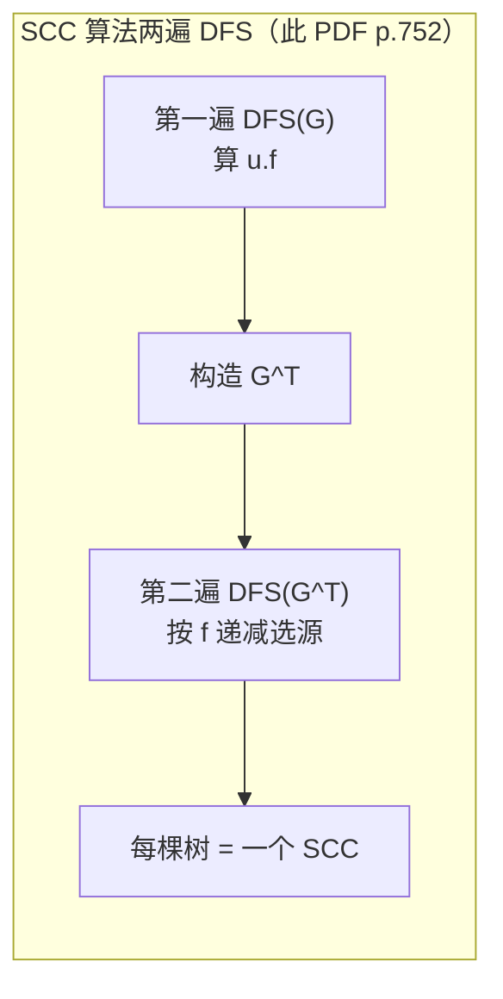

> **本篇范围**：第 20 章（Part VI 图算法开篇）。这一章是全书的"图论入口"：两种表示法、两种搜索（BFS/DFS）、两个 DFS 杀手级应用（拓扑排序、强连通分量）。后面所有图算法——MST、最短路、最大流——都建立在这两种搜索的骨架之上。

## 一、图的表示（§20.1）

| 表示法 | 空间 | 单边查询 | 遍历全图 | 适用 |
|---|---|---|---|---|
| 邻接表 | $\Theta(V+E)$ | $O(\deg v)$ | $\Theta(V+E)$ | **稀疏图**（$|E| \ll V^2$），本书默认 |
| 邻接矩阵 | $\Theta(V^2)$ | $O(1)$ | $\Theta(V^2)$ | **稠密图**、需快速判边的算法（如全源最短路） |

约定（全书通用）：**大 $O$ 里的 $V$ 表示 $|V|$、$E$ 表示 $|E|$**（此 PDF p.717）。无向图每条边在邻接表里出现两次，所以邻接表总长度 $2|E|$；有向图 $|E|$。无向图的邻接矩阵沿对角线对称（$A = A^T$），可以只存上三角省一半空间。

## 二、广度优先搜索 BFS（§20.2）

### 算法：队列 + 三色标记

BFS 从源点 $s$ 出发**逐层（波前）扩散**：先发现所有距离 1 的，再距离 2 的……用一个 FIFO 队列维护波前（队列里至多相邻两层的顶点）。顶点三色：**白**（未发现）、**灰**（已发现在队列里/波前上）、**黑**（邻表扫完、退出波后）。

```
BFS(G, s)
 1  for each u ∈ G.V – {s}:  u.color = WHITE; u.d = ∞; u.π = NIL
 5  s.color = GRAY; s.d = 0; s.π = NIL
 8  Q = ∅;  ENQUEUE(Q, s)
10  while Q ≠ ∅
11      u = DEQUEUE(Q)                    // 队头出列
12      for each v ∈ G.Adj[u]             // 扫 u 的邻居
13          if v.color == WHITE           // 白 ⇒ 刚被发现
14              v.color = GRAY
15              v.d = u.d + 1             // 距离 = 父距离 + 1
16              v.π = u
17              ENQUEUE(Q, v)             // 入队，进入下一层
18      u.color = BLACK                   // u 退出波前
```

### 正确性证明：三引理链条

这是全书证明的典范，层层递进：

**Lemma 20.1**（最短距离的基本性质）：对任意边 $(u,v)$，$\delta(s,v) \le \delta(s,u) + 1$。显然：最短 $s\to u$ 路径接一条边就是 $s \to v$ 的路。

**Lemma 20.2**（$v.d$ 始终是上界）：$v.d \ge \delta(s,v)$ 恒成立。归纳：$v.d$ 只在第 15 行被赋值为 $u.d+1$，而 $u.d \ge \delta(s,u)$（归纳假设）+ Lemma 20.1 ⇒ $v.d \ge \delta(s,v)$。

**Lemma 20.3**（队列的单调性）：队列里 $v_1, \dots, v_r$（$v_1$ 是头）满足 $v_r.d \le v_1.d + 1$ 且 $v_i.d \le v_{i+1}.d$。即队列里的 $d$ 值形如 $\langle k, k, \dots, k, k+1, \dots, k+1 \rangle$——**至多两层**。归纳：出队删头不破坏；入队的新元素 $d$ = 刚出队元素 $u.d + 1 \le v_1.d + 1$。

**Corollary 20.4**：入队顺序按 $d$ 非降。

**Theorem 20.5**（BFS 正确性）：终止时 $v.d = \delta(s,v)$。反证：取 $\delta$ 最小而 $v.d > \delta(s,v)$ 的 $v$。设最短路 $s \to v$ 上 $v$ 的前驱是 $u$，则 $u.d = \delta(s,u)$（最小性）。$u$ 出队时 $v$ 必已被发现（否则第 15 行会让 $v.d = u.d+1$），且 $v.d = w.d + 1$（$w$ 是发现 $v$ 的顶点）。由 Corollary 20.4，$w.d \le u.d$ ⇒ $v.d \le u.d + 1 = \delta(s,v)$，矛盾。

> 一句话记忆 BFS 证明：**Lemma 20.2 管下界、队列单调性管上界，两头一夹就等**。

**Lemma 20.6**：前驱子图 $G_\pi$ 是一棵 BFS 树，树上 $s \to v$ 的路径就是最短路径。

**复杂度**：每顶点入/出队各一次 $O(V)$，每邻表扫一次合计 $\Theta(E)$ ⇒ **$O(V+E)$**，与邻接表规模线性。

> BFS 的变体极多：Prim 的最小生成树、Dijkstra 的最短路都是"BFS + 优先队列"的换核版；二分图判定（Ex 20.2-7 摔跤手正反派）也是 BFS 分层染色的直接应用。

## 三、深度优先搜索 DFS（§20.3）

### 算法：递归栈 + 双时间戳

DFS 尽可能往深处走，走不动了回退。每个顶点两个时间戳：**$v.d$ 发现时间**（涂灰）和 **$v.f$ 完成时间**（涂黑），全局计数器 $1 \sim 2|V|$。

```
DFS(G)
 1  for each u ∈ G.V:  u.color = WHITE; u.π = NIL
 4  time = 0
 5  for each u ∈ G.V                     // 多个源点：白顶点就开新树
 6      if u.color == WHITE
 7          DFS-VISIT(G, u)

DFS-VISIT(G, u)
 1  time = time + 1;  u.d = time          // 发现
 3  u.color = GRAY
 4  for each v ∈ G.Adj[u]                 // 逐条探索边 (u, v)
 5      if v.color == WHITE
 6          v.π = u
 7          DFS-VISIT(G, v)
 8  time = time + 1;  u.f = time          // 完成
10  u.color = BLACK
```

$\Theta(V+E)$。DFS 森林可能有多棵树（多个源点），这正是它能"分解图"的原因。

### 括号定理与结构性质

**Theorem 20.7（括号定理）**（此 PDF p.740-741）：任意两顶点 $u, v$ 的时间区间 $[u.d, u.f]$ 与 $[v.d, v.f]$ 必满足以下之一：

1. 两区间**完全不相交** ⇒ 互不为后代；
2. $[u.d, u.f] \subset [v.d, v.f]$ ⇒ $u$ 是 $v$ 的后代；
3. $[v.d, v.f] \subset [u.d, u.f]$ ⇒ $v$ 是 $u$ 的后代。

想象每个顶点的生命周期是一对括号：发现时打 `(`，完成时打 `)`——**括号必然正确嵌套**。

**Corollary 20.8**：$v$ 是 $u$ 的真后代 $\iff u.d < v.d < v.f < u.f$。

**Theorem 20.9（白色路径定理）**（此 PDF p.742）：$v$ 是 $u$ 的后代 $\iff$ 在时刻 $u.d$，存在一条从 $u$ 到 $v$ 的**全白顶点路径**。这是后续 SCC 证明的发动机。

### 四类边

| 边类型 | 定义 | 发现时 $v$ 的颜色 |
|---|---|---|
| 树边 (T) | 进入 DFS 森林的边 | **白** |
| 回边 (B) | 连到祖先（有向图自环也算） | **灰** |
| 前向边 (F) | 连到真后代（非树边） | 黑 |
| 交叉边 (C) | 其他（同树非祖先关系，或跨树） | 黑 |

判定细则（Ex 20.3-5）：树/前向边 $\iff u.d < v.d < v.f < u.f$；回边 $\iff v.d \le u.d < u.f \le v.f$；交叉边 $\iff v.d < v.f < u.d < u.f$。

**Theorem 20.10**：**无向图的 DFS 只有树边和回边**，没有前向边和交叉边（因为 $(u,v)$ 和 $(v,u)$ 是同一条边，第二次看到时对方必然是灰的祖先）。

## 四、拓扑排序（§20.4）

DAG（有向无环图）的拓扑排序：线性排列使所有边从左指向右。经典意象：穿衣顺序（内裤在裤子前，袜子与裤子无序）。

**Lemma 20.11**：$G$ 无环 $\iff$ DFS 不产生回边。
（⇒：回边 $(u,v)$ + 树上路径 $v \to u$ = 环。⇐：设环上第一个被发现的顶点 $v$，环上其余顶点在 $v.d$ 时刻全白 ⇒ 白色路径定理 ⇒ 全是 $v$ 的后代 ⇒ 环的最后一条边 $(u,v)$ 是回边。）

**算法简单得惊人**：跑 DFS，**按完成时间 $f$ 从大到小输出**（等价于"每个顶点完成时插到链表头部"）。

```
TOPOLOGICAL-SORT(G)
 1  DFS(G) 计算每个顶点的 v.f
 2  每完成一个顶点，把它插入链表头部
 3  返回链表
```

**Theorem 20.12**：若 $(u,v) \in E$ 则 $v.f < u.f$，故逆完成序就是拓扑序。证明：DFS 探索 $(u,v)$ 时 $v$ 不可能是灰的（否则是回边，与 Lemma 20.11 矛盾）；$v$ 白则成 $u$ 后代 ⇒ $v.f < u.f$；$v$ 黑则早已完成，$u.f$ 尚未赋值 ⇒ $v.f < u.f$。

$\Theta(V+E)$。另一种实现（Ex 20.4-5）：反复输出入度 0 的顶点并删除出边（Kahn 算法），也是 $O(V+E)$；**有环时它会提前卡住**（输出不完所有顶点）——这反而是环检测的一种方式。

## 五、强连通分量 SCC（§20.5）

### 问题与转置

SCC = 互相可达的最大顶点集。关键工具：**转置图 $G^T$**（所有边反向）。$G$ 与 $G^T$ 的 SCC 完全相同（互相可达是对称关系）。构造 $G^T$ 邻接表 $\Theta(V+E)$。

**Lemma 20.13**（SCC 的"单行道"性质）：$C, C'$ 不同 SCC，若有路径 $u \leadsto u'$（$u\in C, u'\in C'$），则**不可能**有 $v' \leadsto v$。否则 $u$ 与 $v'$ 互相可达，合并成一个 SCC，矛盾。⇒ **分量图 $G_{SCC}$ 必为 DAG**。

### 算法：两次 DFS

```
STRONGLY-CONNECTED-COMPONENTS(G)
 1  DFS(G)                     // 第一遍：算完成时间 u.f
 2  构造 G^T
 3  DFS(G^T)，主循环按 u.f 递减顺序选源点
 4  第二遍 DFS 森林里每棵树 = 一个 SCC
```

$\Theta(V+E)$：两遍 DFS + 一次转置，全是线性。

### 为什么有效：Lemma 20.14 是灵魂

**Lemma 20.14**（此 PDF p.753-754）：$C \ne C'$ 是两个 SCC，若有边 $(u,v) \in E$ 且 $u \in C'$、$v \in C$，则 $f(C') > f(C)$（$f(X) = \max\{x.f : x \in X\}$）。

证明分两种情况，都用白色路径定理：

1. $d(C') < d(C)$：$C'$ 里第一个被发现的 $x$ 在时刻 $x.d$ 时全图皆白；从 $x$ 有全白路径到 $C'$ 所有顶点，且经边 $(u,v)$ 到 $C$ 所有顶点（$x \leadsto u \to v \leadsto w$）⇒ $C \cup C'$ 全是 $x$ 的后代 ⇒ $x.f = f(C')$ 大于所有后代的 $f$ ⇒ $f(C') > f(C)$。
2. $d(C') > d(C)$：$C$ 第一个被发现的 $y$ 把 $C$ 全收为后代，$y.f = f(C)$；$C'$ 在 $y.d$ 时全白且不可从 $y$ 达（否则 Lemma 20.13 矛盾）⇒ $y$ 完成时 $C'$ 仍全白 ⇒ $C'$ 顶点的 $f$ 都 $> y.f = f(C)$ ⇒ $f(C') > f(C)$。

**Corollary 20.15**：若 $f(C) > f(C')$，则 $G^T$ 中没有从 $C$ 到 $C'$ 的边。（把 Lemma 20.14 用在 $G^T$ 上。）

**Theorem 20.16**：第二遍 DFS 每棵树恰是一个 SCC。归纳：从 $f$ 最大的 SCC 根出发，$G^T$ 里没有出边通向未访问分量（Corollary 20.15），所以搜索被困在这一个分量内；后续每个新根同理。

> 直觉：**第一遍 DFS 按"完成时间"给 SCC 排了个拓扑序的逆序；第二遍在转置图上按这个顺序出发，每个分量就是一个封闭陷阱**。第二遍 DFS 遍历 $G^T$ 的分量图时，相当于按逆拓扑序访问。



## 六、例题精讲

### 例题 A（基础）★ Ex 20.1-8 变体：哈希邻接表

邻接表的每项换成哈希表，单次边查询期望 $O(1)$。有什么缺点？更好的替代？

<details>
<summary>答案</summary>
缺点：(1) 每次遍历邻接表时哈希的常数因子和缓存不友好（遍历退化为 $O(\deg)$ 但常数大）；(2) 均匀哈希假设不总成立（对抗性键）；(3) 遍历顺序不固定，影响 DFS/BFS 等依赖邻接顺序的算法的可复现性；(4) 空间开销（桶数组、装载因子）。替代：每项用**平衡 BST / 跳表**，查询 $O(\lg \deg)$ 最坏保证、遍历有序；或**有序数组 + 二分**（静态图），查询 $O(\lg \deg)$、缓存友好。静态图甚至可以把整个邻接表拍平成 CSR（压缩稀疏行）数组，查询用二分。
</details>

### 例题 B（基础）★ Ex 20.2-8：树的直径

$O(V+E)$ 求树的最大最短路径（直径）。
<details>
<summary>答案</summary>
经典两遍 BFS/DFS：任取 $u$，找最远点 $a$；再从 $a$ 找最远点 $b$；$\delta(a,b)$ 即直径。证明：设最远对为 $(x,y)$。可证从任意 $u$ 出发的最远点必是某条直径的端点（反证：若最远点 $a$ 不是直径端点，用直径路径与 $u\to a$ 路径的分叉点构造更远的点）。树上边权为 1 用 BFS；带权树把 BFS 换成 DFS 求最远距离即可。总 $O(V)$。
</details>

### 例题 C（进阶）★ Ex 20.3-8：路径不蕴含时间序

构造反例：有路径 $u \leadsto v$，但某次 DFS 中 $v.d > u.f$。
<details>
<summary>答案</summary>
三个顶点：$u \to v$、$w \to u$，DFS 从 $w$ 开始。DFS 主循环按字母序：先访问 $w$（假设 $w$ 排最后也行，只要 $w$ 先被访问）。$w \to u \to v$ 一条链。若 DFS 先访问 $v$（独立源点或从别的点先到 $v$），$v$ 在时刻 1-2 完成；再访问 $w$，经 $u$……$u.d=3, u.f=6$。此时 $u \leadsto v$（$u\to v$）但 $v.d=1 < u.d=3$，即 $v$ 在 $u$ 开始前就完成了——$v.d < u.d < u.f < v.f$ 不成立。更简单的：$u \to v$ 单边，DFS 主循环先访问 $v$：$v.d=1, v.f=2$，再访问 $u$：$u.d=3, u.f=4$。$u \leadsto v$ 但 $v.f=2 < u.d=3$。启示：**可达性与 DFS 时间区间没有简单的"单方向"蕴含，必须借白色路径定理小心推**。
</details>

### 例题 D（进阶）★ Ex 20.4-2：DAG 路径计数

$O(V+E)$ 数 DAG 中 $a$ 到 $b$ 的简单路径条数。
<details>
<summary>答案</summary>
DAG 无环 ⇒ 简单路径数 = 总路径数，可 DP。按拓扑序（或 DFS 记忆化）：$\text{cnt}[a] = 1$，$\text{cnt}[v] = \sum_{(u,v)\in E} \text{cnt}[u]$。自顶向下记忆化搜索或自底向上按逆拓扑序填表，$O(V+E)$。教材 Figure 20.8 中 $p$ 到 $v$ 共 4 条：$\langle p,o,v\rangle, \langle p,o,r,y,v\rangle, \langle p,o,s,r,y,v\rangle, \langle p,s,r,y,v\rangle$。若是**有环图**数简单路径则是 #P 难的（与哈密顿路径计数相关），DAG 的结构是算法成立的关键。
</details>

### 例题 E（进阶）★ Ex 20.5-3 变体：SCC 算法的两个错误改法

Professor Bacon 把第二遍 DFS 改成在原图 $G$（而非 $G^T$）上、按**递增** $u.f$ 顺序跑。对吗？
<details>
<summary>答案</summary>
不对。正确性证明的关键是 Corollary 20.15：$f(C) > f(C')$ ⇒ $G^T$ 中 $C$ 到 $C'$ 无边。它依赖 Lemma 20.14 在 $G^T$ 上的应用。改回 $G$ 后，从 $f$ 最大的分量根 $x$ 出发，$G$ 中**有**大量边从 $C$ 指向别的分量（$C$ 在分量图里是"汇侧"分量，$G$ 里它的边指向外部），搜索会越界跑进其他分量，把多个 SCC 并成一棵树。反例：$a \to b, b \to c, c \to a$（一个 SCC）+ $c \to d, d \to e, e \to d$（另一个 SCC）。第一遍 DFS 从 $a$：$a.d{=}1$，$b.d{=}2$，$c.d{=}3$，$d.d{=}4$，$e.d{=}5$，$e.f{=}6, d.f{=}7, c.f{=}8, b.f{=}9, a.f{=}10$。第二遍在 $G$ 上按递增 $f$：先 $e$（$f{=}6$）⇒ $e \to d$ ⇒ 树 $\{e,d\}$；再 $d$ 已黑；再 $c$（$f{=}8$）⇒ $c \to a \to b$ ⇒ 树 $\{c,a,b\}$。这次碰巧对——但把 $d,e$ 的边改成 $a \to d, a \to e, d \to e$（$d,e$ 各自成 SCC）时：第一遍从 $a$：$d.f{<}e.f$ 但 $e.f{<}a.f$……构造 $f$ 序与 $G$ 边方向错配即可失败：$a \to b \to c$（三 SCC 各一点，链），第一遍 DFS 从 $a$：$c.f{=}2, b.f{=}3, a.f{=}4$。第二遍在 $G$ 上按递增 $f$：先 $c$（单点树，对）；再 $b$：$b \to c$ 已访问，树 $\{b\}$（对）；再 $a$：树 $\{a\}$（对）。这个例子也碰巧对。真正的失败需要 $G$ 里从"晚完成"分量指向"早完成"分量的边被第二遍顺路扫到：$a \leftrightarrow b$（SCC1），$c \to a$，$b \to d$，$d \leftrightarrow e$（SCC2），DFS 从 $c$：$c\to a\to b\to d\to e$，完成序 $e,d,b,a,c$。第二遍在 $G$ 上递增 $f$：先 $e$ ⇒ 树 $\{e\}$；再 $d$ ⇒ $d\to e$ 已访问 ⇒ 树 $\{d\}$；再 $b$ ⇒ $b\to d$ 已访问 ⇒ 树 $\{b\}$；再 $a$ ⇒ $a\to b$ 已访问 ⇒ 树 $\{a\}$；$c$ ⇒ 树 $\{c\}$。五个单点树——但正确答案是 $\{a,b\}$ 和 $\{d,e\}$ 两个 SCC！**失败实锤**：原图 + 递增 $f$ 会把 SCC 拆开。
</details>

### 例题 F（进阶）★ Ex 20.5-7 变体：半连通判定

$G$ 半连通 = 任意 $u,v$ 有 $u \leadsto v$ 或 $v \leadsto u$。$O(V+E)$ 判定。
<details>
<summary>答案</summary>
先跑 SCC 得分量图 $G_{SCC}$（必为 DAG）。$G$ 半连通 $\iff G_{SCC}$ 是一条链（全序）：即 $G_{SCC}$ 的拓扑序 $C_1, \dots, C_k$ 中，每对相邻分量间有边（$C_i \to C_{i+1}$）。因为若有 $C_i, C_j$（$i<j$）不可达，则 $C_i$ 中顶点到 $C_j$ 中顶点两个方向都不可达，违反半连通；反之链上任意两分量沿链可达。算法：SCC（$O(V+E)$）+ 拓扑排序分量图（$O(V+E)$）+ 检查相邻分量间边是否存在（对每个分量记录其出边指向的分量集合，或直接用拓扑序后第一条出边检查）。总 $O(V+E)$。
</details>

## 七、习题与答案

**习题 1** ★（Ex 20.2-3，此 PDF p.734）证明 DFS 里 vertex color 只需 1 个 bit，并说明如何彻底去掉 color。

<details>
<summary>答案</summary>
BFS 中第 18 行（涂黑）可以删掉：涂黑只是标记"已处理完"，而队列中元素天然都是"正在处理或待处理"。判定 `v.color == WHITE` 换成"是否已入过队/是否 $\pi$ 已设置"即可——即白 = 未被发现。一个 bit 只记"已发现/未发现"。更彻底：直接用 $v.d < \infty$（BFS）或 $v.\pi \ne$ NIL/发现时间戳是否已赋值（DFS）当作"已访问"标记，连颜色数组都不需要。DFS 同理可删涂黑行（Ex 20.3-4）：灰色=在递归栈中、黑色=已弹出，判定时"灰色"等效于"发现时间已赋值且完成时间未赋值"。
</details>

**习题 2** ★（Ex 20.3-1，此 PDF p.745）画有向图 DFS 的"颜色 × 颜色"边存在性表（白/灰/黑为起点和终点颜色），并标注边类型。

<details>
<summary>答案</summary>
**有向图**（行 = 边起点颜色，列 = 终点颜色）：

| 起点 \ 终点 | 白 | 灰 | 黑 |
|---|---|---|---|
| **白** | 不可能（白顶点不会被探索） | 不可能 | 不可能 |
| **灰** | **树边** | **回边** | **前向边或交叉边** |
| **黑** | 不可能（黑顶点的邻表已扫完） | 不可能 | **交叉边** |

**无向图**（Theorem 20.10：只有树边和回边）：

| 起点 \ 终点 | 白 | 灰 | 黑 |
|---|---|---|---|
| **白** | 不可能 | 不可能 | 不可能 |
| **灰** | **树边** | **回边** | 不可能 |
| **黑** | 不可能 | 不可能 | 不可能 |

（无向图中黑顶点遇到的邻点只能是灰/黑，且灰色那条同一条边的反向已经被记过。）
</details>

**习题 3** ★★（Ex 20.4-3，此 PDF p.749）$O(V)$ 时间（与 $|E|$ 无关）判定无向图是否有简单环。

<details>
<summary>答案</summary>
无向图有简单环 $\iff$ 它不是森林，即 $|E| > |V| - k$（$k$ 为连通分量数）。连通图（$k=1$）有环 $\iff |E| \ge |V|$。算法：用 DFS/BFS 数连通分量 $k$（$O(V+E)$）——但要 $O(V)$ 与 $E$ 无关，得利用"无向图 $|E|$ 大才有环"：从每个未访问顶点 DFS，**一旦走过的边数达到当前已发现顶点数（即 $|E_{\text{visited}}| \ge |V_{\text{visited}}|$）立即停止报告有环**。无环图（森林）满足 $|E| = |V| - k \le |V|-1$，所以遍历过程中边数不会超前顶点数；反之一旦某连通块里边追上顶点就成环。若扫完都没追上则无环。DFS 在"追上"时中止，且每步至少处理一个顶点或一条边，一旦发现环立即退出 ⇒ 总工作量 $O(V)$。
</details>

**习题 4** ★★（Ex 20.5-2 变体）对教材 Figure 20.6 的图跑 SCC 算法，给出第一遍 $u.f$ 和第二遍森林。

<details>
<summary>答案</summary>
Figure 20.6 的图：顶点 $m,n,o,p,q,r,s,t,u,v,w,x,y,z$，边包括 $m \to q, m \to s, q \to t, s \to t, t \to x, x \to z, z \to x, u \to y, y \to v, v \to w, w \to u$（SCC1 = $\{u,v,w,y\}$）、$p \to o, p \to s, p \to w$ 等，SCC2 = $\{x,z\}$，其余单点。第一遍 DFS（字母序）：从 $m$ 起深入 $q \to t \to x \to z \to x$（$z$ 成环后 $z$ 完成先于 $x$），$z.f{<}x.f$；回 $t$ 完成，$q$ 完成，$m$ 经 $s$ 再到 $t$（已黑）后 $s$ 完成，$m$ 完成；类似处理 $p$ 支与 $u$ 支。$u$ 支因环 $u \to y \to v \to w \to u$，$w.f{<}v.f{<}y.f{<}u.f$。第二遍在 $G^T$ 上按 $f$ 递减：最大 $f$ 是 $u$ 支的根（$u$）⇒ 树1 = $\{u,v,w,y\}$ = SCC1；接着是 $p$ 支根 ⇒ 树2 = $\{p\}$；再是 $m$ 支根 ⇒ 树3 = $\{m,q,t,s\}$（$G^T$ 上从 $m$ 只能到同分量）；最后 $x$ ⇒ 树4 = $\{x,z\}$ = SCC2。四个 SCC：$\{m,q,s,t\}, \{p\}, \{u,v,w,y\}, \{x,z\}$，其余单点。精确时间戳随字母序细节而定，但**树的结构由分量唯一决定**。
</details>

**习题 5** ★★（Ex 20-3 变体）证明：强连通有向图有欧拉回路 $\iff$ 每点入度 = 出度，并给 $O(E)$ 算法。

<details>
<summary>答案</summary>
必要性：欧拉回路每进一次某点必出一次。充分性：从任意点沿未走边贪心walk，入度=出度保证"进得去出得来"，walk 必回到起点成环；若还有未走边，则环上某点（该点环上还有没用完的出边——入度=出度）可接一个新环；Hierholzer 算法把边不交的环拼接。实现：DFS 变体，边走边删边（邻接表头指针推进即可 $O(1)$ 删当前边），回溯时把顶点压栈，最后栈序列反向即欧拉回路。总 $O(V+E)$。
</details>

**习题 6** ★★★（Ex 20.3-13）判定有向图是否"单连通"（任意 $u \leadsto v$ 至多一条简单路径）。

<details>
<summary>答案</summary>
判定方法：$G$ 单连通 $\iff$ 分量图 $G_{SCC}$ 是一条链**且每个 SCC 内部单连通**。SCC 内部判定：一个 SCC 是单连通的 $\iff$ 它不存在"两条内部简单路径共两端点"——充要条件是该 SCC 中不存在两个环共享一段路径。经典结论：单连通 DAG 判定可在分量图上做；对一般 SCC，$O(V(V+E))$ 做法：对每个 SCC，删去每个顶点后检查剩余子图是否仍是"唯一路径"结构。已知最好算法 $O(V^2)$ 或 $O(V^{2.376})$（利用矩阵快速幂思想）。实用做法：先 SCC 分解（$O(V+E)$），链判定 $O(V+E)$；若某 SCC 大小 > 1，用"每个点删除后 DAG 最长路径计数"或传递闭包方法判定其内部是否所有点对恰一条路径（中等规模 $O(V(V+E))$）。
</details>

---

**本篇小结**：BFS 用队列保证"按层发现"，距离即层号；DFS 用时间戳刻画祖先/后代（括号定理），四类边中"回边"与环一一对应（Lemma 20.11）——这两个事实分别长出了拓扑排序和 SCC 算法。SCC 算法的"转置 + 按完成时间降序"是本场最优雅的设计：第二遍 DFS 在 $G^T$ 上每棵树自然封闭成一个分量。下一篇：最小生成树（Kruskal / Prim）——贪心算法的图论主场。
