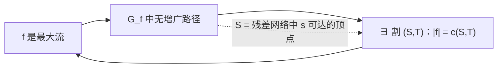
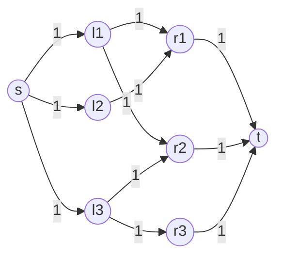
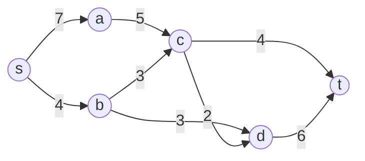

> **本篇范围**：第 24-25 章——**网络流与匹配**。两条主线：**最大流**（残差网络 + 增广路径 + 割，Ford-Fulkerson/Edmonds-Karp 两种实现）与**二分图匹配**（最大基数匹配 → Hopcroft-Karp；稳定匹配 → Gale-Shapley；最大权匹配 → 匈牙利算法）。最大流最小割定理是全篇的心脏，二分图匹配则是它最漂亮的应用，而第 25 章又给出三个"专精"算法，把匹配问题从"借用流"升级为"原生高效"。这一篇也是全书中"建模思维"最密集的一篇——很多看似无关的问题（排课、住院医师分配、任务指派）都能化成流或匹配。

## 一、流网络与流（§24.1）

### 流网络的形式定义

**流网络** $G=(V,E)$ 是一个有向图，每条边 $(u,v) \in E$ 带一个**非负容量** $c(u,v) \ge 0$。三个约定：

1. **无反向平行边**：若 $(u,v) \in E$，则 $(v,u) \notin E$（遇到反向平行边有转化方法，见下）。
2. 若 $(u,v) \notin E$，为了方便约定 $c(u,v)=0$；不允许自环。
3. 有两个特殊顶点：**源点** $s$ 和**汇点** $t$，且每个顶点都在某条 $s \leadsto v \leadsto t$ 的路径上（这个假设让网络"处处有用"，练习 24.1-3 说明它可以不失一般性地满足）。

> **原文摘录**（§24.1，此 PDF p.871）
> A **flow network** $G = (V, E)$ is a directed graph in which each edge $(u, v) \in E$ has a nonnegative **capacity** $c(u, v) \ge 0$. We further require that if $E$ contains an edge $(u, v)$, then there is no edge $(v, u)$ in the reverse direction.

**流**是一个实值函数 $f: V \times V \to \mathbb{R}$，满足两条性质：

- **容量约束**：对所有 $u,v$ 有 $0 \le f(u,v) \le c(u,v)$。
- **流量守恒**：对所有 $u \in V - \{s,t\}$，$\displaystyle \sum_{v \in V} f(v,u) = \sum_{v \in V} f(u,v)$（"流入 = 流出"），这正对应电路里的基尔霍夫电流定律。

**流的值**只统计从源点净流出的部分：

$$|f| = \sum_{v \in V} f(s,v) - \sum_{v \in V} f(v,s) \tag{24.1}$$

第 24.1 节里那个"Lucky Puck 公司"的卡车运冰球问题就是典型模型：源点 $s$ 是温哥华工厂，汇点 $t$ 是温尼伯仓库，边容量是每天最多能运多少箱。目标是找最大流。

### 两个建模技巧

**技巧 1：反向平行边转化（p.873，图 24.2）**。若非要同时有 $(v_1,v_2)$ 与 $(v_2,v_1)$，就挑其中一条（比如 $(v_1,v_2)$）**分裂**：引入新顶点 $v'$，把 $(v_1,v_2)$ 换成 $(v_1,v')$ 与 $(v',v_2)$，两条新边容量都等于原边容量。得到的新网络与原网络等价（练习 24.1-1）。

**技巧 2：多源多汇转化（p.874，图 24.3）**。加一个**超级源** $s$，从 $s$ 向每个源 $s_i$ 连容量 $\infty$ 的边；加一个**超级汇** $t$，从每个汇 $t_i$ 向 $t$ 连容量 $\infty$ 的边。这样多源多汇最大流就化归为标准单源单汇问题（练习 24.1-2）。"$\infty$" 用 $\sum_{(u,v) \in E} c(u,v)$ 之类的有限大数即可。

## 二、残差网络与增广路径（§24.2 前半）

### 残差容量与残差网络

给定流 $f$，**残差容量** $c_f(u,v)$ 衡量"还能往这条边上加多少流"：

$$c_f(u,v) = \begin{cases} c(u,v) - f(u,v) & \text{若 } (u,v) \in E \\[2pt] f(v,u) & \text{若 } (v,u) \in E \\[2pt] 0 & \text{其他} \end{cases} \tag{24.2}$$

因为网络无反向平行边，每对 $(u,v)$ **恰好**只有一种情况适用。

注意第二行——**这是最大流算法最反直觉、也最关键的一点**：如果 $G$ 中边 $(v,u)$ 上有流 $f(v,u)$，那么 $G_f$ 中会有一条"虚拟的"边 $(u,v)$，容量 $f(v,u)$。它代表**把已经推过去的流退回来**的能力。

> **原文摘录**（§24.2，此 PDF p.877-878）
> You might be surprised that the residual network $G_f$ can also contain edges that are not in $G$. As an algorithm manipulates the flow, with the goal of increasing the total flow, it might need to decrease the flow on a particular edge in order to increase the flow elsewhere. … These reverse edges in the residual network allow an algorithm to send back flow it has already sent along an edge.

**残差网络** $G_f = (V, E_f)$，其中 $E_f = \{(u,v) : c_f(u,v) > 0\}$。显然 $|E_f| \le 2|E|$（每条原边最多贡献它自己和它的反向边）。

例子：$c(u,v)=16$、$f(u,v)=11$，则 $c_f(u,v)=5$（还能加 5），且 $c_f(v,u)=11$（最多能退 11）。

### 流的合成（augmentation）

若 $f$ 是 $G$ 的流、$f'$ 是 $G_f$ 的流，定义**合成流** $f \uparrow f'$：

$$(f \uparrow f')(u,v) = f(u,v) + f'(u,v) - f'(v,u) \tag{24.4}$$

第三项是"在残差网络里往反向边推流"，等价于**减小**原图中的流，术语叫**取消（cancellation）**。直觉：$u \to v$ 运 5 箱、$v \to u$ 运 2 箱，从最终结果看等于从 $u$ 到 $v$ 运 3 箱。

> **Lemma 24.1**（此 PDF p.880）：$G=(V,E)$、流 $f$、残差网络 $G_f$、$G_f$ 上的流 $f'$，则 $f \uparrow f'$ 是 $G$ 的流，且 $|f \uparrow f'| = |f| + |f'|$。

### 增广路径

**增广路径** $p$ 是 $G_f$ 中一条从 $s$ 到 $t$ 的**简单路径**。它的**残差容量**是最小瓶颈：

$$c_f(p) = \min\{c_f(u,v) : (u,v) \in p\}$$

- **Lemma 24.2**（p.883）：定义 $f_p(u,v) = c_f(p)$（当 $(u,v) \in p$）、否则 $0$，则 $f_p$ 是 $G_f$ 的流且 $|f_p| = c_f(p) > 0$。
- **Corollary 24.3**（p.883）：$|f \uparrow f_p| = |f| + c_f(p) > |f|$。⇒ 只要还能找到增广路径，流值就能变大。

## 三、割与最大流最小割定理

### 割的定义

流网络的**割** $(S,T)$ 是 $V$ 的一个划分，$S$ 含 $s$、$T=V-S$ 含 $t$。

- **净流**（crossing flow）$\displaystyle f(S,T) = \sum_{u \in S} \sum_{v \in T} f(u,v) - \sum_{u \in T}\sum_{v \in S} f(v,u)$ —— 两个方向**都算**。
- **容量** $\displaystyle c(S,T) = \sum_{u \in S}\sum_{v \in T} c(u,v)$ —— 只算 $S \to T$ 方向的边。

> **原文摘录**（§24.2，此 PDF p.884）
> You probably noticed that the definitions of flow across a cut and capacity of a cut differ in that flow counts edges going in both directions across the cut, but capacity counts only edges going from the source side of the cut toward the sink side. This asymmetry is intentional and important.

这个不对称正是下面两条引理成立的关键：

- **Lemma 24.4**（p.885）：对任意割 $(S,T)$，净流恒等于流值，$f(S,T) = |f|$。
  *证明思路*：从 $|f|$ 出发，对每个 $u \in S-\{s\}$ 加一个"流量守恒 $\Rightarrow$ 流入减流出 $=0$"的项；把求和展开重组后，$S$ 内部顶点之间的项两两抵消（同一项在两个和式中各出现一次），只剩跨割项。
- **Corollary 24.5**（p.886）：任意流值不超过任意割容量，$|f| \le c(S,T)$（因为 $f(S,T) \le c(S,T)$：跨割正向流 $\le$ 容量，反向项非负被减掉了）。

### 最大流最小割定理

> **Theorem 24.6（max-flow min-cut theorem，此 PDF p.887）**：设 $f$ 是流网络 $G=(V,E)$ 的流，则以下三条**等价**：
> 1. $f$ 是 $G$ 的最大流。
> 2. 残差网络 $G_f$ 中不存在增广路径。
> 3. 存在某个割 $(S,T)$ 使 $|f| = c(S,T)$。

**证明三招**：

- (1) ⇒ (2)：若 $G_f$ 还有增广路径 $p$，由 Corollary 24.3 得到值严格更大的流，矛盾。
- (2) ⇒ (3)：**关键构造**。取 $S = \{v : G_f \text{ 中存在 } s \leadsto v \text{ 的路径}\}$，$T = V - S$。因无增广路径 $t \notin S$，故 $(S,T)$ 是合法割。对 $u \in S, v \in T$：若 $(u,v) \in E$，必有 $f(u,v) = c(u,v)$（否则残差边 $(u,v)$ 存在，$v$ 会落入 $S$）；若 $(v,u) \in E$，必有 $f(v,u) = 0$（否则 $c_f(u,v)=f(v,u)>0$，同样矛盾）。于是 $f(S,T) = c(S,T)$，配合 Lemma 24.4 得 $|f| = c(S,T)$。
- (3) ⇒ (1)：由 Corollary 24.5，$|f| \le c(S,T)$ 对一切割成立；若能取等号，$f$ 就是最大流。

**这三条件等价还顺带给了一个算法蓝图**：只要反复增广直到**找不到**增广路径，流就是最大的——而且此时"从 $s$ 出发在残差网络中可达的顶点集合"直接**给出了最小割**。



## 四、Ford-Fulkerson 方法与 Edmonds-Karp 算法

### Ford-Fulkerson 方法

```text
FORD-FULKERSON-METHOD(G, s, t)
1  initialize flow f to 0
2  while 残差网络 G_f 中存在增广路径 p
3      augment flow f along p        // 沿 p 增广
4  return f
```

具体实现（把所有边的流放在 $(u,v).f$ 属性上）：

```text
FORD-FULKERSON(G, s, t)
1  for each edge (u,v) ∈ G.E
2      (u,v).f = 0
3  while 存在从 s 到 t 的路径 p in G_f
4      c_f(p) = min{ c_f(u,v) : (u,v) ∈ p }        // 瓶颈
5      for each edge (u,v) in p
6          if (u,v) ∈ G.E
7              (u,v).f = (u,v).f + c_f(p)          // 正向边：加流
8          else (v,u).f = (v,u).f − c_f(p)         // 反向边：退流（取消）
9  return f
```

第 6-8 行体现了残差边的两种身份：正向边加流、反向边减流。

> **原文摘录**（§24.2，此 PDF p.889）
> Each residual edge in path $p$ is either an edge in the original network or the reversal of an edge in the original network. Lines 6–8 update the flow in each case appropriately, adding flow when the residual edge is an original edge and subtracting it otherwise.

### 复杂度：取决于怎么找增广路径

1. **整数容量、任选路径**：每轮至少把 $|f|$ 增加 1，故最多 $|f^*|$ 轮，每轮 $O(E)$ ⇒ **$O(E|f^*|)$**。
2. **无理数容量**：存在使算法**永不终止**（且不收敛到最大值）的路径选择（经典反例）。
3. **BFS 找路径（Edmonds-Karp）**：多项式时间，与 $|f^*|$ 无关 ⇒ **$O(VE^2)$**。

### Ford-Fulkerson 的病态例子（p.891-892，图 24.7）

网络：$c(s,u)=10^6$、$c(s,v)=10^6$、$c(u,v)=1$、$c(u,t)=10^6$、$c(v,t)=10^6$。最大流显然是 $2 \times 10^6$。

但如果 FF **先选** $s \to u \to v \to t$（残差容量 1），再选 $s \to v \to u \to t$（也是 1，借反向边退流），如此交替，就整整需要 **2000000 轮**。每轮只涨 1。**教训**：增广路径的选法决定复杂度——应优先选**边数最少**的路径，这正是 Edmonds-Karp 的做法。

### Edmonds-Karp 算法

用 **BFS** 在 $G_f$ 中找增广路径（即最短路 = 边数最少的路径），记 $\delta_f(u,v)$ 为 $G_f$ 中 $u$ 到 $v$ 的单位边最短路长度。

- **Lemma 24.7**（p.892）：每做一次增广，$\delta_f(s,v)$ 对所有 $v \in V-\{s,t\}$ **单调不减**。
  *证明思路*：反证。设增广后 $v$ 的距离**变小**了，取这种"距离变小"的顶点中最小的那个 $v$，令 $p = s \leadsto u \to v$ 是增广后 $G_{f'}$ 中的最短路。因 $v$ 选得最小，$u$ 的距离没有变小。若 $(u,v) \in E_f$，由三角不等式推出 $\delta_f(s,v) \le \delta_{f'}(s,v)$，矛盾；故 $(u,v) \notin E_f$，只能是被增广路径**退流**才出现的反向边，说明增广路径经过 $(v,u)$。由于增广路径是 $G_f$ 中最短路，其到 $u$ 的子路径也是最短路且末边为 $(v,u)$，于是 $\delta_f(s,v) = \delta_f(s,u) - 1 \le \delta_{f'}(s,u) - 1 = \delta_{f'}(s,v)-2$，同样矛盾。
- **Theorem 24.8**（p.894）：Edmonds-Karp 的增广次数是 **$O(VE)$**。
  *证明思路（critical edge 论证）*：称增广路径 $p$ 上的边 $(u,v)$ 为**关键边**，若 $c_f(p) = c_f(u,v)$；增广后该边从残差网络消失，且每条增广路径至少含一条关键边。当 $(u,v)$ 首次成为关键边时 $\delta_f(s,v) = \delta_f(s,u)+1$；它要再次成为关键边，必须先被"退流"（即反向边 $(v,u)$ 出现在某次增广路径上），此时 $\delta_{f'}(s,u) = \delta_{f'}(s,v)+1 \ge \delta_f(s,v) + 1 = \delta_f(s,u)+2$。即从一次关键到下一次关键，$u$ 到源点的距离至少增加 2；而可达时该距离至多 $|V|-2$，故每条边最多关键 $|V|/2$ 次。共有 $O(E)$ 条残差边 ⇒ 总关键边数 $O(VE)$ ⇒ 增广次数 $O(VE)$。
- 每轮 BFS 是 $O(E)$，故 **Edmonds-Karp 总时间 $O(VE^2)$**。

### 复杂度一览

| 算法 | 增广次数 | 每轮耗时 | 总时间 | 依赖 |
|---|---|---|---|---|
| Ford-Fulkerson（任选路径，整数容量） | $\le \vert f^* \vert$ | $O(E)$ | $O(E\lvert f^*\rvert)$ | 与流值成正比，可能很慢 |
| Edmonds-Karp（BFS） | $O(VE)$ | $O(E)$ | $O(VE^2)$ | 与容量无关，多项式 |
| 压流缩放（Problem 24-5） | — | — | $O(E^2 \lg C)$ | $C$ = 最大容量 |
| 预流推进（本书未讲，拓展） | — | — | $O(V^3)$ / $O(V^2E)$ | 最高标号变体最优 |

> **拓展**：$O(V^3)$ 的**推送-重标号（push-relabel）**与 $O(E\sqrt{V})$ 的 Dinic 是工程中更常用的选择；本书记录的是理论最简洁的两条路。此外 Problem 24-4 问"容量增/减 1 后如何 $O(V+E)$ 更新最大流"，Problem 24-5 给出**缩放法**（scaling）——先按大粒度 $K$ 找粗增广路径，再逐层减半精细化，总时间 $O(E^2\lg C)$。

## 五、用最大流求二分图最大匹配（§24.3）

**匹配** $M \subseteq E$ 是这样一个边集：每个顶点至多关联 $M$ 中一条边。**二分图** $V = L \cup R$，所有边都在 $L$ 与 $R$ 之间。本节目标是**最大基数匹配**。

### 构造对应的流网络

对二分图 $G=(V,E)$（$V = L \cup R$）构造 $G' = (V', E')$：

$$V' = V \cup \{s,t\}, \quad E' = \{(s,u): u \in L\} \cup \{(u,v): u\in L, v \in R, (u,v) \in E\} \cup \{(v,t): v \in R\}$$

**所有边容量为 1**。因每个顶点至少关联一条边，$|E| \ge |V|/2$，故 $|E'| = |E| + |V| \le 3|E| = \Theta(E)$。



**Lemma 24.9**（p.899）：$G$ 的匹配 $M$ 与 $G'$ 的**整数值**流一一对应，且 $|f| = |M|$。

- 正向：$(u,v) \in M \Rightarrow f(s,u)=f(u,v)=f(v,t)=1$，其余为 0。每条匹配边对应 1 单位流经 $s \to u \to v \to t$。
- 反向：$M = \{(u,v) : f(u,v) > 0\}$。因每个 $u \in L$ 只有一条进入边 $(s,u)$ 且容量 1，流量守恒 + 整数性 ⇒ 每个 $u$ 至多出一条正流边；$R$ 侧同理。故 $M$ 是匹配。

### 整性定理——为什么最大流一定能"翻译"回匹配

关键顾虑：最大流算法会不会返回**带小数**的流（这时 $M = \{(u,v): f(u,v)>0\}$ 就不再是匹配）？

> **Theorem 24.10（Integrality theorem，此 PDF p.900）**：若容量函数 $c$ 只取整数值，则 Ford-Fulkerson 方法产生的最大流 $f$ 满足：$|f|$ 是整数，且**对所有 $u,v$，$f(u,v)$ 都是整数**。

*证明*：对增广轮数归纳。初值全 0（整数）；每轮 $c_f(p)$ 是整数容差的最小值 ⇒ 是整数；更新只做整数加减 ⇒ 仍是整数。

> **Corollary 24.11**（p.901）：二分图 $G$ 的最大匹配基数 = 对应流网络 $G'$ 的最大流值。

*证明思路*：若最大匹配 $M$ 对应的流 $f$ 不是最大流，则存在更大的整数值最大流 $f'$（整性定理），它对应更大的匹配 $M'$，矛盾。

**于是**：求最大二分图匹配 = 建 $G'$ + 跑 FF。因匹配大小 $\le \min(|L|,|R|) = O(V)$，FF 最多增广 $O(V)$ 次，每次 $O(E') = O(E)$ ⇒ **总 $O(VE)$**。

> 值得记住的是，练习 24.3-3 问增广路径最多多长：一条增广路径交替走未匹配边（$L\to R$）和匹配边（$R\to L$），至多 $2\min(|L|,|R|)+1$ 条边——这个"交替"结构在第 25 章会被直接拿来设计算法。

## 六、Hopcroft-Karp：原生匹配算法（§25.1）

第 24 章用流"绕道"求匹配要 $O(VE)$。本节直接对匹配动刀，做到 $O(E\sqrt{V})$。

### 增广路径与对称差

- **$M$-交替路径**：边在 $M$ 与 $E-M$ 之间交替的简单路径。
- **$M$-增广路径**：首尾边都属于 $E-M$ 的 $M$-交替路径。它含的"非匹配边"比"匹配边"多一条，故长度（边数）为**奇数**，两端点都**未被 $M$ 匹配**。
- **对称差** $X \oplus Y = (X \cup Y) - (X \cap Y)$，满足交换律、结合律，$X \oplus X = \varnothing$，$\varnothing$ 是单位元。

> **Lemma 25.1**（此 PDF p.914）：$P$ 是 $M$-增广路径 ⇒ $M' = M \oplus P$ 也是匹配，且 $|M'| = |M| + 1$。
> **Corollary 25.2**（p.915）：$P_1,\dots,P_k$ **顶点不相交**的 $M$-增广路径 ⇒ $M \oplus (P_1 \cup \dots \cup P_k)$ 是匹配，大小为 $|M|+k$。

第二条是 Hopcroft-Karp"批量增广"的合法性基础。还有一条刻画两个匹配差集的结构引理：

> **Lemma 25.3**（p.916）：$M, M^*$ 是两个匹配，$G' = (V, M \oplus M^*)$ 是**简单路径、简单环与孤立顶点的不交并**，每条路径/环上 $M$ 与 $M^*$ 的边交替。若 $|M^*| > |M|$，则 $G'$ 至少含 $|M^*|-|M|$ 条顶点不相交的 $M$-增广路径。

（证明关键：$G'$ 中每个顶点度数 $\le 2$；环上两色边数相等，故"多出的 $|M^*|-|M|$ 条边"必然落在若干条 $M^*$ 边比 $M$ 边多一条的路径上。）

> **Corollary 25.4（Berge 定理，p.917）**：$M$ 是最大匹配 **当且仅当** $G$ 中不存在 $M$-增广路径。

这是所有增广路匹配算法的**停机判据**。最朴素的实现（从每个未匹配顶点做一次交替搜索）得到 $O(VE)$。

### Hopcroft-Karp 的三阶段

```text
HOPCROFT-KARP(G)
1  M = ∅
2  repeat
3      let P = {P1, P2, …, Pk} 为一组"极大"的、顶点不相交的、最短 M-增广路径
4      M = M ⊕ (P1 ∪ P2 ∪ ⋯ ∪ Pk)
5  until P == ∅
6  return M
```

核心是第 3 行：**一次找尽可能多条"最短且互不相交"的增广路径，一起增广**。实现分三阶段（p.918-921，图 25.2-25.3）：

1. **定向**：由 $G$ 与 $M$ 造有向图 $G_M$：未匹配边 $L \to R$（属于 $E-M$），匹配边 $R \to L$（属于 $M$）。
2. **分层（BFS）**：从**所有**未匹配的 $L$ 顶点同时做 BFS，得到分层 DAG $H$：顶点按到"未匹配 $L$ 顶点"的 BFS 距离分层，$L$ 顶点在偶层、$R$ 顶点在奇层；设 $q$ = "未匹配 $R$ 顶点的最小距离"，只保留距离 $\le q$ 的顶点。$H$ 中每条从第 0 层到第 $q$ 层未匹配顶点的路径，就对应 $G$ 中一条**最短**增广路径。
3. **DFS 收割**：在**转置图** $H^T$ 上，从第 $q$ 层的每个未匹配 $R$ 顶点做 DFS 回到第 0 层，沿着 $\pi$ 回溯即得一条增广路径。用"只从未发现过的顶点继续搜"保证路径**顶点不相交**，从而一次性收割出**极大**的一组。

> **为什么在 $H^T$ 上搜**（练习 25.1-3）：$H$ 是 DAG，从第 $q$ 层往回搜能立刻判断"当前顶点是否还能通到第 0 层"；若在 $H$ 上正向搜，每条候选路径都要走到头才知道成功与否，代价更高。

### 复杂度分析（O(E√V)）

- **Lemma 25.5**（p.923）：一轮增广后，**最短增广路径的长度 $q$ 严格增大**。
  *证明思路*：设这轮增广的是长度 $q$ 的极大不相交路径组，$M' = M \oplus (\cup P_i)$，若 $M'$ 还存在长度 $\le q$ 的增广路径 $P$：若 $P$ 与所有 $P_i$ 顶点不相交，则 $P$ 本也是 $M$-增广路径，而 $P$ 长度 $\le q$，与"$P$ 是极大的最短路径集合"矛盾（否则可加入）。若 $P$ 与某个 $P_i$ 共享顶点，则由 $M \oplus M' \oplus P$ 的结构（Lemma 25.3）推出 $|P| > q$，同样矛盾。
- **Lemma 25.6**（p.925）：设最短 $M$-增广路径长 $q$，则**最大匹配**大小 $\le |M| + |V|/(q+1)$。
- **Lemma 25.7**（p.925）：循环迭代 $O(\sqrt{V})$ 次。
  *证明思路*：$q$ 每轮严格增，$O(\sqrt V)$ 轮后 $q > \sqrt V$；再由 Lemma 25.6 推知剩余轮数 $O(\sqrt V)$，两者相加仍是 $O(\sqrt V)$。
- **Theorem 25.8**（p.926）：每轮 $O(E)$，故 **Hopcroft-Karp 总时间 $O(E\sqrt V)$**。

**对比**：$O(E\sqrt V)$ 对稀疏图（$E = O(V)$）是 $O(V^{1.5})$，明显优于流的 $O(VE)$。第 25 章的引言还提到 Madry 的 $\tilde O(E^{10/7})$ 算法，在稀疏图上进一步优于 Hopcroft-Karp。

> **Hall 定理**（练习 25.1-5，p.926）：$|L|=|R|$ 的二分图有**完美匹配**（每个顶点都被匹配）当且仅当对每个 $A \subseteq L$ 有 $|A| \le |N(A)|$（$N(A)$ 为 $A$ 的邻居集）。**推论**（练习 25.1-6）：每个 $d$-正则二分图都含完美匹配，且可分解为 $d$ 个互不相交的完美匹配——这是"边染色/轮转排课"类问题的理论基础。

## 七、稳定婚姻问题（§25.2）

匹配不只有一个"大小"维度。**完全二分图**上给每个顶点一份对另一侧全部顶点的**偏好排序**，我们想找"稳定"的配对。

- **阻断对（blocking pair）**：一对未配在一起的男女，且**双方都更想要对方**（优于各自当前伴侣）。
- **稳定匹配**：不存在阻断对的匹配。

例子（p.928）——四女四男，偏好已给（Wanda/Emma/Lacey/Karen 对 Oscar/Davis/Brent/Hank）：

```text
Wanda: Brent, Hank, Oscar, Davis      Oscar: Wanda, Karen, Lacey, Emma
Emma:  Davis, Hank, Oscar, Brent      Davis: Wanda, Lacey, Karen, Emma
Lacey: Brent, Davis, Hank, Oscar      Brent: Lacey, Karen, Wanda, Emma
Karen: Brent, Hank, Davis, Oscar      Hank:  Lacey, Wanda, Emma, Karen
```

唯一的稳定匹配是：**Lacey-Brent、Wanda-Hank、Karen-Davis、Emma-Oscar**。验证：Karen 更喜欢 Brent 和 Hank，但 Brent 更爱 Lacey、Hank 更爱 Wanda ⇒ 无阻断对。

稳定匹配**不一定唯一**。书中另一个 $3\times3$ 例子（Monica/Phoebe/Rachel 与 Chandler/Joey/Ross）恰有 **3 个**稳定匹配：一个让所有女生得第一志愿（=所有男生得末志愿），一个反过来，还有一个所有人得第二志愿。

### Gale-Shapley 算法（女性主动版）

```text
GALE-SHAPLEY(men, women, rankings)
 1  assign each woman and man as free              // 全部自由
 2  while 存在自由女性 w
 3      let m = w 尚未求过婚的男性中排名最靠前的
 4      if m 自由
 5          w 与 m 订婚（都不再自由）
 6      elseif m 更喜欢 w 而不是现任未婚妻 w′
 7          m 与 w′ 解除婚约，w′ 恢复自由
 8          w 与 m 订婚
 9      else m 拒绝 w，w 保持自由
10  return 订婚配对组成的稳定匹配
```

规则记忆：**女生按偏好逐一下沉求婚；男生一旦订婚就永不单身，但可能"升级"（遇到更喜欢的就换）；被甩的女生从断点继续往下求**。终止条件：无人自由。

> **Theorem 25.9**（p.931）：GALE-SHAPLEY **必定终止**并返回**稳定匹配**。
> *证明思路*：终止性——若循环不停，说明某女生把名单全求完仍被拒，则所有男生都已订婚；而"订婚即不单身"且男女各 $n$ 人 ⇒ 所有女生都订婚，矛盾。稳定性——设 $w$ 配 $m$ 但更喜欢 $m'$；$w$ 一定在求 $m$ 之前求过 $m'$，而 $m'$ 当时要么拒绝了她（说明已在跟更喜欢的交往），要么接受后又为了更喜欢的甩了她；两种情况 $m'$ 最终伴侣都优于 $w$ ⇒ 无阻断对。

**Corollary 25.10**（p.933）：可实现在 **$O(n^2)$** 时间（每个女生至多求 $n$ 次婚，共 $n^2$ 次；用快照/指针使每次求婚 $O(1)$）。

> **Theorem 25.11**（p.933）：**无论第 2 行以何种顺序挑自由女性，返回的都是同一个稳定匹配**；且在此匹配中，**每个女生都拿到了她在任何稳定匹配中能拿到的最好伴侣**。
> **Corollary 25.12**（p.934）：因此，存在一些稳定匹配是 GALE-SHAPLEY **不会**返回的。
> **Corollary 25.13**（p.934）：反过来，在该匹配中**每个男生都拿到他在任何稳定匹配中最差的伴侣**。

这就是著名的"**主动方占优**"现象：谁求婚谁受益。定理 25.11 的证明用了"**首次有人为了稳定匹配中的伴侣而拒绝别人**"的极小时刻反证，是博弈论/机制设计里很著名的一段论证。

> **两个重要推广**（练习）：25.2-3 的**住院医师分配（NRMP）**允许医院招多名学生、且人数不等——把每个医院的 $r_h$ 个名额"复制"成 $r_h$ 个并列的医院副本即可（或直接在算法里让医院保留最优 $r_h$ 个申请人）。25.2-5 的**稳定室友问题**（非二分完全图）则**可能不存在**稳定匹配，书中给出了一个四人的反例。

## 八、匈牙利算法：最大权匹配（§25.3）

**指派问题（assignment problem）**：完全二分图 $G$（$|L| = |R| = n$，共 $n^2$ 条边），每条边有权 $w(l,r)$，求一个**完美匹配**使**总权最大**。暴力枚举 $n!$ 太慢；匈牙利算法做到 $O(n^4)$（Problem 25-2 优化到 $O(n^3)$）。

### 对偶：顶点标号与相等子图

给每个顶点一个标号 $h$（$l.h$ 与 $r.h$）。**可行顶点标号**：

$$l.h + r.h \ge w(l,r), \quad \forall l \in L, r \in R$$

一定存在，比如**默认标号**：$l.h = \max\{w(l,r) : r\in R\}$，$r.h = 0$。

**相等子图** $G_h = (V, E_h)$，只保留"取等号的紧边"：

$$E_h = \{(l,r) \in E : l.h + r.h = w(l,r)\}$$

> **Theorem 25.14**（此 PDF p.938）：若某个相等子图 $G_h$ 含完美匹配 $M^*$，则 $M^*$ 就是指派问题的最优解。

*证明（对偶可行性 + 弱对偶）*：$M^*$ 的每条边都紧 ⇒ $w(M^*) = \sum_{l} l.h + \sum_{r} r.h$。对任意完美匹配 $M$：$w(M) \le \sum_l l.h + \sum_r r.h = w(M^*)$。故 $M^*$ 最优。

这就是**线性规划对偶**的雏形：最大化匹配权 ↔ 最小化标号总和（两者的公共值在最优时相等）。书中特意点出这与"最大流 = 最小割"是同一思想。

### 算法骨架

```text
HUNGARIAN(G)
 1  for each l ∈ L:  l.h = max{ w(l,r) : r ∈ R }     // 默认标号
 3  for each r ∈ R:  r.h = 0
 5  let M be any matching in G_h                      // 贪婪极大匹配即可
 6  构造相等子图 G_h 与有向相等子图 G_{M,h}
 7  while M 不是 G_h 中的完美匹配
 8      P = FIND-AUGMENTING-PATH(G_{M,h})
 9      M = M ⊕ P
10      更新 G_h 与 G_{M,h}
11  return M
```

**有向相等子图** $G_{M,h}$：和 Hopcroft-Karp 一样——未匹配的紧边 $L \to R$，匹配边 $R \to L$。**当搜索失败时**（BFS 队列空了还没摸到未匹配的 $R$ 顶点），就要**调标号**：

$$\delta = \min\{l.h + r.h - w(l,r) : l \in F_L,\ r \in R - F_R\}$$

其中 $F_L = L \cap V_F$、$F_R = R \cap V_F$ 是当前 BFS 森林里的顶点。然后**新标号**：

$$l.h \mathrel{-}= \delta \ (l \in F_L), \qquad r.h \mathrel{+}= \delta \ (r \in F_R)$$

> **Lemma 25.15**（此 PDF p.946）：上面得到的新标号 $h'$ 仍是**可行**的，并且满足：
> 1. 森林 $F$ 中的每条边都还在 $E_{M,h'}$；
> 2. 匹配 $M$ 中的每条边 $(l,r)$ 都还在 $E_{M,h'}$；
> 3. 至少有一条新边 $(l,r)$（$l \in F_L, r \in R-F_R$）进入 $E_{M,h'}$ ⇒ **至少新发现一个 $R$ 顶点**。

三条一起保证了算法不会"倒退"：已做的工作不白费，且每调一次标号必定推进一格。$\delta$ 的定义就是让"最接近紧的边"变紧。为什么 $\delta>0$ 且有限？因为若没有可行候选边，说明搜索已经失败且无改进空间——但由 Lemma 25.15 性质 3 必有候选。

**终止性与正确性**：每次调标号至少发现一个新的 $R$ 顶点，故每轮 FIND-AUGMENTING-PATH 至多 $n$ 次调标号；每轮 while 让 $|M|$ 增加 1，至多 $n$ 轮；最终 $M$ 是完美匹配，由 Theorem 25.14 最优。

**复杂度**：$O(n)$ 轮 × $O(n^3)$ 每次 FIND-AUGMENTING-PATH = **$O(n^4)$**；用 Problem 25-2 的 $\sigma_r = \min\{l.h + r.h - w(l,r) : l \in F_L\}$ 技巧把每次 $\delta$ 计算与更新降到 $O(n)$，总时间降为 **$O(n^3)$**。

### 一张全景表

| 问题 | 目标 | 代表算法 | 时间 | 核心机制 |
|---|---|---|---|---|
| 单源单汇最大流 | 最大化流值 | Ford-Fulkerson | $O(E\lvert f^*\rvert)$ | 增广路径 + 残差网络 |
| 单源单汇最大流 | 同上 | Edmonds-Karp | $O(VE^2)$ | BFS 最短路增广 |
| 二分图最大基数匹配 | 最大化 $\lvert M\rvert$ | 流网络 + FF | $O(VE)$ | 整性定理 |
| 二分图最大基数匹配 | 同上 | Hopcroft-Karp | $O(E\sqrt V)$ | 分层 + 批量增广 |
| 稳定匹配 | 无阻断对 | Gale-Shapley | $O(n^2)$ | 求婚-升级 |
| 最大权完美匹配 | 最大化权 | 匈牙利算法 | $O(n^3)$ | 可行标号 + 相等子图 |

---

## 例题精讲

### 例题 A：Edmonds-Karp 全程手算（含最小割）

网络（边权即容量）：



**问题**：(1) 用 BFS（Edmonds-Karp）求最大流，写出每轮增广路径、瓶颈与流值；(2) 求最小割。

<details>
<summary>答案</summary>

**第 1 轮**：BFS 最短路 $s \to a \to c \to t$，瓶颈 $\min(7,5,4) = 4$。增广后：$f(s,a)=f(a,c)=f(c,t)=4$，流值 $4$。

**第 2 轮**：残差网络中 $s\to a$ 余 $3$，$a\to c$ 余 $1$，$s\to b$ 余 $4$，$b\to d$ 余 $3$，$d\to t$ 余 $6$。BFS 树：$s\!\to\!a,\ s\!\to\!b$（第 1 层）；$a\!\to\!c$、$b\!\to\!d$（第 2 层）；$d \to t$（第 3 层）。最短路径 $s \to b \to d \to t$，瓶颈 $\min(4,3,6)=3$。流值 $7$。

**第 3 轮**：此时 $s\!\to\!a$ 余 $3$、$a\!\to\!c$ 余 $1$、$c\!\to\!d$ 余 $2$、$d\!\to\!t$ 余 $3$。BFS 找到 $s \to a \to c \to d \to t$，瓶颈 $\min(3,1,2,3)=1$。增广后 $f(s,a)=5,\ f(a,c)=5,\ f(c,d)=1,\ f(d,t)=4$，流值 $8$。

**第 4 轮**：$s\!\to\!b$ 余 $1$、$b\!\to\!c$ 余 $3$、$c\!\to\!d$ 余 $1$、$d\!\to\!t$ 余 $2$。BFS 找到 $s \to b \to c \to d \to t$，瓶颈 $1$。增广后 $f(s,b)=4,\ f(b,c)=1,\ f(c,d)=2,\ f(d,t)=5$，流值 $9$。

**第 5 轮**：从 $s$ 出发残差可达集只有 $s\to a$（$s\to b$ 已饱和）；$a$ 的出边 $a\to c$ 已饱和（余 0），$a\to s$ 是回退边已被访问。**队列为空** ⇒ 无增广路径，终止。

**最大流 $=9$**。最终流：$f(s,a)=5,\ f(s,b)=4$；$f(a,c)=5,\ f(b,c)=1,\ f(b,d)=3$；$f(c,d)=2,\ f(c,t)=4,\ f(d,t)=5$。（自查守恒：$a$ 入 5 出 5；$b$ 入 4 出 $1+3$；$c$ 入 $5+1=6$ 出 $2+4$；$d$ 入 $3+2=5$ 出 5；$t$ 入 $4+5=9$ ✓）

**最小割**：终止时残差网络中 $s$ 可达顶点为 $S=\{s,a\}$，故最小割 $(S,T)$ 为：

$$c(S,T) = c(s,b) + c(a,c) = 4 + 5 = 9 = |f| \ \checkmark$$

注意第 3、4 轮里出现了**流量重路由**：$c\to t$ 第 1 轮就被填满 $4$，之后新流只能绕道 $c \to d \to t$；第 4 轮又让 $b$ 的流从 $b\to d$ 改走 $b \to c \to d$。这正是残差网络反向边"取消"机制在起作用。
</details>

### 例题 B：Ford-Fulkerson 的病态慢（图 24.7）

网络：$c(s,u)=c(s,v)=c(u,t)=c(v,t)=10^6$，$c(u,v)=1$。

<details>
<summary>答案</summary>

若 FF 交替选择 $s \to u \to v \to t$ 与 $s \to v \to u \to t$（后者借 $v\to u$ 反向边退掉第 1 轮推过去的 1 单位），每次只把流值提高 1，共需 **$2\times 10^6$ 轮**，而最大流是 $2\times10^6$（$s\to u\to t$ 与 $s\to v\to t$ 各 $10^6$）。

**Edmonds-Karp 只需 2 轮**：BFS 先取 $s\to u\to t$（瓶颈 $10^6$），再取 $s\to v\to t$（瓶颈 $10^6$）。因为 $s\to u\to v\to t$ 有 3 条边，比 $s\to u\to t$（2 条边）长，BFS 永远不会选它。

**结论**：$O(E|f^*|)$ 是"与流量数值成正比"的复杂度，容量很大时就退化成指数级般的行为；改用最短路增广把它降到 $O(VE^2)$，与容量数值**无关**。
</details>

### 例题 C：二分图匹配的最大流视角

$L=\{l_1,l_2,l_3\}$，$R=\{r_1,r_2,r_3\}$，边：$l_1r_1,\ l_1r_2,\ l_2r_1,\ l_3r_2,\ l_3r_3$。

**问题**：从空匹配开始，用增广路径逐步求出最大匹配。

<details>
<summary>答案</summary>

（用匹配语言说明，等价于在流网络上增广。）

1. $M = \varnothing$。未匹配的 $l_1$ 直达未匹配的 $r_1$ ⇒ 增广路径 $l_1r_1$（1 条边）。$M=\{l_1r_1\}$。
2. 未匹配 $l_2$：$l_2 \to r_1$（未匹配边）$\to l_1$（$r_1$ 的匹配边）$\to r_2$（未匹配边，$r_2$ 未匹配）⇒ **交替路径** $l_2 r_1 l_1 r_2$（3 条边）。对称差后 $M=\{l_1r_2,\ l_2r_1\}$。
3. 未匹配 $l_3$：$l_3 \to r_3$（$r_3$ 未匹配）⇒ 增广。$M=\{l_1r_2,\ l_2r_1,\ l_3r_3\}$。
4. 无未匹配的 $L$ 顶点 ⇒ 由 Berge 定理（Corollary 25.4），这是最大匹配，**大小为 3**（恰好是完美匹配）。

对照流网络：每条匹配边对应 1 单位流 $s \to l_i \to r_j \to t$，流值 = 匹配大小 = 3。第二轮增广路径 $l_2 r_1 l_1 r_2$ 在流网络中就是 $s \to l_2 \to r_1 \rightsquigarrow l_1 \to r_2 \to t$（其中 $r_1 \to l_1$ 是反向边，表示"取消"原来的 $l_1r_1$）。**增广路径的交替结构 = 残差网络的回退边**，这就是两章之间的桥。
</details>

### 例题 D：Hopcroft-Karp 的批量增广

$L=\{l_1,l_2,l_3,l_4\}$，$R=\{r_1,r_2,r_3,r_4\}$。边：$l_1r_1,\ l_1r_2,\ l_2r_1$（第一组）；$l_3r_3,\ l_3r_4,\ l_4r_3$（第二组）。初始贪婪匹配 $M=\{l_1r_1,\ l_3r_3\}$。

<details>
<summary>答案</summary>

未匹配的 $L$ 顶点：$\{l_2, l_4\}$；未匹配的 $R$ 顶点：$\{r_2, r_4\}$。注意 $l_2$ 与 $r_2$ **不**相邻、$l_4$ 与 $r_4$ **不**相邻，所以不存在长度为 1 的增广路径。

在 $G_M$ 中从 $\{l_2,l_4\}$ 做 BFS：第 0 层 $\{l_2, l_4\}$；第 1 层 $\{r_1, r_3\}$（来自 $l_2\to r_1$、$l_4\to r_3$）；第 2 层 $\{l_1, l_3\}$（经匹配边 $r_1\to l_1$、$r_3\to l_3$）；第 3 层 $\{r_2, r_4\}$（来自 $l_1\to r_2$、$l_3 \to r_4$，两者都**未匹配**）。故 $q = 3$。

两条最短增广路径 $P_1 = l_2\,r_1\,l_1\,r_2$ 与 $P_2 = l_4\,r_3\,l_3\,r_4$ 长度都是 3，且**顶点不相交**——构成一个极大集合。一次全部增广：

$$M \oplus (P_1 \cup P_2) = \{l_2r_1,\ l_1r_2,\ l_4r_3,\ l_3r_4\}$$

已是完美匹配（大小 4）。**只用了 1 个阶段**；若逐条增广则需要 2 次。

**要点**：Hopcroft-Karp 的增益来自"同一层（同样长度）的多条不相交增广路径 **打包增广**"。本例两条路径等长且互不干扰，故一次搞定。
</details>

### 例题 E：Gale-Shapley 手动执行

用书中四女四男的偏好（见 §25.2 正文），女生主动，按 Wanda → Emma → Lacey → Karen 的顺序依次求婚。

<details>
<summary>答案</summary>

1. Wanda 求 Brent（榜首）——Brent 自由 ⇒ 订婚 **Wanda-Brent**。
2. Emma 求 Davis（榜首）——Davis 自由 ⇒ 订婚 **Emma-Davis**。
3. Lacey 求 Brent——Brent 更喜欢 Lacey（Brent 榜：Lacey > Karen > Wanda > Emma）⇒ 与 Wanda 解约，订 **Lacey-Brent**，Wanda 恢复自由。
4. Karen 求 Brent——Brent 更爱 Lacey（Lacey 在其榜首位）⇒ 拒绝 Karen，Karen 仍自由。
5. Karen 求 Hank——Hank 自由 ⇒ 订婚 **Karen-Hank**。
6. Wanda（自由）求 Hank——Hank 更爱 Wanda（Hank 榜：Lacey > Wanda > Emma > Karen）⇒ 与 Karen 解约，订 **Wanda-Hank**，Karen 恢复自由。
7. Karen 求 Davis——Davis 更爱 Karen（Davis 榜：Wanda > Lacey > Karen > Emma）⇒ 与 Emma 解约，订 **Karen-Davis**，Emma 恢复自由。
8. Emma 求 Hank——Hank 更爱 Wanda ⇒ 拒绝，Emma 仍自由。
9. Emma 求 Oscar——Oscar 自由 ⇒ 订婚 **Emma-Oscar**。

此时无人自由，返回 **Lacey-Brent、Wanda-Hank、Karen-Davis、Emma-Oscar**——与书中唯一稳定匹配一致。

**观察**：Wanda 最终拿到第 2 志愿（Hank），Karen 拿到第 3 志愿（Davis）……总体女生拿到的是"最好的可能"；男生这边 Brent 拿到第 1 志愿（Lacey），但 Oscar 拿到第 4 志愿（Emma）——男生整体最差（Theorem 25.11 + Corollary 25.13 的实例化）。若把主动方换成男生，结果会翻转成"男生最优、女生最劣"的另一个稳定匹配。
</details>

### 例题 F：匈牙利算法全程手算（3×3）

权重矩阵：

| | $r_1$ | $r_2$ | $r_3$ |
|---|---|---|---|
| $l_1$ | 8 | 6 | 5 |
| $l_2$ | 4 | 7 | 3 |
| $l_3$ | 9 | 5 | 8 |

**问题**：求最大权完美匹配及其总权，并给出对偶证书。

<details>
<summary>答案</summary>

**默认标号**：$l_1.h=8,\ l_2.h=7,\ l_3.h=9$；$r_1.h=r_2.h=r_3.h=0$。

**相等子图** $E_h$（$l.h+r.h = w$）：$l_1r_1$（$8=8$）、$l_2r_2$（$7=7$）、$l_3r_1$（$9=9$）。其余 $l_1r_2:8\ne6$、$l_1r_3:8\ne5$、$l_2r_1:7\ne4$、$l_2r_3:7\ne3$、$l_3r_2:9\ne5$、$l_3r_3:9\ne8$，都不是紧边。

**贪婪极大匹配**：$l_1$ 配 $r_1$，$l_2$ 配 $r_2$；$l_3$ 在 $E_h$ 中的唯一邻居 $r_1$ 已被占 ⇒ $M=\{l_1r_1,\ l_2r_2\}$，大小 2，非完美。

**第 1 次 BFS**（从 $G_{M,h}$ 中的未匹配 $L$ 顶点 $l_3$ 出发）：
- $l_3 \to r_1$（未匹配紧边）⇒ 发现 $r_1$（第 1 层）。$r_1$ 已匹配，从 $r_1 \to l_1$（匹配边，$R\to L$）⇒ 发现 $l_1$（第 2 层）。
- $l_1$ 的未匹配紧边：无（$l_1r_1$ 是匹配边，其余非紧）⇒ 队列空，**失败**。

$F_L=\{l_3, l_1\}$，$F_R=\{r_1\}$。

**计算 $\delta$**：$l \in \{l_3,l_1\}$，$r \in \{r_2,r_3\}$：

$$l_3r_2: 9+0-5=4;\quad l_3r_3: 9+0-8=1;\quad l_1r_2: 8+0-6=2;\quad l_1r_3: 8+0-5=3$$

故 $\delta = 1$（边 $l_3r_3$ 达到）。

**调标号**：$l_3.h: 9 \to 8$，$l_1.h: 8 \to 7$；$r_1.h: 0 \to 1$。新标号：$l_1=7, l_2=7, l_3=8$；$r_1=1, r_2=0, r_3=0$。

**新相等子图自检**：$l_1r_1: 7+1=8$ ✓（匹配边保住）、$l_2r_2: 7+0=7$ ✓（匹配边保住）、$l_3r_1: 8+1=9$ ✓、**$l_3r_3: 8+0=8$ ✓ 新进入** —— 恰好符合 Lemma 25.15 的三条性质。

**继续 BFS**：新边 $l_3 \to r_3$，而 $r_3$ **未匹配** ⇒ 找到增广路径 $P = l_3 r_3$。$M = M \oplus P = \{l_1r_1,\ l_2r_2,\ l_3r_3\}$，**完美匹配**，总权 $8+7+8 = 23$。

**验证最优性**：枚举 6 个完美匹配：

| 匹配 | 总权 |
|---|---|
| $l_1r_1, l_2r_2, l_3r_3$ | **23** |
| $l_1r_1, l_2r_3, l_3r_2$ | 16 |
| $l_1r_2, l_2r_1, l_3r_3$ | 18 |
| $l_1r_2, l_2r_3, l_3r_1$ | 18 |
| $l_1r_3, l_2r_1, l_3r_2$ | 14 |
| $l_1r_3, l_2r_2, l_3r_1$ | 21 |

最大 $=23$ ✓。

**对偶证书**：最终标号总和 $= 7+7+8 + 1+0+0 = 23 = w(M^*)$。这印证了 Theorem 25.14 的对偶等式——**最大权匹配值 = 最小可行标号总和**，与"最大流 = 最小割"同构；而且**匹配边全部是紧边**，所以它能同时充当"原问题最优解"与"对偶问题最优解"的证书。
</details>

### 例题 G：最小割的建模应用——雇佣咨询专家（Problem 24-3）

$n$ 个领域 $C_1,\dots,C_n$，雇领域 $C_k$ 的专家花 $e_k$ 元；$m$ 个任务 $J_1,\dots,J_m$，接下任务 $J_i$ 需要已雇 $R_i \subseteq C$ 中所有领域的专家，收入 $p_i$ 元。求最大净收益。

构造流网络：源 $s$、领域顶点 $C_k$、任务顶点 $J_i$、汇 $t$；边 $s \to C_k$ 容量 $e_k$；边 $J_i \to t$ 容量 $p_i$；若 $C_k \in R_i$，加边 $C_k \to J_i$ 容量 $\infty$。

<details>
<summary>答案</summary>

**割的语义**：约定 **$T$ 侧的顶点 = 被选中**——$C_k \in T$ 表示雇佣该领域的专家，$J_i \in T$ 表示接下该任务；$S$ 侧表示放弃。记 $P = \sum_i p_i$（全部任务的总收入）。

**$\infty$ 边强制"依赖闭合"**（Problem 24-3a）：$\infty$ 边 $C_k \to J_i$ 跨割（$S\to T$）当且仅当 $C_k \in S$（不雇）而 $J_i \in T$（接任务）。要让割容量有限，这种情况必须被禁止：

$$J_i \in T \ \Rightarrow\ \text{对所有 } C_k \in R_i \text{ 有 } C_k \in T$$

——**接下任务 $J_i$ 就必须雇佣它依赖的每一位专家**，正是题目要求的硬约束。

**割容量**：跨 $S\to T$ 的有限边只有两类：

- $s \to C_k$：跨割当且仅当 $C_k \in T$（雇佣），每条贡献 $e_k$；
- $J_i \to t$：跨割当且仅当 $J_i \in S$（放弃），每条贡献 $p_i$。

于是

$$c(S,T) = \underbrace{\sum_{C_k \in T} e_k}_{\text{雇佣成本}} + \underbrace{\sum_{J_i \in S} p_i}_{\text{放弃的收入}} = \big(\text{雇佣成本}\big) + \big(P - \text{接单收入}\big) = P - \text{净收益}$$

整理得

$$\boxed{\ \text{最大净收益} = P - c(S_{\min},\, T_{\min})\ }$$

其中 $(S_{\min}, T_{\min})$ 是 $G$ 的最小割（容量有限）。

**小例验证**：$n=1$ 个领域 $C_1$（$e_1=5$），$m=1$ 个任务 $J_1$（$p_1=10$，依赖 $C_1$）。合法割：
- $S=\{s\}$：$T=\{C_1,J_1,t\}$，容量 $e_1 = 5$ —— 雇人并接单，净收益 $10-5=5$；
- $S=\{s,C_1,J_1\}$：$T=\{t\}$，容量 $p_1 = 10$ —— 什么都放弃，净收益 $0$；
- $S=\{s,J_1\}$：$T=\{C_1,t\}$，容量 $e_1 + p_1 = 15$ —— 雇了人却不接单，净收益 $-5$。

（注意 $S=\{s,C_1\}$ 不可行：$\infty$ 边 $C_1\to J_1$ 会跨割。）最小割 $=5$，故最大净收益 $= 10-5 = 5$ ✓。

**结论**：跑一次最大流得到最小割，取 **$T$ 侧**的领域（雇佣）与任务（接受）即为最优方案，时间与最大流同阶（Edmonds-Karp 为 $O(VE^2)$，其中 $V = m+n+2$）。这是"**最大权闭合子图 / 项目选择**"问题的标准解法，也是把"选择型优化"化为流问题的经典范式——**最小割 = 最小化（成本 + 放弃的收益）**，等价于最大化净收益。
</details>

---

## 习题与答案

> 说明：标注「书中原题」的来自 CLRS 第 4 版，附题号与 PDF 页码；标注「自编模拟」的是按考试风格设计的变式。

**习题 1** ★（书中原题 Ex 24.1-1，此 PDF p.875）证明"边分裂不改变最大流值"：把 $(u,v)$ 换成 $(u,x),(x,v)$（容量均 $=c(u,v)$），两网络最大流相同。

<details>
<summary>答案</summary>

两个方向互推：

- 给定 $G$ 的流 $f$，定义 $G'$ 的流 $f'$：$f'(u,x) = f'(x,v) = f(u,v)$，其余边同 $f$。容量约束显然满足；$x$ 上的守恒是 $f(u,v) = f(u,v)$ 恒等；其他顶点守恒不变 ⇒ $|f'| = |f|$。
- 反之，给定 $G'$ 的流 $f'$，因 $x$ 只有一条入边 $(u,x)$ 和一条出边 $(x,v)$，守恒强制 $f'(u,x) = f'(x,v)$，令 $f(u,v) = f'(u,x)$ 即可回收 $G$ 的等值流。

故两个网络的最大流值相等。**用途**：这就是"反向平行边转化"（图 24.2）与前向/后向顶点容量改造（练习 24.1-7）的技术基座。
</details>

**习题 2** ★（书中原题 Ex 24.1-3，此 PDF p.875）若顶点 $u$ 不在任何 $s \leadsto t$ 路径上，证明存在最大流 $f$ 使 $f(u,v) = f(v,u) = 0\ (\forall v)$。

<details>
<summary>答案</summary>

设 $R = \{v : u \text{ 可达 } v\}$（从 $u$ 出发可达的顶点集）。因 $u$ 不能到达 $t$，$t \notin R$。

关键：$R$ 中顶点与 $V-R$ 之间**没有出边**（否则可从 $u$ 走到更多顶点，$R$ 会更大）。因此对任意流 $f$ 与任意 $v \in R$、$w \notin R$，有 $f(v,w) = 0$（无此边），于是 $R$ 内部**既无流入也无流出**——$f$ 在 $R$ 上自身构成一个"封闭子系统"，其流入流出都是 0。

构造 $f'$：在 $R$ 内部把 $f$ 置 0（即令 $f'(x,y)=0$ 对所有 $x,y \in R$），$R$ 外保持 $f$ 不变。$R$ 无外部流入/流出，故 $R$ 内每点的守恒仍成立（都是 0 进出）；$R$ 外顶点的守恒只涉及 $R$ 外与跨割边，而跨割边原本流量就是 0，不变 ⇒ 守恒保持。容量约束显然满足，且流值不变（$s$ 与 $t$ 的边不在 $R$ 内，`s ∉ R` 因为 $s \to u$ 未必可达 $u$；实际上 $s$ 若可达 $u$ 则 $s \in$ 前驱集...）。简化版：只需注意 $R$ 与外部之间没有边，故在 $R$ 上清零不改变任何跨割流量与流值。于是存在这样的最大流。
</details>

**习题 3** ★★（书中原题 Ex 24.2-2，此 PDF p.895）在 Lucky Puck 网络（图 24.1(b)，$|f|=19$）中，割 $(\{s,v_2,v_4\},\{v_1,v_3,t\})$ 的净流与容量各是多少？

<details>
<summary>答案</summary>

**净流**：由 Lemma 24.4，任何割的净流都等于流值，故直接得 $\boxed{19}$，无需逐边计算。

若逐边核对（图 24.1(b) 的流：$f(s,v_1)=13,\ f(s,v_2)=6,\ f(v_1,v_2)=1,\ f(v_1,v_3)=12,\ f(v_2,v_4)=11,\ f(v_3,v_2)=4,\ f(v_3,t)=15,\ f(v_4,v_3)=7,\ f(v_4,t)=4$）：跨 $S\to T$ 的边为 $s\to v_1$（13）、$v_4\to v_3$（7）、$v_4\to t$（4）；跨 $T \to S$ 的边为 $v_1\to v_2$（1）、$v_3\to v_2$（4）。净流 $=(13+7+4)-(1+4)=24-5=19$ ✓。

**容量**：只算 $S \to T$ 方向的容量：$c(s,v_1)+c(v_4,v_3)+c(v_4,t) = 16+7+4 = \boxed{27}$。

因为 $27 > 23$（最小割容量），这个割**不是**最小割——最小割是 $\{s,v_1,v_2,v_4\}$ 侧，容量 $c(v_1,v_3)+c(v_4,v_3)+c(v_4,t) = 12+7+4 = 23$，与最大流 23 吻合。
</details>

**习题 4** ★★（书中原题 Ex 24.2-4，此 PDF p.895）图 24.6（最大流 23）对应的最小割是哪个？哪些增广路径发生了"取消流"？

<details>
<summary>答案</summary>

**最小割**：终止时在残差网络中从 $s$ 做可达性搜索，得到 $S = \{s,v_1,v_2,v_4\}$（$v_3$ 与 $t$ 不可达，因 $v_1\to v_3$、$v_4\to v_3$、$v_4\to t$ 都已饱和或不可用）。故最小割为 $(\{s,v_1,v_2,v_4\},\ \{v_3,t\})$，容量 $12+7+4 = 23 = |f|$ ✓。

**发生取消的路径**：图 24.6 执行中出现过 $s \to v_2 \to v_4 \to v_3 \to v_1 \to t$（或类似含反向边的路径）——它经过 $v_4 \to v_3$ 的反向边（即"退回"此前 $v_4\to v_3$ 推过的流）。凡是路径中包含**残差网络中方向与 $G$ 中相反**的边，就是取消操作。具体到该图，第 (c)→(d) 与 (d)→(e) 两步各有一条这样的回退边。
</details>

**习题 5** ★★（书中原题 Ex 24.3-2，此 PDF p.902）证明整性定理（Theorem 24.10）。

<details>
<summary>答案</summary>

对 while 循环的执行轮数归纳。

**基础**：初始化 $f \equiv 0$，所有 $f(u,v) = 0 \in \mathbb{Z}$。

**归纳步**：设第 $k$ 轮开始前 $f$ 的所有分量都是整数。该轮在残差网络 $G_f$ 中找增广路径 $p$，计算 $c_f(p) = \min\{c_f(u,v) : (u,v)\in p\}$。由 $c_f$ 的定义（整数容量与整数流之差，或整数流本身），每个 $c_f(u,v)$ 都是整数，故 $c_f(p)$ 是整数 $>0$。更新规则 $f(u,v) \mathrel{+}= c_f(p)$ 或 $f(v,u) \mathrel{-}= c_f(p)$ 都是整数间的加减 ⇒ 更新后所有分量仍是整数。

**归纳完成** ⇒ 终止时最大流 $f$ 全部分量都是整数，从而 $|f| = \sum_v f(s,v) - \sum_v f(v,s)$ 也是整数。□

**推论**：这条定理是"用最大流求匹配"的合法性命门——它保证最大流不会给出 0.5 这样的分数流（那样"$f(u,v)>0$ 的边集"就不是匹配了）。
</details>

**习题 6** ★★★（书中原题 Ex 25.1-5，此 PDF p.926）证明 Hall 定理：$|L|=|R|$ 的二分图有完美匹配 $\iff$ 对每个 $A \subseteq L$ 有 $|A| \le |N(A)|$。

<details>
<summary>答案</summary>

**(⇒) 必要性**：设 $M$ 是完美匹配。$A$ 中每个顶点在 $M$ 下匹配到 $N(A)$ 中一个**不同**的顶点（匹配是单射），故 $|A| \le |N(A)|$。

**(⇐) 充分性**（构造流网络 + 最大流最小割）：建流网络 $G'$：$s \to l$ 容量 1（$l\in L$）、$l\to r$ 容量 1（$(l,r)\in E$）、$r\to t$ 容量 1（$r\in R$）。由 Corollary 24.11，最大匹配 $=$ 最大流；又 $s$ 的出边总容量为 $|L|$，故最大流 $\le |L|$。因此只需证明**任意有限割的容量 $\ge |L|$**，即可得最大流 $= |L| = |R|$，对应完美匹配。

取任意割 $(S,T)$（$s\in S,\ t\in T$）。令 $a = L \cap S$（源侧的左部顶点），$B = R \cap S$（源侧的右部顶点），则 $L \cap T = L - a$。跨 $S\to T$ 的边有三类：

- $s\to l$，$l \in L-a$：贡献 $|L-a|$；
- $l \to r$，$l \in a$ 且 $r \in R-B$：至少有一条对应每个这样的邻居；
- $r \to t$，$r \in B$：贡献 $|B|$。

关键在于同时估计后两类之和。$a$ 的每个邻居 $r \in N(a)$ 要么落在 $B$（此时 $r\to t$ 计入割容量），要么落在 $R-B$（此时至少有一条边 $l\to r$ 计入割容量）。于是

$$|B| + \#\{a \to R-B\} \;\ge\; \big|N(a) \cap B\big| + \big|N(a) \cap (R-B)\big| \;=\; |N(a)| \;\ge\; |a|$$

最后一步用的正是对顶点集合 $a$ 的 Hall 条件。于是

$$c(S,T) \;\ge\; |L-a| + |a| \;=\; |L|$$

对一切割成立 ⇒ 最小割 $\ge |L|$ ⇒ 最大流 $= |L|$ ⇒ 存在完美匹配。∎

（注：也可按标准的"归纳 + 删点"路线直接构造完美匹配；上面这条按流来走，正好复用最大流最小割定理。）
</details>

**习题 7** ★（书中原题 Ex 25.2-2，此 PDF p.935）两女两男的稳定婚姻问题中，可能存在不稳定匹配吗？

<details>
<summary>答案</summary>

**可能。** 取偏好：

```text
女性：  w1: m1 ≻ m2        w2: m1 ≻ m2
男性：  m1: w2 ≻ w1        m2: w1 ≻ w2
```

$n=2$ 只有两个完美匹配：

- $M_1 = \{w_1m_1,\ w_2m_2\}$：$w_2$ 更喜欢 $m_1$（榜首）胜过现任 $m_2$，而 $m_1$ 也更喜欢 $w_2$ 胜过现任 $w_1$ ⇒ $(w_2, m_1)$ 是**阻断对** ⇒ $M_1$ **不稳定**。
- $M_2 = \{w_1m_2,\ w_2m_1\}$：$w_1$ 更喜欢 $m_1$，但 $m_1$ 的现任恰是 $w_2$，且 $m_1$ 眼中 $w_2 \succ w_1$ ⇒ 不构成阻断对；逐一检查其余未配对组合也都不构成 ⇒ $M_2$ **稳定**。

顺带验证：女性主动的 Gale-Shapley 正好返回 $M_2$（$w_1$ 求婚 $m_1$ 被 $w_2$ 挤掉，改投 $m_2$），与"稳定匹配必定存在"一致。

**结论**：不稳定匹配确实存在——"稳定"是实质性约束，并非任何匹配都满足。
</details>

**习题 8** ★★★（书中原题 Ex 25.2-4，此 PDF p.936）证明**弱帕累托最优**：Gale-Shapley（女性主动）返回的稳定匹配 $M$ 中，不存在任何匹配（稳定或不稳定）能让**每个女性**都得到比 $M$ 中更好的伴侣。

<details>
<summary>答案</summary>

先备好 GS 的两条基本事实：

- **(F1) 男性一旦订婚就永不恢复自由**，且他的订婚对象只会越来越好（他只会在"更喜欢的女性"求婚时换人）。
- **(F2)** 若女性 $w$ 更喜欢某男性 $m$ 胜过她的最终伴侣 $M(w)$，则 $M(m) \succ_m w$。*理由*：$w$ 一定在结束前向 $m$ 求过婚（她的名单要经过 $m$ 才到 $M(w)$）；$m$ 当时要么直接拒绝了她（说明他已订给更喜欢的女性），要么接受后又为更喜欢的女性抛弃了她——两种情况下 $m$ 的最终伴侣都优于 $w$。

**证明（反证）**：设存在匹配 $M'$ 使每位女性 $w$ 都有 $M'(w) \succ_w M(w)$。

取 GS 运行中的**最后一次求婚**：由女性 $w^*$ 发出，对象为 $m^* = M(w^*)$。

**(1)** 在这次求婚**之前**，$m^*$ 必定是自由的。否则设 $m^*$ 当时已与某女 $u$ 订婚：$w^*$ 求婚时 $m^*$ 要么更爱 $w^*$（则抛弃 $u$，$u$ 恢复自由，算法必须继续求婚），要么更爱 $u$（则拒绝 $w^*$，$w^*$ 仍自由，算法也必须继续）——两种情形都与"这是最后一次求婚、此后无人自由"矛盾。

**(2)** 由 (F1)，$m^*$ 在最后一次求婚前自由 ⇒ $m^*$ **此前从未订婚过**。因此任何女性向 $m^*$ 的求婚都必然被**拒绝**：一旦被接受，$m^*$ 就订婚了，之后再不会恢复自由。

**(3)** 断言：**没有任何女性更喜欢 $m^*$ 胜过她自己的最终伴侣 $M(w)$**。反证：若女性 $w$ 更喜欢 $m^*$，则 $M(w) \neq m^*$（否则"更喜欢 $m^*$ 胜过 $M(w)=m^*$"不成立），于是 $w$ 在结束前（某时刻 $\tau$）向 $m^*$ 求过婚。由 (2)，$\tau$ 时刻 $m^*$ 自由，故他必然接受 ⇒ $m^*$ 在 $\tau$ 之后处于订婚状态，与 (1) 中"$m^*$ 在最后一次求婚前自由"矛盾。

**(4)** 令 $U(w) = \{m : m \succ_w M(w)\}$（女性 $w$ 眼中"优于现有伴侣"的男性集合）。由 (3)，$m^* \notin U(w)$ 对所有 $w$ 成立，因此

$$\Big|\bigcup_{w \in W} U(w)\Big| \;\le\; n - 1 \;<\; n \;=\; |W|$$

**(5)** 若匹配 $M'$ 使每位女性都严格改善，则 $M'(w) \in U(w)$ 对所有 $w$ 成立——也就是说，把 $W$ 中全部 $n$ 位女性都匹配到 $\bigcup_w U(w)$ 中的男性。由 Hall 定理（习题 6），这要求 $\big|\bigcup_w U(w)\big| \ge n$，与 (4) 矛盾。∎

**要点**：这个证明比"女性最优"（Theorem 25.11）更强——它说明 GS 结果不仅在**稳定匹配**中让全体女性最优，而且在**所有匹配**（含不稳定的）中都不可能被"全体女性同时改善"所击败。也解释了 NRMP 为何采用它：对申请人（主动方）公平到极致。
</details>

**习题 9** ★★（书中原题 Ex 25.3-2，此 PDF p.957）证明 GREEDY-BIPARTITE-MATCHING 返回的匹配至少是最大匹配的一半。

<details>
<summary>答案</summary>

**算法**：对每个 $l \in L$，若它还有未被占用的邻居 $r$，就把 $l$ 与某个这样的 $r$ 配上（$M = M\cup\{lr\}$）。

**证明**：设贪婪算法结束时得到 $M_G$，最大匹配为 $M^*$。只需证 $|M^*| \le 2|M_G|$。

考虑最大匹配 $M^*$ 的每条边 $(l,r)$。贪婪算法结束时，$l$ 与 $r$ **不可能同时未匹配于 $M_G$**——否则当算法处理到 $l$ 时（或 $r$ 的对侧端点时），必定会配上一条边。

具体：若 $l$ 在 $M_G$ 中未匹配，则 $r$ 必在 $M_G$ 中已匹配（因为处理 $l$ 时它有空闲邻居 $r$，算法必给 $l$ 配上一个）。于是每条 $M^*$ 边至少有一个端点在 $M_G$ 中被匹配，即

$$M^* \subseteq \{(l,r) : l \text{ 或 } r \text{ 在 } M_G \text{ 中被匹配}\}$$

在 $M_G$ 中被匹配的顶点共 $2|M_G|$ 个，每个这样的顶点在 $M^*$ 中至多关联一条边。故

$$|M^*| \le 2|M_G| \quad\Rightarrow\quad |M_G| \ge \tfrac{1}{2}|M^*| \qquad \blacksquare$$

**意义**：这是一个最简单、但价值极高的**近似比**结果——$1/2$-近似，$O(E)$ 时间。它也是 Hungarian 算法初始化匹配（第 5 行）的好选择。
</details>

**习题 10** ★★（书中原题 Ex 24.1-7，此 PDF p.876）网络既有边容量又有**顶点容量** $l(v)$（通过顶点 $v$ 的流量上限），如何化成普通最大流？

<details>
<summary>答案</summary>

**顶点分裂**：把每个带容量的顶点 $v$ 拆成 $v_{\text{in}}$ 与 $v_{\text{out}}$ 两个顶点，中间加一条有向边 $v_{\text{in}} \to v_{\text{out}}$，容量 $l(v)$（这正是"通过 $v$ 最多 $l(v)$"的约束）。

- 所有**进入** $v$ 的边 $(u, v)$ 改为 $(u, v_{\text{in}})$；
- 所有**离开** $v$ 的边 $(v, w)$ 改为 $(v_{\text{out}}, w)$；
- 源 $s$ 与汇 $t$ 通常不设顶点容量（或按需分裂）。

于是无容量顶点 $v$ 变成"由一条容量 $l(v)$ 的桥连起来的两个点"，任何穿过 $v$ 的流都必须走过这条桥，自然被限制在 $l(v)$ 以内。

**规模**：$|V'| = 2|V|$（或 $2|V|-2$ 若 $s,t$ 不裂）、$|E'| = |E| + |V'|/2$ 条边（原边 + 每个顶点的桥）。最大流值不变，故 $O(V+E)$ 规模的膨胀，复杂度与原问题同级。

**应用**（与 Problem 24-1 逃逸问题同源）：$n\times n$ 网格上判断 $m$ 个起点能否找到 $m$ 条**顶点不相交**路径逃到边界——给每个网格顶点容量 1、每条格边容量 1，加超级源连接各起点、超级汇连接边界顶点，跑最大流看是否 $=m$。这正是"顶点不相交路径"的标准流建模。
</details>

**习题 11** ★★★（自编模拟）Professor Adam 的两个孩子上学（书中原题 Ex 24.1-6 变式）：两人不能走**同一段街道**（但可以在路口相遇）。给定街道路网图，如何判断两个孩子能否同时上学？

<details>
<summary>答案</summary>

**建模**：把地图看成无向图 $G$：每个路口是顶点，每段街道是边。家与学校各是一个顶点 $s$（家）与 $t$（学校）。

两人不能共用街道 ⇒ 需要两条**边不相交**的 $s$–$t$ 路径。

构造流网络：每条街道（无向边）用**两条反向有向边**替代——但需注意反向平行边问题，用"分裂技巧"或直接视为容量各 1 的两条有向边（最大流算法允许残差网络出现反向边，故可先按图 24.2 的转化消掉反向平行边）。**所有边容量设为 1**。

**判据**：两个孩子能同时上学 $\iff$ 该网络的最大流 $\ge 2$。

**理由**：容量全是整数 1，由整性定理，最大流是整数值的，每条边流量 $\in\{0,1\}$。由流的分解定理，值 2 的流可分解为 2 条 $s\to t$ 路径，且每条边总流量 $\le 1$ ⇒ 两条路径**边不相交**。反之，两条边不相交路径显然给出值 2 的流。

跑一次最大流（两次增广即可，因为流值上限 2），$O(E)$ 级别完成判断。**关键洞察**：把"资源不冲突"翻译成"容量约束"，把"两条路径"翻译成"流值 2"。
</details>

---

**本篇小结**：第 24 章的骨架是"**残差网络 → 增广路径 → 割**"三位一体，最大流最小割定理（Theorem 24.6）把"算法何时可以停"（无增广路径）与"最优性证书"（割容量）钉死在一起；Ford-Fulkerson 是方法、Edmonds-Karp 是把增广路径选成最短路后的多项式实现；二分图匹配靠**整性定理**搭上便车。第 25 章则把匹配做成"专精武器"：Hopcroft-Karp 用**分层 + 批量增广**把 $O(VE)$ 压到 $O(E\sqrt V)$；Gale-Shapley 用**求婚-升级**找出稳定匹配（主动方最优、被动方最劣）；匈牙利算法用**可行标号 + 相等子图**把带权匹配变成对偶问题（最大权 = 最小标号总和，与最大流最小割同构）。

到这里，Part VI（图算法）全部结束。下一篇进入 **Part VII 专题选讲**：并行算法与在线算法、矩阵与线性规划、FFT 与数论、字符串匹配、机器学习、NP 完全性与近似算法——这些是"算法的边界"：既包括解决新问题的新模型，也包括承认某些问题**没有**高效解之后的应对之道。
